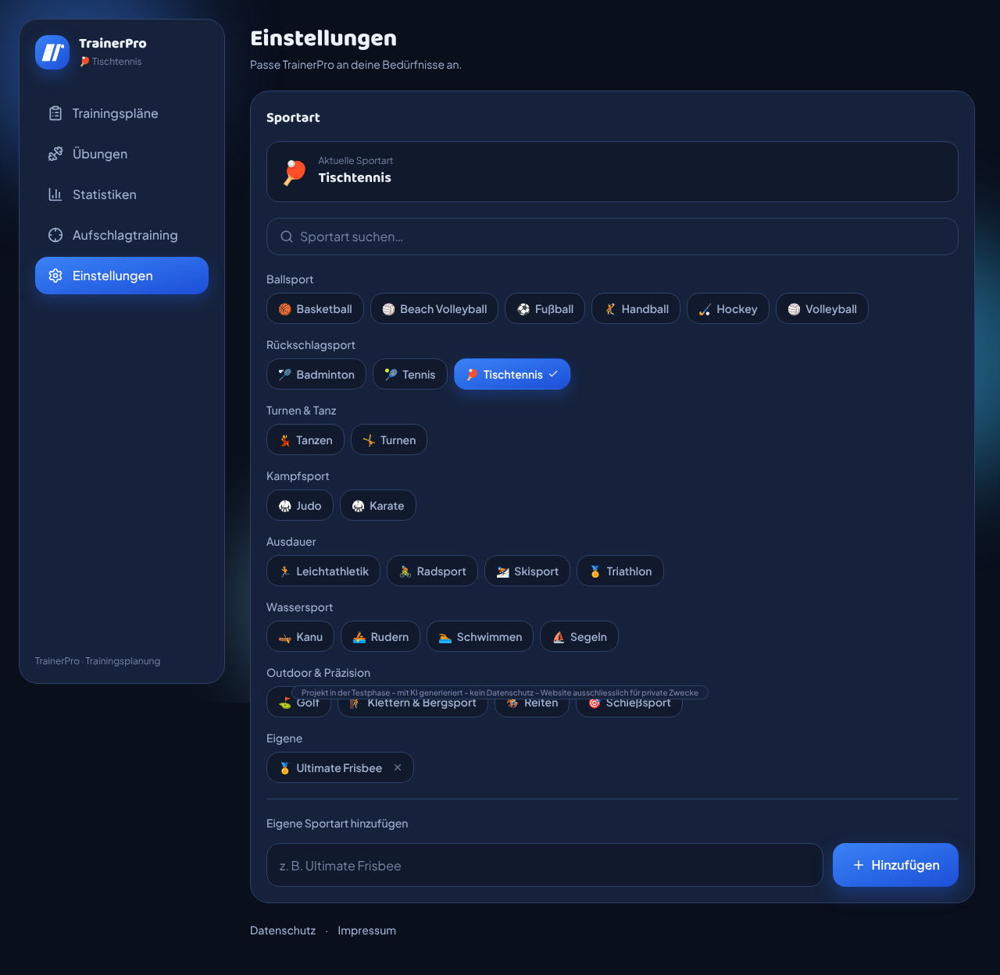

# C1 – Eigene Sportarten hinzufügen

**Phase:** Flowstate A · **Branch:** `phase-1` · **Datum:** 15.11.2026 · **Status:** ✅ umgesetzt

## Anforderung

> In den Einstellungen sollen weitere Sportarten per Eingabe hinzugefügt werden können. Ebenso soll
> in der Vorauswahl 25 Sportarten angeboten werden. Welche Sportarten diese sind, kann die KI auf
> Datenmaterial (Internetrecherche) entscheiden.

## Zusammenfassung

- **Vorauswahl mit 25 Sportarten**, gruppiert nach Kategorien (Ballsport, Rückschlagsport, Turnen & Tanz,
  Kampfsport, Ausdauer, Wassersport, Outdoor & Präzision).
- **Eigene Sportarten** lassen sich in den Einstellungen per Eingabe hinzufügen und wieder löschen.
  Sie erscheinen in der Gruppe „Eigene“ und werden nach dem Anlegen direkt ausgewählt.
- **Suche** über alle Sportarten. Gibt es keinen Treffer, wird der Suchbegriff als eigene Sportart angeboten.
- **Neues Datenmodell:** Eine Sportart ist ein Objekt mit stabiler ID (`{ id, name, emoji, category, custom }`)
  statt eines festen Textwerts. Das ist die Grundlage für C2 (Symbole/Farben) und C5 (Daten je Sportart).

## Auswahl der 25 Sportarten

Grundlage ist die **DOSB-Bestandserhebung 2025** (Rangliste der Spitzenverbände nach Mitgliedschaften
in deutschen Sportvereinen). Aufgenommen wurden die mitgliederstärksten Sportarten, in denen
Vereinstraining mit Trainingsplänen und Übungen üblich ist. Verbände ohne eigene Sportart im
Trainingssinn (z. B. Behinderten-, Betriebssport- oder Rettungsschwimmverbände) wurden nicht berücksichtigt.
„Beach Volleyball“ bleibt zusätzlich zu „Volleyball“ erhalten, weil es schon vor C1 auswählbar war.

| Kategorie | Sportarten |
|-----------|------------|
| Ballsport | Fußball, Handball, Basketball, Volleyball, Beach Volleyball, Hockey |
| Rückschlagsport | Tischtennis, Tennis, Badminton |
| Turnen & Tanz | Turnen, Tanzen |
| Kampfsport | Judo, Karate |
| Ausdauer | Leichtathletik, Radsport, Triathlon, Skisport |
| Wassersport | Schwimmen, Kanu, Rudern, Segeln |
| Outdoor & Präzision | Reiten, Golf, Schießsport, Klettern & Bergsport |

Quellen:
[DOSB-Pressemitteilung Bestandserhebung 2025 (via DBB)](https://www.basketball-bund.de/wp-content/uploads/sites/2/2025/11/2025_11_11_PM-Bestandserhebung-2025_Mitgliederrekord.pdf),
[Spitzenverbandszahlen 2025 (via DBB)](https://www.basketball-bund.de/wp-content/uploads/sites/2/2025/11/spitzenverbaendezahlen2025.pdf)

## Regeln für eigene Sportarten

| Fall | Verhalten |
|------|-----------|
| Leere Eingabe / nur Leerzeichen | Fehlermeldung „Bitte gib einen Namen für die Sportart ein.“ |
| Länger als 30 Zeichen | Fehlermeldung (Kopfzeile/Sidebar würden den Namen abschneiden) |
| Duplikat, auch bei anderer Groß-/Kleinschreibung oder Leerzeichen (z. B. „ tischTENNIS “) | Fehlermeldung „„Tischtennis“ gibt es bereits.“ |
| Mehrfache Leerzeichen („Ultimate   Frisbee“) | Werden zu einem Leerzeichen zusammengefasst |
| Löschen einer eigenen Sportart | Mit Bestätigungsdialog; ist sie aktiv, wird auf Tischtennis zurückgesetzt |
| Symbol | Neutrales 🏅, bis C2 eigene Symbole/Farben einführt |

## Speicherung & Migration

| localStorage-Schlüssel | Inhalt |
|------------------------|--------|
| `trainerpro:sportId` | **neu** – ID der gewählten Sportart (z. B. `"tischtennis"`) |
| `trainerpro:customSports` | **neu** – Liste der eigenen Sportarten |
| `trainerpro:sport` | **alt** – Name der Sportart; wird beim ersten Start automatisch in `sportId` übernommen und danach gelöscht |

Gespeicherte eigene Sportarten werden beim Laden geprüft (`sanitizeCustomSports`): Ungültige Einträge
und Duplikate werden verworfen. Unbekannte IDs fallen auf Tischtennis zurück.

> **Wichtig für spätere Chunks:** Die IDs der Vorauswahl (`fussball`, `tischtennis`, …) sind stabil und
> dürfen nicht geändert werden. Ab C5 werden Pläne/Übungen über diese ID einer Sportart zugeordnet.
> Beim Löschen einer eigenen Sportart muss in C5 entschieden werden, was mit deren Daten passiert
> (Hinweis im Code an `removeCustomSport`).

## Geänderte Dateien

| Datei | Änderung |
|-------|----------|
| `src/types.ts` | `Sport` ist jetzt ein Interface mit ID; neu: `SportId`, `SportCategory`, `SPORT_CATEGORIES`. Entfernt: `SPORTS` |
| `src/lib/sport.ts` | 25 Sportarten (`PRESET_SPORTS`), Validierung, Normalisierung, Migration. Entfernt: `SPORT_EMOJI` |
| `src/context/SportContext.tsx` | Neue API: `sport`, `sports`, `customSports`, `setSport(id)`, `addCustomSport`, `removeCustomSport`; Migration |
| `src/components/SportPicker.tsx` | **neu** – Auswahl mit Suche, Kategorien, Hinzufügen und Löschen |
| `src/pages/Settings.tsx` | `PillSelect` durch `SportPicker` ersetzt |
| `src/components/Sidebar.tsx`, `MobileTopBar.tsx`, `Logo.tsx` | Zugriff auf `sport.emoji` / `sport.name` |
| `src/pages/PlansOverview.tsx`, `Statistics.tsx` | Zugriff auf `sport.emoji` / `sport.name` |

## Tests

- `npm run build` ✅ und `npm run lint` ✅ (nur die zwei schon vorher bestehenden Warnungen)
- Im Browser (Playwright, Handy- und Desktop-Größe) geprüft:
  - Altes Format `"Beach Volleyball"` wird zu `beach-volleyball` migriert, alter Schlüssel entfernt ✅
  - 25 Sportarten in der Vorauswahl ✅
  - Duplikat „ tischTENNIS “ und leere Eingabe werden abgelehnt ✅
  - „Ultimate   Frisbee“ wird als „Ultimate Frisbee“ angelegt und direkt ausgewählt ✅
  - Suche ohne Treffer bietet „Floorball“ als eigene Sportart an ✅
  - Löschen der aktiven eigenen Sportart setzt auf Tischtennis zurück ✅
  - Alles bleibt nach dem Neuladen erhalten ✅

