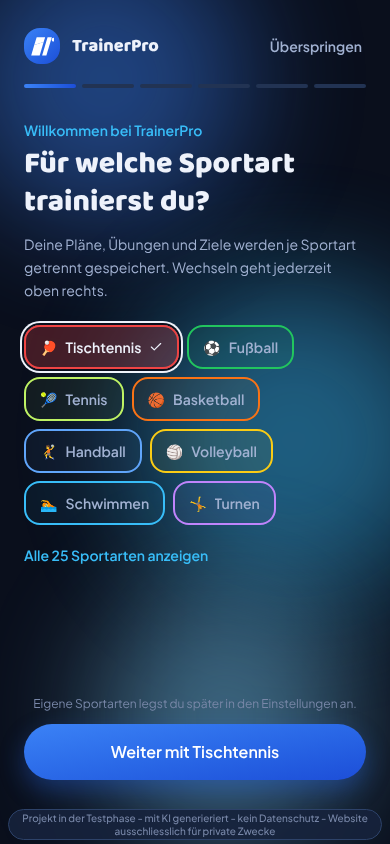
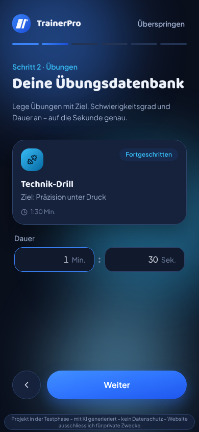
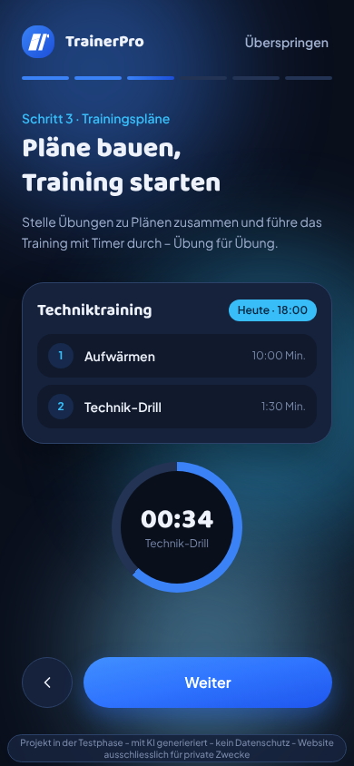
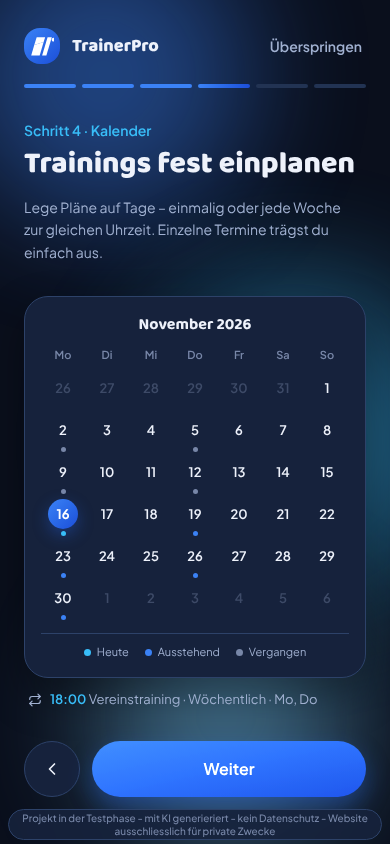
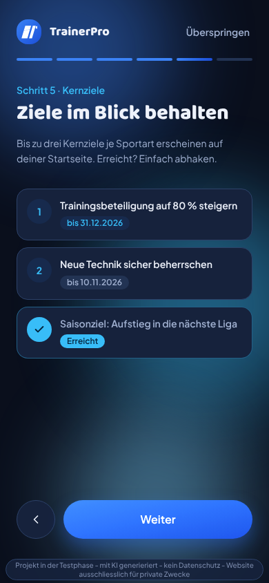
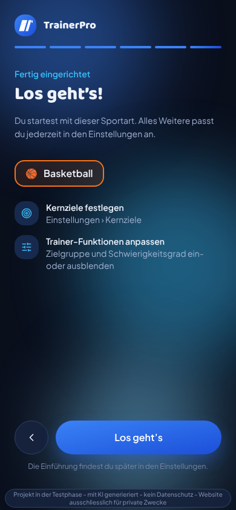
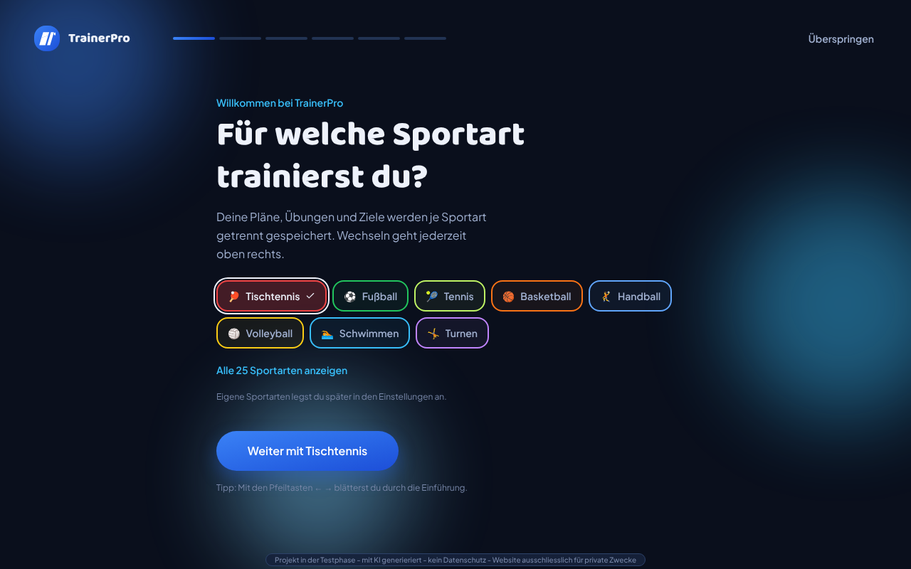
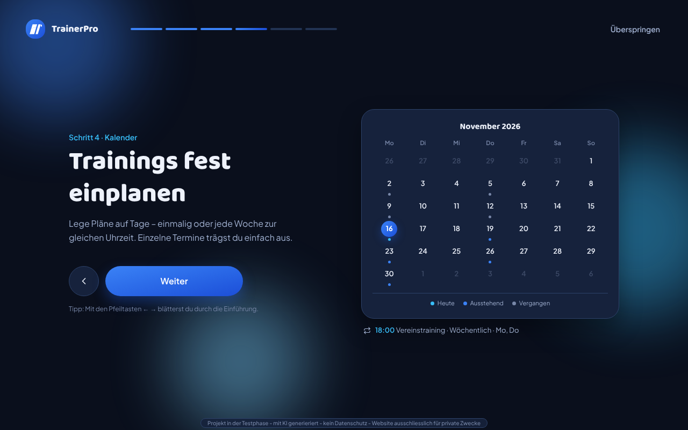
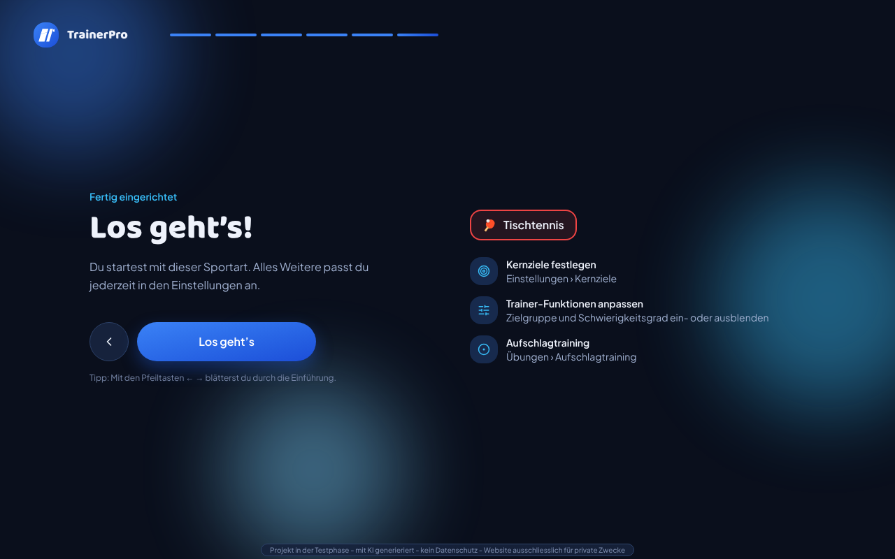

# C10 – Einführung in die App

**Phase:** Flowstate B · **Branch:** `phase-1` · **Datum:** 16.11.2026 · **Status:** ✅ umgesetzt

## Anforderung

> Eine App-Einführung beim ersten Öffnen der App wird in die Features der App einführen und die App samt den
> Kernelementen vorstellen. → Claude Design zur Unterstützung verwenden.

**Abstimmung im Team (vor der Umsetzung):**
- Die alte dreiteilige Tischtennis-Einführung wird **ersetzt**.
- **Bestehende Nutzer:innen** sehen die neue Einführung **einmal**. Dazu kommt **„Einführung erneut ansehen“** in den
  Einstellungen.
- Die **Sportart wird direkt im ersten Schritt gewählt**. Danach ist die Einführung persönlich.
- Ablauf mit **Claude Design**: erst Entwurf, dann 1:1-Umsetzung.
- Beim Design sollte **auch das Feedback aus den bisherigen Chunks** berücksichtigt werden.

## Design-Entwurf (Claude Design)

**Entwurf:** https://claude.ai/artifact/ULdqe7LLLCJ4qSV272FPx3. Er ist privat; zum Weitergeben im Entwurf über
„Teilen“ freigeben.

- Sechs Handy-Ansichten (390 × 844), eine pro Schritt, plus eine Desktop-Ansicht (1280 × 800, Schritt „Kalender“).
- Kein Design-System im Konto hinterlegt. Der Entwurf nutzt deshalb **direkt die Gestaltungsregeln der App**:
  - Farben `#0a0f1c` / `#16223c` / Primärblau / Akzent
  - Baloo 2 + Plus Jakarta Sans
  - Verlauf-Buttons, Karten, Sportfarben
- Eine Notiz auf der Zeichenfläche hält die **Design-Regeln aus bisherigem Feedback** fest. Sie wurden in Entwurf und
  Code umgesetzt:

| Feedback aus | Regel | Umsetzung in C10 |
|--------------|-------|------------------|
| C2b / C2c | Sportfarbe umrandet das **ganze** Element | Sportart-Chips (Schritt 1) und Sportart-Anzeige (Schritt 6) komplett in Sportfarbe umrandet |
| C6a | Keine Extra-Kästchen, Vergangenes **grau statt rot** | Mini-Kalender ohne Tagesrahmen; vergangene Termine und abgelaufenes Kernziel-Datum grau |
| C8a | Bedienelemente in sinnvoller Reihenfolge | „Überspringen“ immer oben rechts, „Weiter“ immer unten (Handy) bzw. unter dem Text (Desktop) |
| C9a | Kurze Texte, kein Umbruch am Handy | Kurze Titel; ausgewogener Zeilenumbruch (`text-balance` / `text-pretty`) |
| C6 / C9 | Runde Sekundär-Buttons | „Zurück“ rund wie die Pfeile im Kalender; „Einführung erneut ansehen“ wie „Heute“ |

## Zusammenfassung

### Die sechs Schritte

| # | Schritt | Inhalt / Vorschau |
|---|---------|-------------------|
| 1 | **Für welche Sportart trainierst du?** | 8 bekannte Sportarten als Chips, „Alle 25 Sportarten anzeigen“; Button „Weiter mit {Sportart}“. Die Auswahl gilt sofort |
| 2 | **Deine Übungsdatenbank** | Übungskarte + Dauer-Eingabe „1 : 30“ (C4) |
| 3 | **Pläne bauen, Training starten** | Plankarte „Heute · 18:00“ mit Übungsliste + Timer-Ring |
| 4 | **Trainings fest einplanen** | Mini-Kalender des **aktuellen Monats** mit Beispiel-Serie Mo + Do, Statusfarben und Legende (C6a/C7) |
| 5 | **Ziele im Blick behalten** | Drei Kernziel-Kacheln: ausstehend (blau), Datum vorbei (grau), erreicht (C8) |
| 6 | **Los geht’s!** | Gewählte Sportart + Hinweise: Kernziele festlegen, Trainer-Funktionen anpassen (C9), **nur bei Tischtennis** Aufschlagtraining (C3) |

- Die Vorschauen sind **echte App-Bausteine** (`OnboardingPreviews.tsx`), keine Deko-Bilder. Der Mini-Kalender
  rechnet mit denselben Helfern wie die Kalenderseite.
- Die **Texte sind sportartneutral**. Es gibt keine Tischtennis-Begriffe mehr wie „Vorhand“ oder „am Tisch“.

### Bedienung
- **Überspringen** (oben rechts) springt zum letzten Schritt.
- **Zurück** (runder Button) und **Weiter**.
- **Pfeiltasten ← →** blättern.
- **Fortschrittsbalken** mit sechs Segmenten.
- **Handy:** Text, Vorschau, Buttons unten.
- **Desktop:** zwei Spalten (Text + Buttons links, Vorschau rechts). Schritt 1 ist einspaltig und zentriert, damit
  keine leere Spalte entsteht.

### Wann die Einführung erscheint

| Situation | Verhalten |
|-----------|-----------|
| Neue Nutzer:innen | nach dem Zugangspasswort, vor der App |
| Bestehende Nutzer:innen (alte Markierung `onboarding-seen = 1`) | **einmal** die neue Einführung, danach nie wieder |
| Direktlink, z. B. `/kalender`, Einführung noch nicht gesehen | erst die Einführung, danach **zurück zur gewünschten Seite** |
| Einstellungen › **„Einführung erneut ansehen“** | Einführung, danach zurück in die Einstellungen |
| Speicher nicht verfügbar (z. B. privater Modus) | keine Endlosschleife: direkt in die App |

## Barrierefreiheit

- Der Fortschritt ist als `progressbar` angelegt („Schritt 2 von 6“).
- Nach jedem Schrittwechsel springt der **Fokus auf die Überschrift**. Screenreader lesen den neuen Schritt vor.
- Sportart-Chips sind Buttons mit `aria-pressed` und mindestens 44 px hoch. Die Vorschauen sind dekorativ
  (`aria-hidden`), der Text erklärt alles.
- **„Bewegung reduzieren“** (Systemeinstellung) wird jetzt **app-weit** respektiert: keine Einblend-Animation, keine
  schwebenden Hintergrund-Blobs.

## Technik

- `src/lib/onboarding.ts`: Gesehen-Markierung mit **Versionsnummer** (`trainerpro:onboarding-version = 2`). Die alte
  Markierung wird beim Abschluss entfernt. Lesen und Schreiben sind mit `try/catch` abgesichert.
- `RequireOnboarding` (RouteGuards) umschließt alle App-Seiten. Die Einführung greift so für **jeden** Einstieg, nicht
  nur über `/`.
- Die alte Komponente `OnboardingIllustration.tsx` ist entfernt (nicht mehr verwendet).
- Die alten Screenshots in `docs/logo-brief/` zeigen noch die frühere Einführung. Sie sind historisches Material des
  Logo-Briefings und bleiben unverändert.

## Geänderte Dateien

| Datei | Änderung |
|-------|----------|
| `src/pages/Onboarding.tsx` | **neu geschrieben** – sechs Schritte, Sportwahl, responsives Layout, Tastatur, Fokus |
| `src/components/OnboardingPreviews.tsx` | **neu** – Vorschauen Übung, Plan + Timer, Kalender, Kernziele |
| `src/components/OnboardingIllustration.tsx` | **entfernt** |
| `src/lib/onboarding.ts` | Versionierte, abgesicherte Gesehen-Markierung |
| `src/components/RouteGuards.tsx` | neu: `RequireOnboarding` |
| `src/App.tsx` | App-Seiten hinter `RequireOnboarding` |
| `src/pages/Settings.tsx` | Button „Einführung erneut ansehen“ |
| `src/index.css` | `prefers-reduced-motion` für Einblendungen und Hintergrund-Blobs |

## Tests

- `npm run build` ✅ und `npm run lint` ✅ (nur die drei bekannten gleichartigen Hinweise)
- Im Browser (Playwright, Handy 390 px + Desktop 1280 px, Datum fest auf 16.11.2026) geprüft:
  - Alte Markierung + Direktlink `/kalender` → Einführung → nach „Los geht’s“ zurück auf `/kalender`; Markierung `2`, alte entfernt ✅
  - 8 Sportarten, „Alle anzeigen“ → 25; Auswahl Basketball → Button „Weiter mit Basketball“, Sportart oben rechts danach 🏀 ✅
  - Alle sechs Schritte, Fokus jeweils auf der Überschrift ✅
  - Letzter Schritt: bei Basketball zwei Hinweise, bei Tischtennis zusätzlich „Aufschlagtraining“; kein „Überspringen“ ✅
  - „Einführung erneut ansehen“ → Überspringen → Los geht’s → zurück in die Einstellungen ✅
  - Neuling über `/` → Einführung; Pfeiltasten → → → / ← blättern ✅
  - „Bewegung reduzieren“: keine Animation an Inhalt und Hintergrund ✅

| 1 Sportart | 2 Übungen | 3 Pläne |
|---|---|---|
|  |  |  |

| 4 Kalender | 5 Kernziele | 6 Los geht’s |
|---|---|---|
|  |  |  |

