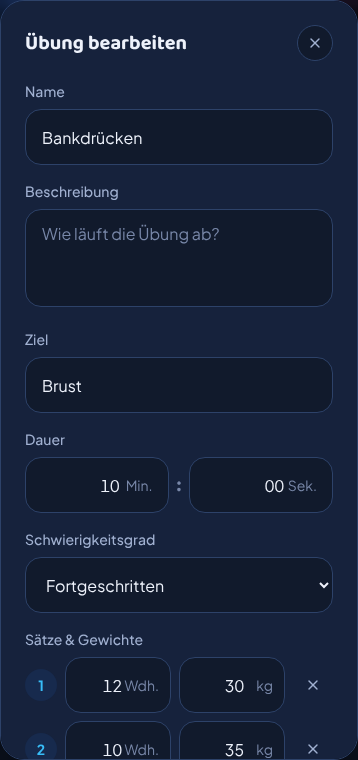
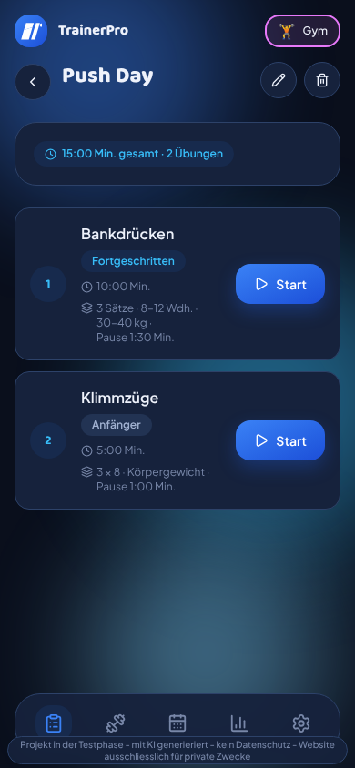
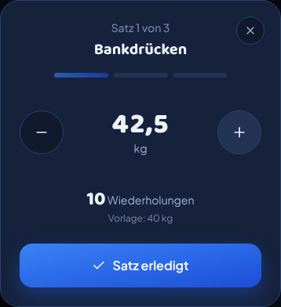
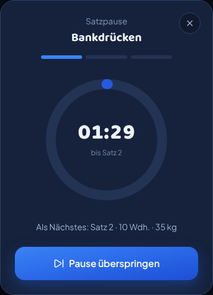
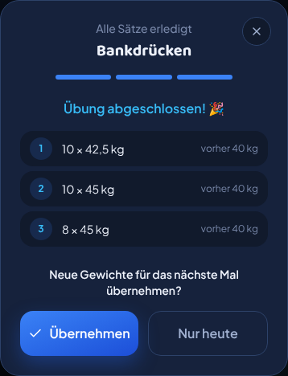

# C11 – Gewichte, Sätze und Satzpausen für Gym

**Phase:** Flowstate C · **Branch:** `phase-1` · **Datum:** 17.11.2026 · **Status:** ✅ umgesetzt

> **Hinweis:** Die − / +-Schritte betragen seit [C11a](C11a.md) 0,5 kg statt 2,5 kg.

## Anforderung

> Bei der vorabwählbaren Sportart Gym werden Sätze und Gewichte sowie die Satzpausen notierbar sein. Das Gewicht wird
> dabei auch in der Ausführung der Übung anpassbar sein.

**Abstimmung im Team (vor der Umsetzung):**
- **„Gym“ wird als 26. Sportart** in die Vorauswahl aufgenommen. In der DOSB-Liste aus C1 war sie nicht enthalten.
- **Eigene Werte je Satz:** Wiederholungen und Gewicht pro Satz, damit sind gleiche Sätze und Pyramiden möglich.
- **In der Ausführung** angepasste Gewichte werden am Ende **auf Nachfrage** in die Vorlage übernommen.
- Die **Satzpause startet nach „Satz erledigt“ automatisch** als Countdown.

## Zusammenfassung

### Sportart Gym
- Neue Vorauswahl-Sportart **Gym** 🏋️ mit der festen ID `gym`, der Farbe Fuchsia `#e879f9` (Kontrast ≥ 5,12:1) und der
  neuen Kategorie **„Kraft & Fitness“**. Die Einführung zeigt jetzt „Alle 26 Sportarten anzeigen“.
- Sätze und Gewichte gibt es **nur bei Gym**. Die Prüfung läuft über die ID (`hasStrengthTraining()`), wie beim
  Aufschlagtraining in C3.
- **Zusammenführung:** Wer vor C11 eine **eigene Sportart „Gym“** angelegt hatte, wird automatisch auf die neue
  Vorauswahl-Sportart umgestellt. **Pläne, Übungen und Kernziele wandern mit**, und die aktive Sportart bleibt Gym.

### Übungsformular (nur bei Gym): „Sätze & Gewichte“
- Pro Satz gibt es eine Zeile mit Satznummer im Kreis, **Wiederholungen** („Wdh.“), **Gewicht** („kg“) und ✕ zum
  Entfernen.
- **„Satz hinzufügen“** übernimmt die Werte des letzten Satzes (höchstens 10 Sätze).
- **Gewicht leer = Körpergewicht**, zum Beispiel bei Klimmzügen.
- **Satzpause** wird als „Min. : Sek.“ eingegeben, wie die Dauer. 0 ist erlaubt, höchstens 10:00.
- Standard für neue Gym-Übungen: 3 × 10, Körpergewicht, Pause 1:30.

| Eingabe | Ergebnis |
|---------|----------|
| Gewicht `42,5` oder `42.5` | ✅ 42,5 kg (Komma und Punkt erlaubt) |
| Gewicht `42,3` | ❌ „Satz 2: Bitte gib das Gewicht in 0,5-kg-Schritten an, z. B. 42,5.“ |
| Gewicht über 500 kg, negativ, Buchstaben | ❌ klare Meldung, nichts wird still bereinigt (Lehre aus C4) |
| Wiederholungen `8,5` oder `0` | ❌ „Satz 3: Bitte gib die Wiederholungen als ganze Zahl ein.“ bzw. „1 bis 100“ |
| Satzpause `1 : 75` | ❌ „Die Sekunden der Satzpause müssen zwischen 0 und 59 liegen.“ |

### Anzeige
Übungskarte und Plandetail zeigen eine kompakte Zusammenfassung mit Symbol:
- gleiche Sätze: **„3 × 10 · 40 kg · Pause 1:30 Min.“**
- Pyramide: **„3 Sätze · 8–12 Wdh. · 30–40 kg · Pause 1:30 Min.“**
- Körpergewicht: **„3 × 8 · Körpergewicht · Pause 1:00 Min.“**

### Ausführung: Satz-Ansicht
„Start“ im Plandetail öffnet bei Gym-Übungen statt des Timers die **Satz-Ansicht**:

1. **Satz:** „Satz 1 von 3“ mit Satz-Fortschritt. Das **Gewicht steht groß in der Mitte**, daneben **−** und **+**
   (je 2,5 kg, 56-px-Buttons). Ein Antippen der Zahl erlaubt das Eintippen. Darunter stehen die Wiederholungen und bei
   Abweichung „Vorlage: 40 kg“. Dann folgt **„Satz erledigt“**.
2. **Satzpause:** Der Countdown im **gleichen Ring wie der Übungs-Timer** startet automatisch. Darunter steht
   „Als Nächstes: Satz 2 · 10 Wdh. · 42,5 kg“. Es gibt **„Pause überspringen“**. Bei 0 geht es automatisch zum nächsten
   Satz, mit kurzer Vibration auf Geräten, die das können.
3. **Ende:** „Übung abgeschlossen! 🎉“ mit einer Liste aller Sätze („10 × 42,5 kg · vorher 40 kg“). Wurden Gewichte
   geändert, kommt die Frage **„Neue Gewichte für das nächste Mal übernehmen?“** mit **„Übernehmen“** oder
   **„Nur heute“**.

**Gewicht ändern:** Eine Änderung mit **− / +** oder per Eintippen gilt für den aktuellen Satz **und die folgenden
Sätze mit bisher gleichem Gewicht**. Das ist der typische Fall „heute alles mit 42,5 statt 40“. Pyramiden mit anderen
Gewichten bleiben unberührt. Beide Wege verhalten sich gleich (im Test vereinheitlicht).

### Vorbereitung für C14 (Flammenstreak)
Jede beendete Übung wird protokolliert (`trainerpro:exerciseLog`): Übung, Sportart, Plan, Zeitpunkt und bei Gym die
**tatsächlich trainierten Sätze und Gewichte**. Das gilt für Gym-Übungen (alle Sätze erledigt) und für Übungen mit
Timer (Countdown abgelaufen). Das Protokoll ist nach Sportart getrennt und wird beim Löschen einer eigenen Sportart
mitgelöscht.

## Einheitliches Design

- Die **Satz-Ansicht** hat denselben Dialog-Rahmen, denselben Schließen-Button, dieselben Primär-Buttons und denselben
  **Ring** wie der Übungs-Timer. Der Satz-Fortschritt sieht aus wie die Fortschrittsleiste der Einführung (C10).
- Das **Formular** nutzt dieselben Felder (`inputClass`, Einheit grau im Feld) wie Dauer (C4). Die Satznummern sitzen
  im Kreis wie bei „Ausgewählte Übungen“. „Satz hinzufügen“ ist ein runder Sekundär-Button wie „Heute“ (C6) und
  „Einführung erneut ansehen“ (C10).
- Die **Zusammenfassung** ist ein gemeinsamer Baustein (`StrengthSummary`) für Karte und Plandetail. Umbrochen wird nur
  zwischen den Teilen, nie mitten in „30–40 kg“ (am Handy getestet).
- Fehler erscheinen in der roten Meldungszeile des Formulars und nennen den betroffenen Satz.
- **Für das Studio:** große Zahlen, Treffflächen ≥ 56 px, keine kleinen Bedienelemente in der Ausführung.

## Beim Testen gefunden und behoben

1. **Zusammenführung einer eigenen „Gym“-Sportart:** Die App-Daten werden erst nach dem Zugangspasswort geladen. Bis
   dahin war die bereinigte Liste der eigenen Sportarten schon gespeichert, und Pläne, Übungen und Kernziele blieben
   auf der alten ID hängen. **Lösung:** Die Umleitungstabelle wird gleich beim Start festgehalten
   (`loadSportIdRemap()`).
2. **„Körpergewicht–20 kg“** las sich holprig. Gewichtsspannen erscheinen jetzt als „0–20 kg“.
3. **− / + änderten nur den aktuellen Satz**, Eintippen auch die folgenden. Jetzt verhalten sich beide gleich.
4. **Satzpause:** Das Weiterschalten passierte innerhalb einer State-Aktualisierung, die React im Entwicklungsmodus
   doppelt ausführt. Das hätte einen Satz überspringen können. Jetzt ist es ein eigener Effekt.
5. **Doppeltes „Pause“** in der Pausen-Ansicht. Im Ring steht jetzt „bis Satz 2“.
6. **Zusammenfassung im Plandetail** brach mitten in „30–40 kg“ um bzw. ragte über den Kartenrand. Jetzt gibt es einen
   gemeinsamen Baustein mit sauberen Umbruchstellen.

## Geänderte Dateien

| Datei | Änderung |
|-------|----------|
| `src/lib/sport.ts` | Gym (26. Sportart), `hasStrengthTraining()`, Zusammenführung eigener Sportarten (`presetRemapForCustomSports`, `loadSportIdRemap`), `migrateSportId` mit Umleitung |
| `src/types.ts` | Kategorie „Kraft & Fitness“; `StrengthSet`, `StrengthSpec`, `Exercise.strength`, `ExerciseLogEntry` |
| `src/lib/strength.ts` | **neu** – Prüfung (Gewicht, Wiederholungen, Pause), Formatierung, Zusammenfassung, Bereinigung, ±-Schritte |
| `src/context/SportContext.tsx` | Umleitung beim Start festhalten, aktive Sportart umleiten |
| `src/context/AppDataContext.tsx` | `strength` einlesen, Umleitung für Pläne/Übungen/Kernziele, `exerciseLog`, `logExerciseCompleted`, `applyStrengthWeights` |
| `src/components/ExerciseFormModal.tsx` | Bereich „Sätze & Gewichte“ (nur Gym) |
| `src/components/StrengthSession.tsx` | **neu** – Satz-Ansicht mit Gewicht ±, Satzpause, Übernahme-Frage |
| `src/components/StrengthSummary.tsx` | **neu** – Kurzbeschreibung der Sätze |
| `src/components/ExerciseCard.tsx`, `src/pages/PlanDetail.tsx` | Zusammenfassung; Plandetail öffnet bei Gym die Satz-Ansicht |
| `src/components/Timer.tsx` | Abgelaufene Übung wird protokolliert |

## Tests

- `npm run build` ✅ und `npm run lint` ✅ (nur die drei bekannten gleichartigen Hinweise)
- **29 Funktionsprüfungen** für Gewicht (Komma/Punkt, 0,5-Schritte, Grenzen), Wiederholungen, Satzpause, Formatierung,
  Zusammenfassungen, ±-Schritte und Bereinigung ✅
- Im Browser (Playwright, Handy 390 px) geprüft:
  - Eigene Sportart „gym“ mit Plan, Übung und Kernziel → aktiv „🏋️ Gym“, eigene Sportart entfernt, alle Daten mit `sportId: gym` ✅
  - Formular: Standard 3 Sätze, Pause 1:30; Meldungen für 42,3 kg, 8,5 Wdh. und Pause :75 ✅; „Satz hinzufügen“ übernimmt 40 kg ✅
  - Gespeichert `[10×40, 10×40, 8×40]`, Pause 0:03; Karte und Plandetail zeigen die Zusammenfassung ✅
  - Ausführung: + → 42,5 kg (auch für folgende Sätze), „Vorlage: 40 kg“; „Satz erledigt“ → Pause „Als Nächstes: Satz 2 · 10 Wdh. · 42,5 kg“ → nach 3 s automatisch Satz 2 ✅
  - 45 eingetippt in Satz 2 → gilt auch für Satz 3 ✅; Ende mit „vorher 40 kg“ und Übernahme-Frage → Vorlage `[42,5, 45, 45]` ✅
  - Protokoll mit Plan, Sportart und tatsächlichen Gewichten ✅; Timer-Übung (Tischtennis) wird nach Ablauf protokolliert ✅
  - Tischtennis-Formular ohne Bereich „Sätze & Gewichte“ ✅; Einstellungen: Kategorie „Kraft & Fitness“ mit Gym ✅

| Übungen (Gym) | Formular | Plandetail |
|---|---|---|
|  |  |  |

| Satz | Satzpause | Ende |
|---|---|---|
|  |  |  |
