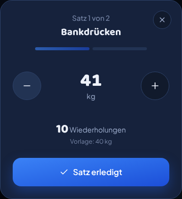

# C11a – Gewicht in 0,5-kg-Schritten anpassen

**Phase:** Flowstate C · **Branch:** `phase-1` · **Datum:** 17.11.2026 · **Status:** ✅ umgesetzt
**Bezug:** Nachbesserung zu [C11](C11.md)

## Anforderung

> Das Gewicht soll in der Ausführung nicht in großen Schritten, sondern in 0,5er-Schritten gesteigert werden.

Hinweis: In C11 waren die − / +-Schritte **2,5 kg** groß (eine 1,25-kg-Scheibe je Seite).

## Zusammenfassung

- **− / +** in der Satz-Ansicht ändern das Gewicht jetzt um **0,5 kg**, zum Beispiel 40 → 40,5 → 41.
- Das passt zur Eingabe im Formular und beim Eintippen, die schon in 0,5-kg-Schritten prüft (C11).
- Grenzen bleiben: nie unter 0 (Körpergewicht), höchstens 500 kg.
- Weiterhin gilt: Eine Änderung wirkt auf den aktuellen Satz und die folgenden Sätze mit bisher gleichem Gewicht.
- Größere Sprünge gehen schneller per **Eintippen** (Zahl antippen).
- Die Schrittweite steht an **einer zentralen Stelle** (`WEIGHT_BUTTON_STEP_KG`). Auch die Screenreader-Beschriftung
  („Gewicht um 0,5 kg erhöhen“) kommt von dort (`WEIGHT_BUTTON_STEP_LABEL`) statt als fest eingetragene Zahl.

## Geänderte Dateien

| Datei | Änderung |
|-------|----------|
| `src/lib/strength.ts` | `WEIGHT_BUTTON_STEP_KG = 0.5`, neu: `WEIGHT_BUTTON_STEP_LABEL` |
| `src/components/StrengthSession.tsx` | Beschriftungen der − / +-Buttons aus der Konstante |

## Tests

- `npm run build` ✅ und `npm run lint` ✅ (nur die drei bekannten gleichartigen Hinweise)
- Funktionsprüfungen: 40 + → 40,5, 40 − → 39,5, 0,5 − → 0, 0 − → 0, 500 + → 500, 42,5 + + + → 44, Beschriftung „0,5 kg“ ✅
- Im Browser (Handy) geprüft: 40 → + 40,5 → + + 41,5 → − 41; Beschriftungen „Gewicht um 0,5 kg erhöhen/verringern“;
  „Als Nächstes: Satz 2 · 10 Wdh. · 41 kg“ ✅

