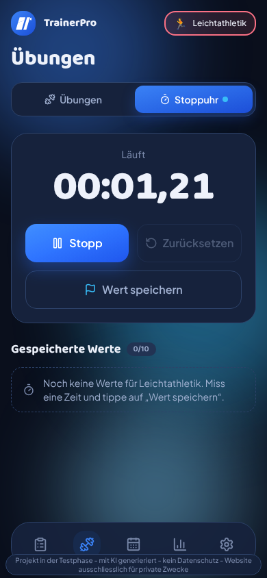
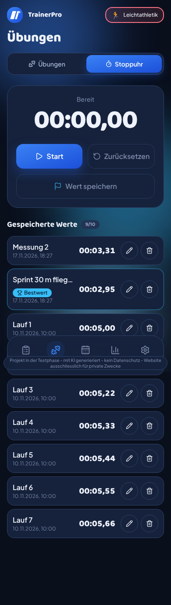
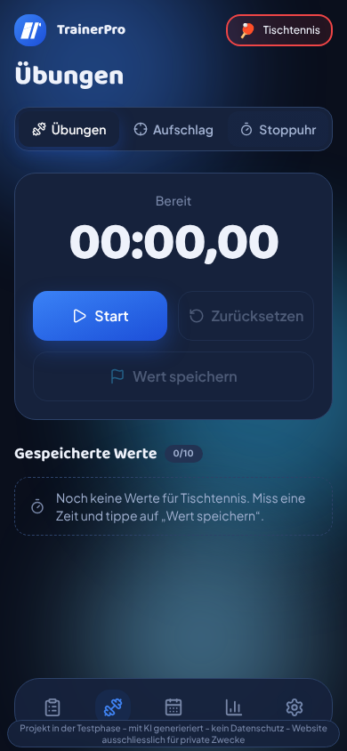
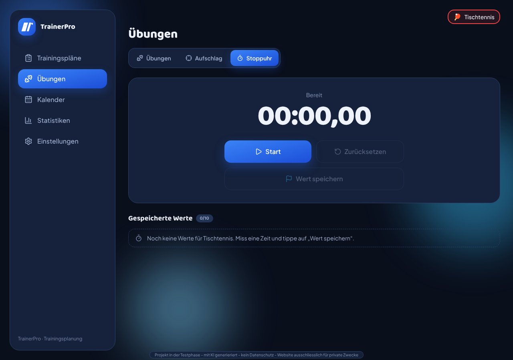

# C12 – Stoppuhr im Übungsbereich

**Phase:** Flowstate C · **Branch:** `phase-1` · **Datum:** 17.11.2026 · **Status:** ✅ umgesetzt

## Anforderung

> Eine Stoppuhr wird im Übungsbereich ergänzt werden, in der bis zu 10 Werte benannt und gespeichert werden können.

**Abstimmung im Team (vor der Umsetzung):**
- Gespeicherte Werte sind **je Sportart getrennt**.
- Bei **10 Werten** erscheint ein **Hinweis**, und man muss erst einen Wert löschen. Es wird nie still etwas
  überschrieben.
- Die Anzeige erfolgt auf **Hundertstel**. „Gerade die Hundertstel sind in einigen Sportarten nicht unwichtig.“
- Die schnellste Zeit wird als **„Bestwert“** markiert.

## Zusammenfassung

### Reiter „Stoppuhr“
- Neuer Reiter im Übungsbereich (`/uebungen/stoppuhr`) für **alle Sportarten**. Die Reiterleiste erscheint dadurch
  jetzt immer:
  - bei allen Sportarten „Übungen | Stoppuhr“,
  - bei Tischtennis „Übungen | Aufschlag | Stoppuhr“.
- Der Reiter „Aufschlagtraining“ heißt jetzt kurz **„Aufschlag“**, damit drei Reiter am Handy in eine Zeile passen
  (Regel aus C9a). Die Überschrift im Reiter bleibt „Aufschlagtraining“.
- Läuft die Stoppuhr, zeigt ein **Punkt am Reiter** „Stoppuhr läuft“, wie beim laufenden Aufschlagtraining.

### Stoppuhr
- **Große Zeit auf Hundertstel**, zum Beispiel „00:12,34“, ab einer Stunde „1:00:00,00“. Hundertstel werden
  **abgeschnitten, nicht gerundet**, wie bei Stoppuhren üblich (12,349 s → 12,34).
- Die Buttons stehen an festen Plätzen: **Start / Stopp / Weiter** (Hauptaktion) und **Zurücksetzen**, darunter
  **Wert speichern**.
- **Genau:** Die Zeit wird aus **Zeitstempeln** berechnet (Start + bereits gelaufene Zeit), nicht durch Hochzählen. Sie
  bleibt dadurch genau, auch wenn der Browser im Hintergrund drosselt oder das Handy gesperrt ist.
- **Läuft weiter** beim Wechsel des Reiters oder der Seite und **nach dem Neuladen**. Der Zustand liegt in
  `trainerpro:stopwatch`, es gibt **eine** Stoppuhr für die ganze App.
- **Speichern auch während des Laufens** (Zwischenzeit): Die Zeit wird im Moment des Klicks festgehalten, die Uhr läuft
  weiter.

### Gespeicherte Werte
- Beim Speichern öffnet sich ein Dialog mit der **Zeit groß** zur Kontrolle und einem **Namen**, vorbelegt mit
  „Messung 3“ (zum Überschreiben markiert). Ein leerer Name wird mit einer Meldung abgelehnt, höchstens 40 Zeichen.
  Gleiche Namen sind erlaubt, zum Beispiel „Sprint“ mehrmals gemessen.
- Die **Liste** zeigt den neuesten Wert zuerst: Name, Datum/Uhrzeit, **Zeit groß** und Buttons **✎ Umbenennen** /
  **🗑 Löschen** (mit Bestätigung, die die Zeit nennt).
- **Bestwert:** Ab zwei Werten bekommt die kürzeste Zeit das Badge **🏆 Bestwert** und einen Akzent-Rahmen. Bei
  Gleichstand zählt der zuerst gemessene Wert.
- **Höchstens 10 je Sportart.** Der Zähler „9/10“ steht in der Überschrift. Bei 10 ersetzt der Hinweis „Maximal 10
  Werte. Lösche einen, um einen neuen zu speichern.“ den Button. Abgesichert ist das in der Oberfläche, im
  Speicher-Context und beim Laden.
- **Je Sportart getrennt** (C5). Beim Löschen einer eigenen Sportart nennt der Dialog die Stoppuhr-Werte mit und
  löscht sie mit.

## Einheitliches Design

- Die **Zeit** steht in derselben Schrift und denselben gleich breiten Ziffern (`tabular-nums`) wie Timer und
  Satz-Ansicht. Die Zahl „springt“ beim Laufen nicht.
- **Buttons** im Stil von Timer und Satz-Ansicht: blauer Verlauf für die Hauptaktion, Rahmen-Button für Nebenaktionen,
  alle 56 px hoch.
- Die **Liste** folgt den Kernzielen (C8): Karten-Zeilen, runde Symbol-Buttons, Zähler-Badge in der Überschrift,
  gestrichelter Hinweis im leeren Zustand und bei der Obergrenze.
- Das **Bestwert-Badge** nutzt die Farben des „Heute“-Badges (C6a) bzw. „Erreicht“ (C8).
- **Screenreader:** Die laufenden Hundertstel werden nicht vorgelesen (unbrauchbar). Beim Anhalten wird die Zeit
  einmal angesagt. Der Status lautet „Bereit / Läuft / Angehalten“.

## Beim Testen gefunden und behoben

1. **„Wert speichern“ war nur ~28 px hoch.** Der Button übernahm `flex-1` aus dem gemeinsamen Stil, und in der
   senkrechten Anordnung fällt damit die Höhe zusammen. Jetzt ist er 56 px hoch.
2. **Bei Tischtennis wurde „Stoppuhr“ am Handy abgeschnitten.** Drei Reiter mit dem bisherigen Innenabstand waren zu
   breit. Am Handy gilt jetzt ein kleinerer Innenabstand, die Reiter sind gleich breit, und es gibt keinen Umbruch.
3. Der **Punkt am Reiter** sagte immer „Session läuft“. Jetzt hat jeder Reiter seinen eigenen Text.

## Geänderte Dateien

| Datei | Änderung |
|-------|----------|
| `src/lib/stopwatch.ts` | **neu** – Zeitberechnung aus Zeitstempeln, Hundertstel-Format, Namensprüfung, Bestwert, Bereinigung |
| `src/context/StopwatchContext.tsx` | **neu** – eine Stoppuhr für die App, läuft über Seitenwechsel/Neuladen weiter |
| `src/pages/Stopwatch.tsx` | **neu** – Stoppuhr-Seite mit Speichern, Umbenennen, Löschen, Bestwert |
| `src/types.ts` | `StopwatchValue` |
| `src/context/AppDataContext.tsx` | Werte je Sportart (max. 10), `addStopwatchValue`, `renameStopwatchValue`, `deleteStopwatchValue`, Mitlöschen mit eigener Sportart |
| `src/pages/ExercisesLayout.tsx` | Reiter „Stoppuhr“, kurz „Aufschlag“, eigener Text am Punkt, kompaktere Reiter am Handy |
| `src/App.tsx` | `StopwatchProvider`, Route `stoppuhr` |
| `src/components/SportPicker.tsx` | Löschdialog nennt Stoppuhr-Werte |

## Tests

- `npm run build` ✅ und `npm run lint` ✅ (vier gleichartige Hinweise der Contexts, bewusst einheitliches Muster)
- **21 Funktionsprüfungen**:
  - Format inkl. Abschneiden (12,349 → 12,34), Stunde, negativ
  - Start/Stopp/Fortsetzen über Zeitstempel, Doppelstart, zurückgestellte Uhr
  - Namen, Bestwert inkl. Gleichstand, Obergrenze beim Laden, Bereinigung
- Im Browser (Playwright, Handy 390/360 px + Desktop) geprüft:
  - Leichtathletik: Reiter „Übungen | Stoppuhr“; Zurücksetzen/Speichern anfangs deaktiviert ✅
  - Läuft (00:01,19), Punkt „Stoppuhr läuft“; läuft nach Kalender-Besuch (00:02,46) und Neuladen (00:02,91) weiter ✅
  - Speichern während des Laufens (Dialog „Messung 1“, leerer Name abgelehnt), Uhr läuft danach weiter ✅
  - Stopp hält die Zeit fest; zweiter Wert gespeichert; „Bestwert“ beim schnelleren Wert ✅
  - 10/10 → Hinweis statt Button; Löschen (Dialog nennt Zeit) → 9/10, Button wieder da; Umbenennen ✅
  - Tischtennis: „Übungen | Aufschlag | Stoppuhr“ ohne Abschneiden, eigene (leere) Werte-Liste ✅

| Läuft (Handy) | Gespeicherte Werte | Tischtennis, 3 Reiter |
|---|---|---|
|  |  |  |

