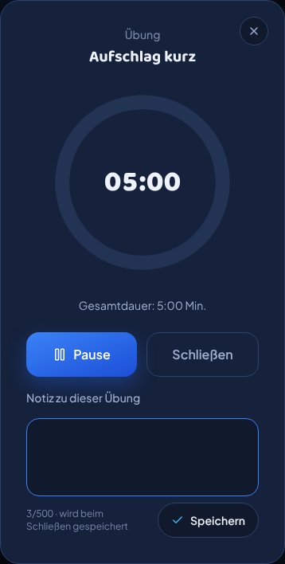
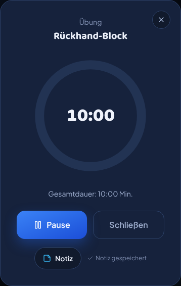
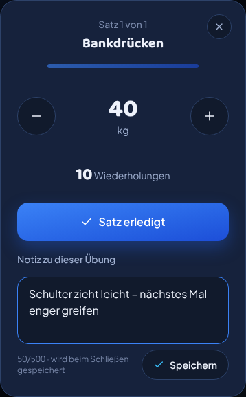
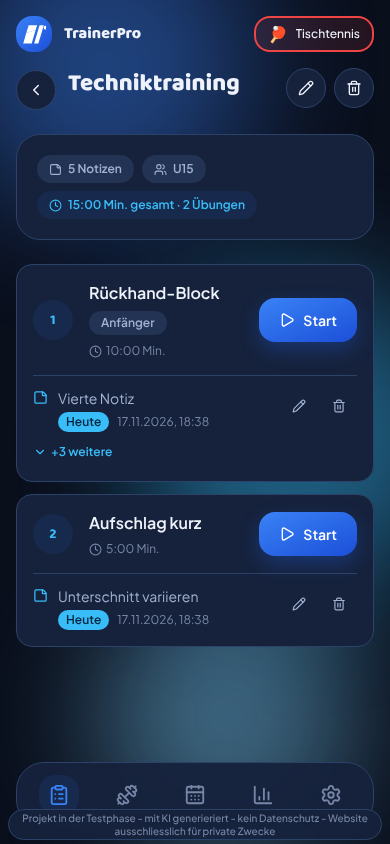
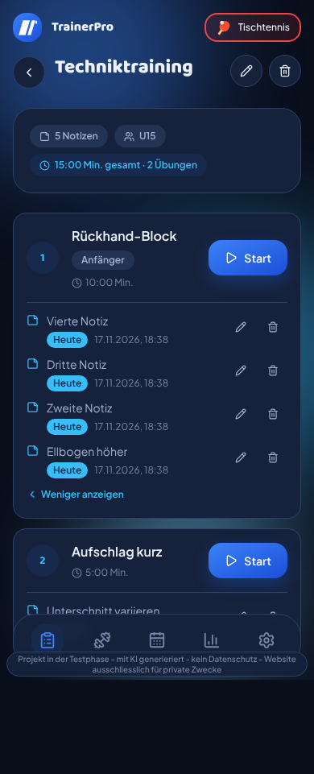

# C13 – Notizen in der Übungsansicht

**Phase:** Flowstate C · **Branch:** `phase-1` · **Datum:** 17.11.2026 · **Status:** ✅ umgesetzt

## Anforderung

> In der Übungsansicht, bei der Ausführung, wird es möglich sein, sich Notizen zu machen, welche später in der
> Plansansicht angezeigt werden.

**Abstimmung im Team (vor der Umsetzung):**
- **Mehrere Notizen je Übung** als Verlauf mit Datum, keine einzelne überschriebene Notiz.
- Eine Notiz gilt für die **Übung in genau diesem Plan**.
- Notizen werden **beim Schließen automatisch gespeichert**.
- Notizen lassen sich **in der Plan-Ansicht bearbeiten und löschen**.

## Zusammenfassung

### In der Ausführung (Timer und Gym-Satz-Ansicht)
- Unter den Haupt-Buttons sitzt ein dezenter, runder Button **„Notiz“**. Er öffnet ein Textfeld „Notiz zu dieser
  Übung“ mit Zeichenzähler (max. 500) und dem Hinweis „wird beim Schließen gespeichert“.
- **Timer und Satzpause laufen beim Schreiben weiter.** Die Hauptaktionen bleiben an ihrem Platz.
- **Kein Datenverlust:** Ein angefangener Text wird auf **jedem** Schließweg gespeichert:

| Schließweg | Verhalten |
|------------|-----------|
| ✕ oben rechts | Notiz gespeichert, Dialog zu |
| Tipp neben den Dialog | Notiz gespeichert, Dialog zu |
| „Schließen“ (Timer) / „Fertig“, „Übernehmen“, „Nur heute“ (Gym) | Notiz gespeichert, Dialog zu |
| **Escape im Textfeld** | Notiz gespeichert, **nur das Textfeld klappt zu**, Training läuft weiter |
| Escape außerhalb des Textfelds | Notiz gespeichert, Dialog zu |
| „Speichern“ im Notizbereich | gespeichert, Textfeld klappt zu; danach „✓ Notiz gespeichert“ |

- Leere Notizen werden nicht gespeichert. Mehrere Notizen in einer Ausführung sind möglich
  („2 Notizen gespeichert“).

### In der Plan-Ansicht (Plandetail)
- Unter jeder Übung steht die **neueste Notiz**: Notiz-Symbol, Text in Grau (mehrzeilig möglich), Datum und Uhrzeit.
  Notizen von heute tragen das **„Heute“-Badge** aus C6a.
- Ältere Notizen lassen sich über **„+3 weitere“** aufklappen, mit „Weniger anzeigen“ wieder zu.
- Jede Notiz kann **bearbeitet** (✎, Dialog mit Zähler, Vermerk „· bearbeitet“) und **gelöscht** werden (🗑, mit
  Bestätigung, die das Datum nennt).
- Im Kopfbereich zeigt ein **Info-Chip** die Anzahl der Notizen im Plan, zum Beispiel „5 Notizen“, im Stil der übrigen
  Chips.

### Aufräumen
- **Plan gelöscht** → seine Notizen werden mitgelöscht.
- **Übung gelöscht** → ihre Notizen in allen Plänen werden mitgelöscht.
- **Eigene Sportart gelöscht** → der Dialog nennt die Notizen mit und löscht sie.
- Notizen sind über ihren Plan **nach Sportart getrennt** (C5).

## Einheitliches Design

- **Kein gelber „Notizzettel“-Look.** Notizen sind ruhige Zeilen im App-Stil, ohne extra Kästchen (Feedback aus C6a),
  durch eine dünne Linie von der Übung getrennt.
- Der Button „Notiz“ und „Speichern“ sind runde Sekundär-Buttons wie „Satz hinzufügen“ (C11) und „Heute“ (C6).
- Das Textfeld nutzt den Formularstil der App (`textareaClass`). Fehler erscheinen in der roten Meldungszeile.
- Bearbeiten/Löschen nutzen denselben Dialog und dieselbe Bestätigung wie Kernziele und Stoppuhr-Werte.

## Technik

- `ExerciseNote { id, planId, exerciseId, sportId, text, createdAt, updatedAt }` in `trainerpro:exerciseNotes`. Die
  Notizen sind **unabhängig vom Abschluss-Protokoll** aus C11, denn man kann auch bei abgebrochenen Übungen notieren.
- `useExecutionNote()` hält den Entwurf. Die Dialoge rufen bei jedem Schließen `handleClose()` auf, das zuerst
  speichert.
- **Escape** am Fenster ruft über eine Referenz immer die **aktuelle** Schließ-Funktion auf, mit dem aktuellen
  Entwurf. Die Tastatur-Abfrage wird dabei nicht bei jedem Neuzeichnen neu angemeldet (Lint-Hinweis behoben).
- Escape im Textfeld stoppt die Weitergabe an das Fenster. Deshalb klappt nur das Textfeld zu.

## Geänderte Dateien

| Datei | Änderung |
|-------|----------|
| `src/types.ts` | `ExerciseNote` |
| `src/lib/notes.ts` | **neu** – Prüfung (leer, max. 500), Bereinigung, Notizen je Plan/Übung |
| `src/hooks/useExecutionNote.ts` | **neu** – Entwurf und Speichern während der Ausführung |
| `src/components/ExecutionNote.tsx` | **neu** – Notiz-Bereich in Timer und Satz-Ansicht |
| `src/components/PlanExerciseNotes.tsx` | **neu** – Notizen im Plandetail (Verlauf, Bearbeiten, Löschen) |
| `src/components/Timer.tsx`, `src/components/StrengthSession.tsx` | Notiz-Bereich, alle Schließwege speichern |
| `src/pages/PlanDetail.tsx` | Notizen je Übung, Info-Chip mit Anzahl |
| `src/context/AppDataContext.tsx` | Notizen speichern/bearbeiten/löschen, Aufräumen bei Plan/Übung/Sportart |
| `src/components/SportPicker.tsx` | Löschdialog nennt Notizen |

## Tests

- `npm run build` ✅ und `npm run lint` ✅ (nur die vier bekannten gleichartigen Context-Hinweise)
- **8 Funktionsprüfungen** (leer, 500/501 Zeichen, Zeilenumbrüche, Filter/Sortierung, Bereinigung) ✅
- Im Browser (Playwright, Handy) geprüft:
  - Tipp daneben, ✕, Escape außerhalb, „Schließen“: Notiz jeweils gespeichert ✅
  - Escape im Textfeld: gespeichert, Dialog bleibt offen, „Notiz gespeichert“ ✅
  - Leere Notiz wird nicht gespeichert; Zähler „22/500“; Speichern-Button ✅
  - Gym-Satz-Ansicht: Notiz + „Übernehmen“ → Notiz und neues Gewicht gespeichert ✅
  - Plandetail: „5 Notizen“, neueste sichtbar, „+3 weitere“ → vier Notizen neueste zuerst ✅
  - Bearbeiten („· bearbeitet“), Löschen mit Bestätigung ✅; Plan gelöscht → keine Notizen mehr ✅

| Timer mit Notiz | Gespeichert | Gym-Satz-Ansicht |
|---|---|---|
|  |  |  |

| Plandetail | Verlauf aufgeklappt |
|---|---|
|  |  |
