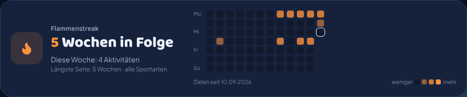
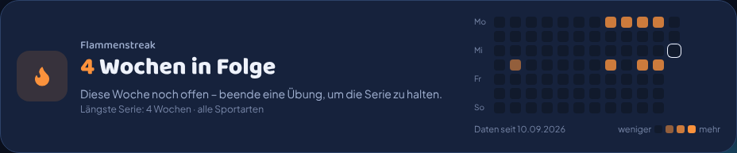
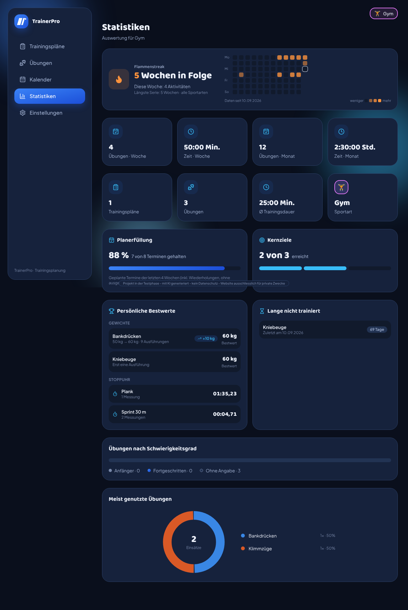
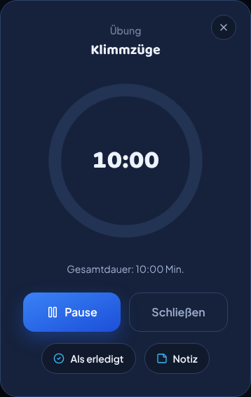
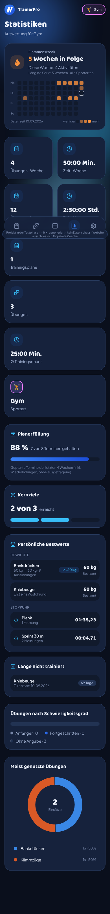
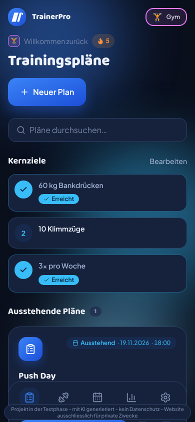
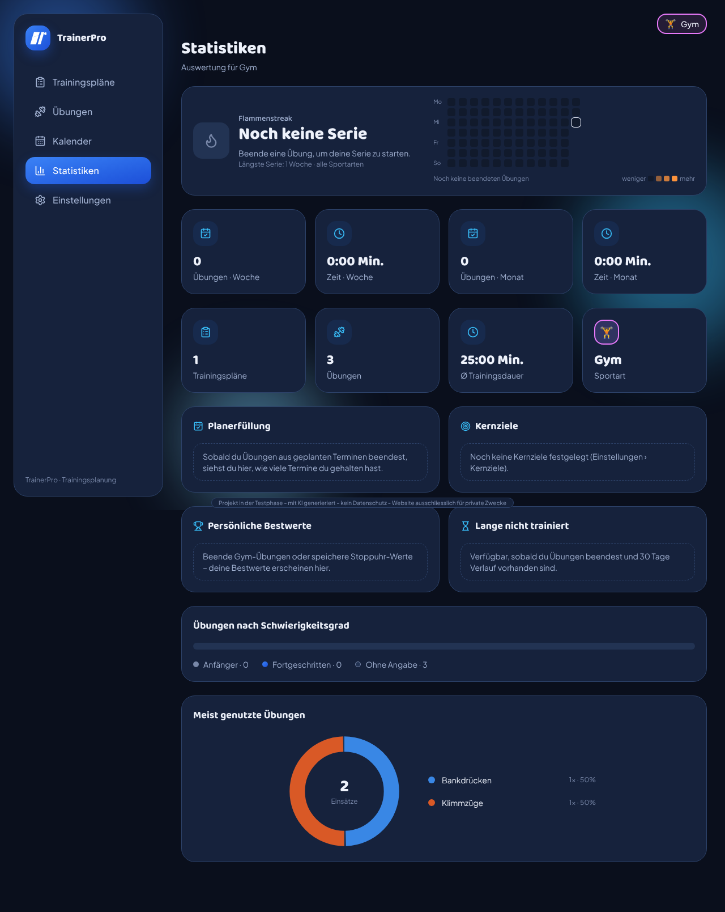

# C14 – Statistiken erweitern und Flammenstreak

**Phase:** Flowstate C · **Branch:** `phase-1` · **Datum:** 17.11.2026 · **Status:** ✅ umgesetzt

> **Hinweis:** Mit [C14a](C14a.md) zählt der Flammenstreak **Tage** statt Wochen, und die Karte heißt
> „Übungen lange nicht trainiert“. Die Regeln unten gelten sinngemäß pro Tag.

## Anforderung

> Die Statistiken werden um markante Werte erweitert. Außerdem gibt es einen Flammenstreak, der steigt, wenn man eine
> Übung beendet oder eine neue Übung erstellt.

**Abstimmung im Team (vor der Umsetzung):** In der Vorarbeit wurde aus Sicht eines Sportlers eine Liste möglicher
Kennzahlen erstellt. Beschlossen: **die ersten acht Punkte** der Liste plus **alle Empfehlungen** der Vorarbeit.

| # | Beschlossener Punkt | Umsetzung |
|---|---------------------|-----------|
| 1 | Flammenstreak + Aktivitäts-Kalender | Streak-Karte oben auf „Statistiken“, Flamme auf der Startseite |
| 2 | Diese Woche / dieser Monat | Vier Kacheln: Übungen und Trainingszeit je Woche und Monat |
| 3 | Längste Serie (Rekord) | In der Streak-Karte: „Längste Serie: n Wochen“ |
| 4 | Planerfüllung | Karte „Planerfüllung“: gehaltene Termine der letzten 4 Wochen in % |
| 5 | Stoppuhr-Bestwerte | Karte „Persönliche Bestwerte“ › Stoppuhr (je Name die schnellste Zeit) |
| 6 | Gym: Gewichtssteigerung | Karte „Persönliche Bestwerte“ › Gewichte (erste → letzte Ausführung, Bestwert) |
| 7 | Kernziele erreicht | Karte „Kernziele“: „2 von 3 erreicht“ mit Segmenten |
| 8 | Lange nicht trainiert | Karte „Lange nicht trainiert“: Übungen seit über 30 Tagen nicht beendet |

**Übernommene Empfehlungen der Vorarbeit:**
1. **Wochen-Streak statt Tages-Streak** – Training findet 2–4× pro Woche statt; ein Tages-Streak würde an jedem
   Ruhetag reißen und zum „Pflicht-Klicken“ verleiten.
2. **Neu erstellte Übungen zählen höchstens 1× pro Tag** – sonst ließe sich der Streak durch Anlegen leerer Übungen
   „farmen“.
3. **Streak über alle Sportarten** – wer an einem Tag Tennis und am nächsten Gym trainiert, trainiert durchgehend.
   Alle anderen Kennzahlen bleiben – wie die ganze App seit C5 – je Sportart.
4. **„Als erledigt markieren“ im Timer** – im echten Training endet eine Übung oft vor Ablauf des Countdowns; auch
   dann soll sie zählen.
5. **Ehrlich statt geschätzt** – alle Werte werden aus vorhandenen Daten berechnet; wo der Verlauf zu kurz ist,
   steht „Daten seit …“ bzw. „Verfügbar ab …“ statt erfundener Zahlen.

Die Punkte 9–13 der Liste sind unten unter „Für später vorgemerkt“ notiert.

## Zusammenfassung

### Der Flammenstreak – Regeln

| Regel | Festlegung |
|-------|------------|
| Einheit | **Wochen** (Montag–Sonntag, wie im Kalender aus C6) |
| Aktive Woche | mindestens **eine Aktivität** in der Woche |
| Aktivität | **beendete Übung** (jede einzeln, aus dem Protokoll von C11) **oder** **neu erstellte Übung** (max. 1 pro Tag) |
| Beendet heißt | Timer läuft ab · „Als erledigt“ im Timer (neu) · Gym-Satz-Ansicht abgeschlossen (C11) |
| Laufende Woche ohne Aktivität | Serie bleibt bestehen, Woche ist **„noch offen“** |
| Serie reißt | erst, wenn eine **ganze Kalenderwoche** ohne Aktivität vergangen ist |
| Längste Serie | längste lückenlose Folge aktiver Wochen im gesamten Verlauf |
| Gültigkeit | **über alle Sportarten** (global) |
| Speicherung | **keine** – der Streak wird bei jedem Anzeigen aus Protokoll und Übungen **berechnet** |

Weil nichts gespeichert wird, kann der Streak nicht „verrutschen“: Löscht man eine Übung, verschwindet nur ihre
Erstellungs-Aktivität; beendete Übungen bleiben im Protokoll. Zukünftige Zeitstempel (z. B. falsche Geräte-Uhr)
werden ignoriert. Tage werden – wie seit C6 überall – als lokale Datums-Schlüssel gebildet, also zeitzonensicher.

### Streak-Karte (Statistiken, ganz oben)
- Links: **Flamme** im runden Quadrat, daneben „Flammenstreak“, groß **„5 Wochen in Folge“** (Zahl in Orange).
- Darunter ein Satz zum Stand der Woche:
  - ohne Serie: „Beende eine Übung, um deine Serie zu starten.“
  - Woche aktiv: „Diese Woche: 4 Aktivitäten“
  - Woche noch offen: „Diese Woche noch offen – beende eine Übung, um die Serie zu halten.“
- Klein: „Längste Serie: 5 Wochen · alle Sportarten“.
- Rechts (Handy: darunter): **Aktivitäts-Kalender der letzten 12 Wochen** – Spalten sind Wochen, Zeilen Mo–So,
  heute mit feinem Ring markiert, zukünftige Tage leer. Vier Stufen (0 · 1 · 2–3 · 4+ Aktivitäten), Legende
  „weniger … mehr“, Tooltip je Tag mit Datum und Anzahl der Aktivitäten.
- Fußzeile: **„Daten seit 10.09.2026“** – macht ehrlich sichtbar, ab wann beendete Übungen protokolliert werden
  (das Protokoll gibt es erst seit C11).

### Flamme auf der Startseite
In der Begrüßungszeile „Willkommen zurück“ steht eine kleine **Flamme mit Zahl** (z. B. 🔥 5). Sie führt per Tipp
direkt zur Statistik. Ohne Serie ist sie grau mit „0“.

### Die neuen Kennzahlen (je aktiver Sportart)
- **Übungen · Woche / Zeit · Woche / Übungen · Monat / Zeit · Monat** – beendete Übungen und Summe ihrer Dauer
  (Woche ab Montag, Monat ab dem 1.).
- **Planerfüllung** – geplante Termine der letzten 4 Wochen (inkl. Wiederholungen aus C7, ohne ausgetragene aus C7a)
  gegenüber Terminen, an denen mindestens eine Übung **dieses Plans** beendet wurde. Liegt der Datenbeginn innerhalb
  der 4 Wochen, zählt erst ab Datenbeginn („seit …“) – Termine vor dem Protokoll würden sonst fälschlich als verpasst
  gelten.
- **Kernziele** – „2 von 3 erreicht“, ein Segment je Ziel (C8).
- **Persönliche Bestwerte**
  - *Gewichte* (nur bei Sportarten mit Krafttraining, z. B. Gym): je Übung das höchste **tatsächlich trainierte**
    Gewicht (aus dem Protokoll, nicht aus der Planung), dazu „50 kg → 60 kg · 9 Ausführungen“ und eine Steigerung
    „+10 kg“.
  - *Stoppuhr*: je Name die schnellste gespeicherte Zeit (C12); gleiche Namen werden unabhängig von Groß-/
    Kleinschreibung zusammengefasst („Sprint 30 m“ = „sprint 30 m“).
- **Lange nicht trainiert** – Übungen, die seit über 30 Tagen nicht beendet wurden, älteste zuerst, mit
  „Zuletzt am …“ oder „Noch nie beendet“. Erst verfügbar, wenn der Verlauf 30 Tage zurückreicht („Verfügbar ab …“),
  sonst stünden alle Übungen fälschlich als „nie trainiert“ da.

### „Als erledigt“ im Timer
Neben „Notiz“ (C13) steht ein runder Button **„Als erledigt“**. Er setzt den Countdown auf 0; die Übung wird damit
genau wie bei Ablauf **einmal** protokolliert und zählt für Streak und Kennzahlen. Danach verschwindet der Button.

## Design-Einbettung des Streaks

Der Streak ist das einzige „spielerische“ Element der App. Damit er auffällt, ohne das ruhige, blaue Design zu
brechen, gelten feste Regeln:

1. **Eine eigene Farbe – und nur dafür.** Neues Token `--color-flame: #fb923c` (Orange) in `src/index.css`.
   Orange ist der **einzige warme Akzent** der App und erscheint **ausschließlich** beim Streak: Flamme, Streak-Zahl,
   Aktivitäts-Kalender, Flamme auf der Startseite. Alle anderen Kennzahlen bleiben im App-Blau (`primary`/`accent`).
   So lernt man: Orange = meine Serie.
2. **Gleiche Bausteine wie überall.** Karte mit `rounded-3xl border border-border bg-surface p-5` wie alle
   Statistik-Karten, Zahl in derselben Display-Schrift wie die Kacheln, Icon-Quadrat wie bei den StatTiles
   (`bg-flame/15` statt `bg-primary/15`). Die Flamme auf der Startseite ist eine Pille in Höhe und Rundung der
   übrigen Badges.
3. **Kein Rot, kein Vorwurf** (Feedback aus C6a). Ohne Serie ist die Flamme **grau** (`bg-surface-2 text-muted-2`)
   und leer; eine offene Woche heißt „noch offen“, nicht „gefährdet“. Auch „Lange nicht trainiert“ nutzt das neutrale
   Grau von „Vergangen“, eine Gewichtsabnahme das graue Badge – nur Steigerungen das helle „Ausstehend“-Blau.
4. **Ohne zusätzliche Rahmen** (Feedback aus C6a): Kalenderzellen sind schlichte, abgerundete Flächen ohne Umrandung;
   nur „heute“ hat einen feinen Ring.
5. **Kurze Texte, kein Umbruch auf dem Handy:** „5 Wochen in Folge“ steht einzeilig (Handy eine Schriftstufe
   kleiner, Flammen-Quadrat 48 statt 64 px), Kachel-Beschriftungen sind kurz („Zeit · Woche“), im Timer heißt der
   Button „Als erledigt“, damit er mit „Notiz“ in **einer** Reihe steht.
6. **Feste Positionen:** Streak-Karte immer ganz oben in „Statistiken“, Flamme immer am Ende der Begrüßungszeile,
   „Als erledigt“ immer links neben „Notiz“ unter den Haupt-Buttons.

**Kontraste (geprüft, WCAG):**

| Element | Kontrast |
|---------|----------|
| Orange-Text auf Kartenfläche / Seitenhintergrund | 5,57 : 1 bis 8,45 : 1 |
| Orange auf eigener Tönung (`bg-flame/15`, Flamme Startseite) | 5,44 : 1 |
| Kalender: schwächste aktive Stufe gegen leere Zelle | 3,31 : 1 (≥ 3 : 1 für Grafik) |

Die erste Fassung der Kalenderstufen lag bei 1,55 : 1 und wurde deshalb angepasst (leer = `bg-bg-soft`,
Stufe 1 = `flame/55`).

**Desktop / Handy:** Auf großen Bildschirmen stehen Streak-Angabe und Kalender nebeneinander, auf dem Handy
untereinander; der Kalender (12 Spalten) passt ohne Scrollen auf 390 px Breite.

## Reihenfolge der Statistik-Seite

1. Flammenstreak (neu)
2. Diese Woche / dieser Monat (neu)
3. Bisherige Kacheln (Pläne, Übungen, Ø-Dauer, Sportart)
4. Planerfüllung · Kernziele (neu, nebeneinander ab Tablet)
5. Persönliche Bestwerte · Lange nicht trainiert (neu, nebeneinander ab Tablet)
6. Übungen nach Schwierigkeitsgrad (C9-Schalter wird weiter beachtet)
7. Meist genutzte Übungen (Donut)

## Technik

- **`src/lib/streak.ts`** (neu) – reine Funktionen ohne React:
  `activityByDay(log, exercises)` (Aktivitäten je Tag; Beendigungen einzeln, Erstellungen 1× je Tag),
  `computeStreak(activity, today)` → `{ current, longest, thisWeek, atRisk }`,
  `weekStartOf`, `heatmapWeeks(today, 12)`, `heatLevel(count)`, `trackingStart(log)`, `isoToDateKey`.
- **`src/lib/insights.ts`** (neu) – Kennzahlen je Sportart: `periodSummary`, `planFulfillment` (nutzt
  `occurrencesInRange` aus C7, damit Wiederholungen und Ausnahmen identisch zum Kalender gezählt werden),
  `stopwatchBests`, `gymProgress`, `staleExercises` mit `STALE_DAYS = 30`.
- **`AppDataContext`** stellt `streakActivity` und `trackingStartKey` bereit – berechnet per `useMemo` über
  **alle** Sportarten (die übrigen Listen bleiben wie seit C5 nach Sportart gefiltert).
- **Kein neues Speicherfeld, keine Migration** – alles wird aus vorhandenen Daten abgeleitet.
- **Timer „Als erledigt“** setzt `running = false` und `remaining = 0`; die bestehende Protokollierung aus C11
  (Ref `loggedRun`) erkennt den Ablauf und schreibt genau einen Eintrag.
- **`ExecutionNote`** hat einen optionalen Platz `leading` für eine weitere runde Aktion in derselben Reihe.

## Geänderte Dateien

| Datei | Änderung |
|-------|----------|
| `src/lib/streak.ts` | **neu** – Wochen-Streak, Aktivität je Tag, Kalenderwochen, Stufen, Datenbeginn |
| `src/lib/insights.ts` | **neu** – Woche/Monat, Planerfüllung, Bestwerte, Gym-Steigerung, lange nicht trainiert |
| `src/components/StreakCard.tsx` | **neu** – Streak-Karte mit 12-Wochen-Aktivitäts-Kalender |
| `src/components/StreakBadge.tsx` | **neu** – kleine Flamme mit Zahl für die Startseite |
| `src/components/StatisticsInsights.tsx` | **neu** – PeriodTiles, PlanFulfillmentCard, GoalsCard, BestsCard, StaleCard |
| `src/context/AppDataContext.tsx` | `streakActivity`, `trackingStartKey` (global) |
| `src/index.css` | Token `--color-flame` |
| `src/pages/Statistics.tsx` | neue Bereiche eingebunden, Reihenfolge |
| `src/pages/PlansOverview.tsx` | Flamme in der Begrüßungszeile |
| `src/components/Timer.tsx` | Button „Als erledigt“ |
| `src/components/ExecutionNote.tsx` | optionaler Platz `leading` neben „Notiz“ |

## Tests

**Logik (27 Prüfungen, je in Europe/Berlin, America/Los_Angeles und Australia/Sydney – alle bestanden):**
Wochenbeginn inkl. Jahreswechsel · offene Woche hält die Serie · Serie reißt nach voller leerer Woche · längste
Serie in der Vergangenheit · Erstellung zählt 1× pro Tag, Beendigungen einzeln · Zukunft ignoriert ·
Kalender 12 × 7 mit richtigem Startmontag · Stufen 0/1/2–3/4+ · Datenbeginn · Woche/Monat · Planerfüllung mit
ausgetragenen Terminen · Stoppuhr-Namen zusammengefasst · Gym erste/letzte/beste Ausführung · „Lange nicht trainiert“
erst nach 30 Tagen.

**Browser (Playwright, feste Uhrzeit Mi 18.11.2026, Desktop 1280 px und Handy 390 px):**

| Fall | Ergebnis |
|------|----------|
| Keine beendeten Übungen | „Noch keine Serie“, graue Flamme, Startseite „Noch keine Serie“, „Lange nicht trainiert“ zeigt Verfügbarkeitshinweis |
| Training Mo/Do über 5 Wochen | „5 Wochen in Folge“, „Diese Woche: 4 Aktivitäten“, Daten seit 10.09.2026, 84 Kalenderzellen |
| Diese Woche noch nichts | „4 Wochen in Folge“ + „Diese Woche noch offen …“ |
| Flamme Startseite | „🔥 5“, Tipp führt zu `/statistiken` |
| Planerfüllung | 88 % – 7 von 8 Terminen (ein Donnerstag bewusst ausgelassen) |
| Bestwerte | Bankdrücken 50 → 60 kg, +10 kg, 9 Ausführungen; Sprint 30 m aus 2 Messungen 00:04,71 |
| Lange nicht trainiert | Kniebeuge, zuletzt 10.09.2026, 69 Tage |
| „Als erledigt“ im Timer | Protokoll 19 → 20 Einträge, Button danach ausgeblendet |
| Layout | kein horizontaler Überlauf (Desktop und Handy), keine Konsolenfehler |

`npm run build` erfolgreich, `npm run lint` ohne neue Warnungen.

## Für später vorgemerkt (Punkte 9–13 der Vorarbeit)

- Trainingsvolumen (Sätze × Wiederholungen × Gewicht) im Verlauf
- Verlauf der Aufschlag-Quote über die Wochen
- Lieblings-Trainingstag (an welchem Wochentag am meisten trainiert wird)
- Hinweis „Neuer Bestwert!“ direkt beim Speichern bzw. Beenden
- Notizen-Feed: alle Notizen (C13) chronologisch in den Statistiken
