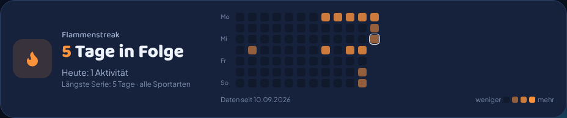
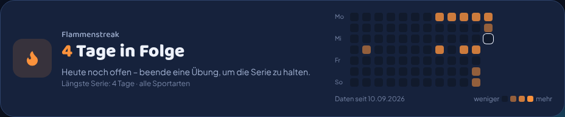
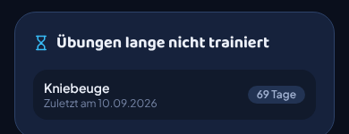

# C14a – Nachbesserung: Tages-Streak und „Übungen lange nicht trainiert“

**Phase:** Flowstate C · **Branch:** `phase-1` · **Datum:** 17.11.2026 · **Status:** ✅ umgesetzt

## Anforderung

> Ergänze bei „Lange nicht trainiert“, dass es Übungen sind, und mache den Streak in Tagen.

## Zusammenfassung

### 1. Streak in Tagen statt Wochen
Der Flammenstreak aus [C14](C14.md) zählt jetzt **Tage in Folge**. Alle übrigen Regeln bleiben gleich und werden
nur von „Woche“ auf „Tag“ übertragen:

| Regel | C14 (vorher) | C14a (jetzt) |
|-------|--------------|--------------|
| Einheit | Wochen (Mo–So) | **Tage** |
| Aktiv | ≥ 1 Aktivität in der Woche | **≥ 1 Aktivität am Tag** |
| Aktivität | beendete Übung oder neu erstellte Übung (max. 1 pro Tag) | unverändert |
| Noch nichts getan | „Diese Woche noch offen“ | **„Heute noch offen – beende eine Übung, um die Serie zu halten.“** |
| Serie reißt | nach einer ganzen Woche ohne Aktivität | **nach einem ganzen Tag ohne Aktivität** (gestern leer) |
| Stand-Zeile | „Diese Woche: n Aktivitäten“ | **„Heute: n Aktivitäten“** |
| Anzeige | „5 Wochen in Folge“, „Längste Serie: 5 Wochen“ | **„5 Tage in Folge“, „Längste Serie: 5 Tage“** |
| Flamme Startseite | Zahl = Wochen | **Zahl = Tage** |
| Gültigkeit / Speicherung | global, berechnet | unverändert |

Dass „heute“ ohne Aktivität die Serie noch nicht beendet, ist wichtig: Sonst stünde morgens um 7 Uhr jede Serie auf 0,
obwohl der Tag noch gar nicht vorbei ist.

Der **Aktivitäts-Kalender** (12 Wochen × 7 Tage) bleibt unverändert – er zeigt ohnehin einzelne Tage, sodass man die
Tages-Serie dort direkt als Kette orangener Felder sieht.

### 2. „Übungen lange nicht trainiert“
Der Kartentitel nennt jetzt ausdrücklich, worum es geht: **„Übungen lange nicht trainiert“** (vorher „Lange nicht
trainiert“). Er passt auf dem Handy (390 px) in eine Zeile.

## Einheitliches Design
Keine neuen Farben oder Bausteine – Orange bleibt ausschließlich der Streak, Grau für „ohne Serie“, keine roten
Warnungen. „5 Tage in Folge“ ist kürzer als „5 Wochen in Folge“ und bleibt auf dem Handy einzeilig.

## Technik
- `src/lib/streak.ts` – `computeStreak` zählt aufeinanderfolgende aktive **Tage**; Rückgabe
  `{ current, longest, today, atRisk }` (`today` = Aktivitäten heute, ersetzt `thisWeek`).
- `src/components/StreakCard.tsx` – Texte „Tag/Tage“, „Heute: …“, „Heute noch offen …“.
- `src/components/StreakBadge.tsx` – Bildschirmleser-Text „n Tage in Folge“.
- `src/components/StatisticsInsights.tsx` – Titel „Übungen lange nicht trainiert“.

## Tests
- **Logik:** 10 Prüfungen je in Europe/Berlin, America/Los_Angeles, Australia/Sydney – alle bestanden (leer;
  3 Tage inkl. heute; heute offen; gestern leer → gerissen; längste Serie früher; Monats- und Jahreswechsel;
  Erstellung 1× pro Tag; Zukunft ignoriert; Aktivität 23 Uhr + 0 Uhr = 2 Tage).
- **Browser** (Desktop 1280 px, Handy 390 px): tägliches Training 14.–18.11. → „5 Tage in Folge“, „Heute:
  1 Aktivität“, Startseite „🔥 5“; ohne Aktivität heute → „4 Tage in Folge“ + „Heute noch offen …“; Kartentitel
  einzeilig; kein Überlauf, keine Konsolenfehler.
- `npm run build` erfolgreich, `npm run lint` ohne neue Warnungen.
