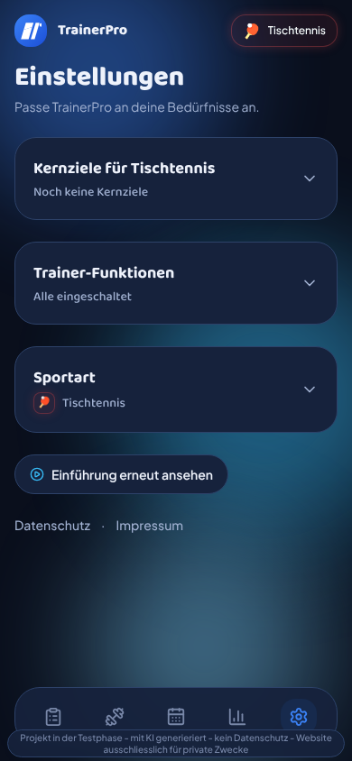
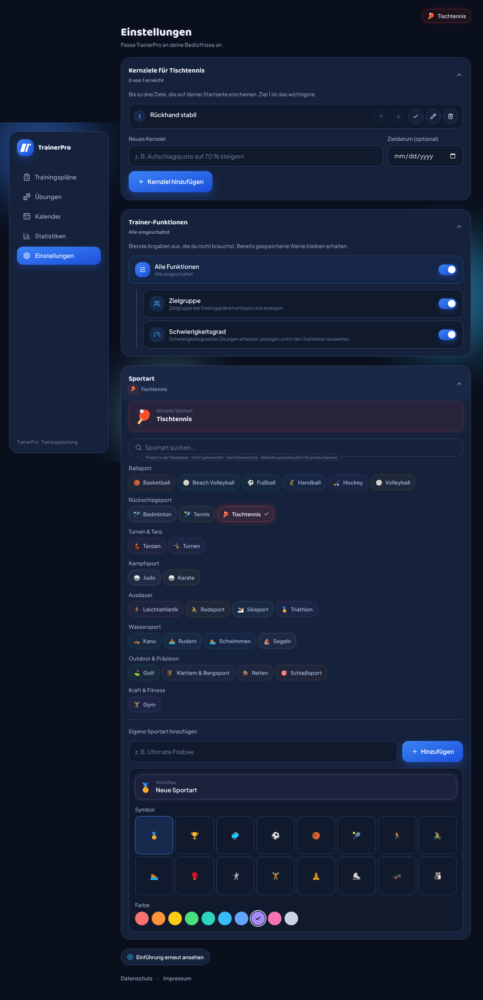
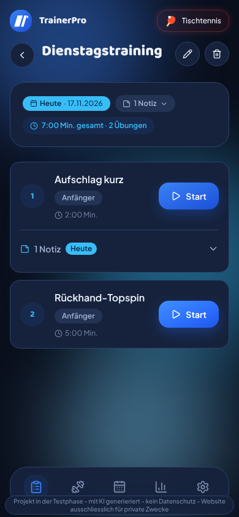
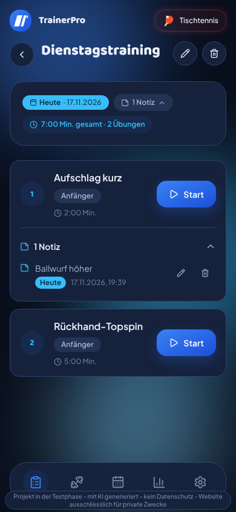
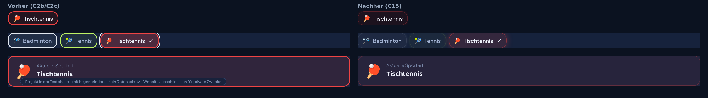

# C15 – Klappbare Bereiche, dezente Sportfarben und finale Kontrolle

**Phase:** Flowstate C · **Branch:** `phase-1` · **Datum:** 17.11.2026 · **Status:** ✅ umgesetzt

## Anforderung

> Alle Bereiche in den Einstellungen müssen ein- und ausklappbar sein, ebenso die Notizen unterhalb der Trainingspläne.
> Die Farben für die Sportarten viel dezenter gestalten – sie sollen nur leicht leuchten und keine vollständige Border
> sein; dafür auch den Shadow anpassen. Abschließend alle Funktionen erneut prüfen.

(C15 war ursprünglich als „Design-Abstimmung und finale Kontrolle“ angelegt und wurde mit dieser Liste konkretisiert.)

**Abstimmung im Team (vor der Umsetzung):**
- In den Einstellungen sind **alle Bereiche anfangs geschlossen** – auch die Kernziele.
- Auf der **Startseite bleiben die Kernziele offen** (unverändert).
- Gemeint sind die **Notizen aus C13** unter den Übungen im Plandetail.
- Das neue Leuchten gilt **überall**, wo die Sportfarbe erscheint.
- **Alle Funktionen** werden abschließend erneut geprüft.

## Zusammenfassung

### 1. Einstellungen: klappbare Bereiche
- **Kernziele**, **Trainer-Funktionen** und **Sportart** sind Klapp-Karten; beim Öffnen der Einstellungen sind
  **alle zu**. Die ganze Kopfzeile ist der Button, rechts dreht sich ein Pfeil.
- Im eingeklappten Kopf steht der **Stand** – man muss nicht aufklappen, um ihn zu sehen:
  - Kernziele: „Noch keine Kernziele“ bzw. „1 von 3 erreicht“
  - Trainer-Funktionen: „Alle eingeschaltet“ / „1 von 2 eingeschaltet“ / „Alle ausgeschaltet“
  - Sportart: Sporticon + Name der aktiven Sportart
- Der Erklärtext erscheint erst aufgeklappt – so bleiben die Köpfe ruhig und gleich hoch.
- **Ausnahme:** Kommt man über „Kernziele festlegen/Bearbeiten“ von der Startseite (`#kernziele`), öffnet sich die
  Kernziele-Karte direkt und die Seite scrollt hin – sonst würde der Link ins Leere führen.
- „Einführung erneut ansehen“ und „Datenschutz · Impressum“ sind einzelne Buttons/Links, keine Bereiche, und bleiben
  unverändert.

### 2. Notizen im Plandetail: klappbar
- Unter jeder Übung mit Notizen steht nur noch eine schmale Zeile **„📄 2 Notizen ⌄“** – anfangs **zu**.
- Aufgeklappt erscheinen **alle** Notizen (neueste zuerst). Das „+n weitere“ aus C13 entfällt, damit es nicht zwei
  Klapp-Ebenen gibt.
- Gibt es eine **Notiz von heute**, zeigt die zugeklappte Zeile das „Heute“-Badge (C6a) – nach dem Training sieht man
  sofort, dass etwas Neues da ist. Aufgeklappt trägt die Notiz selbst das Badge (nicht doppelt).
- Der Chip **„n Notizen“** oben im Plan ist jetzt ein Button mit Pfeil: er klappt **alle** Notizen des Plans auf bzw. zu.

 

### 3. Sportfarben: dezentes Leuchten statt voller Umrandung
Die Regel aus C2b/C2c („ganzes Element in voller Sportfarbe umrandet, 2 px“) ist **ersetzt**. Neu:

| Bestandteil | Vorher (C2b/C2c) | Nachher (C15) |
|-------------|------------------|---------------|
| Rahmen | 1,5–2,5 px, **volle** Sportfarbe | **1 px**, Sportfarbe mit 12–45 % Deckkraft (nur angedeutete Kante) |
| Schatten | keiner | **weicher farbiger Glow** nach außen (10–18 px Unschärfe, 35–45 % Deckkraft) |
| Hintergrund | 6–25 % getönt | 4–14 % getönt |
| Auswahl (Chips) | stärker getönt + **weißer Ring** + Häkchen | **stärkeres Leuchten** + Häkchen + helle Schrift (weißer Ring entfällt – er wirkte wie eine zweite harte Umrandung) |

Drei Stufen, zentral in `src/lib/sportStyle.ts` (`sportGlowStyle`):

| Stufe | Einsatz | Rahmen | Tönung | Glow |
|-------|---------|--------|--------|------|
| `soft` | Chips in langen Listen (Sportart-Auswahl, Einführung) | 12 % | 4 % | 10 px, 35 % |
| `default` | einzelne Anzeigen (Pille oben rechts, aktuelle Sportart, Sporticon, Vorschauen) | 30 % | 8 % | 14 px, 35 % |
| `strong` | ausgewählte Sportart | 45 % | 14 % | 18 px, 45 % |

Gilt **überall**: Sportart-Pille oben rechts (Handy + Desktop), Sporticon (`SportBadge`: Startseite, Statistiken,
Einstellungen-Kopf), Sportart-Auswahl (aktuelle Sportart, Chips, Vorschau „Neue Sportart“, Dialog „anpassen“) und
Einführung (Auswahl + Ergebnis). Die Sportfarbe bleibt Wiedererkennung; der Name steht immer daneben, und die
Auswahl ist zusätzlich am Häkchen erkennbar – nicht nur an der Farbe.

## Einheitliches Design
- **Eine** Klapp-Logik für die ganze App (`Collapsible.tsx`): gleiche Animation (~200 ms, bei „Bewegung reduzieren“
  ohne Animation), gleicher Pfeil, gleiche Kopfzeile. Karten behalten Rundung, Rahmen und Abstände der bisherigen
  Einstellungen-Karten.
- Keine neuen Farben; Zusammenfassungen in der vorhandenen gedämpften Textfarbe.
- Kurze Texte, keine Umbrüche auf dem Handy (390 px).
- Barrierefreiheit: Kopf-Buttons mit `aria-expanded`/`aria-controls`; eingeklappter Inhalt ist `inert` (nicht per
  Tab erreichbar, für Screenreader verborgen).

## Technik
- **`src/components/Collapsible.tsx`** (neu): `Collapse` (Höhen-Animation per CSS-Grid `0fr ↔ 1fr`, ohne feste
  Höhen), `CollapseChevron`, `CollapsibleSection` (Karte mit Titel, Zusammenfassung, Erklärtext, `defaultOpen`).
- Dialoge (Bearbeiten/Löschen) liegen **außerhalb** des Klappbereichs.
- **Plandetail** verwaltet die geöffneten Notizen als Menge von Übungs-IDs → einzelne Übung oder alle über den Chip.
- **`sportGlowStyle(color, level)`** ersetzt `sportFrameStyle(color, tint)`; alle Sport-Elemente nutzen `border`
  (1 px) statt `border-2`.

## Geänderte Dateien

| Datei | Änderung |
|-------|----------|
| `src/components/Collapsible.tsx` | **neu** – Klapp-Bausteine |
| `src/pages/Settings.tsx` | Sportart als Klapp-Karte, Kernziele öffnen bei `#kernziele` |
| `src/components/CoreGoalsSettings.tsx` | Klapp-Karte mit „n von m erreicht“, `defaultOpen` |
| `src/components/TrainerFeaturesSettings.tsx` | Klapp-Karte mit Stand des Hauptschalters |
| `src/components/PlanExerciseNotes.tsx` | Notizen je Übung klappbar, „Heute“ im Kopf |
| `src/pages/PlanDetail.tsx` | Zustand der Notizen, Chip klappt alle |
| `src/lib/sportStyle.ts` | `sportGlowStyle` mit drei Stufen |
| `src/components/SportBadge.tsx`, `SportPill.tsx`, `SportPicker.tsx`, `src/pages/Onboarding.tsx` | Leuchten statt Rahmen |

## Abschließende Prüfung aller Funktionen

Automatischer Durchlauf im Browser (Playwright) mit leerem Speicher, **Desktop 1280 px und Handy 390 px** –
**39 von 39 Prüfungen bestanden**, keine Konsolen- oder Seitenfehler:

| Bereich | Geprüft |
|---------|---------|
| Start | Passwort-Tor, leere Startseite mit Sportart-Namen (C5), Flamme grau „0“ (C14) |
| Einstellungen | 3 Bereiche, alle anfangs zu, Inhalt `inert`; Kernziel anlegen (C8) + Kopf „0 von 1 erreicht“; Hauptschalter Trainer-Funktionen aus/an (C9a); zuklappen |
| Übungen | zwei Übungen anlegen mit Dauer (C4) |
| Pläne | Plan mit Datum heute + 2 Übungen erstellen, öffnet Plandetail, erscheint unter „Pläne des Tages“ (C6a) |
| Ausführung | Timer starten, Notiz schreiben (C13), „Als erledigt“ protokolliert (C14), Notiz beim Schließen gespeichert |
| Notizen | anfangs zu, „Heute“ im Kopf, aufklappen, Chip klappt alle auf (C15) |
| Kalender | Plan am heutigen Tag sichtbar (C6) |
| Stoppuhr | starten, stoppen, Wert speichern (C12) |
| Aufschlagtraining | Ziel wählen, Session starten, bewerten, beenden (Tischtennis) |
| Statistiken | „1 Tag in Folge“ (C14a), Kacheln Woche/Monat (C14) |
| Sportart | Wechsel auf Gym über die Auswahl; Kopf zeigt Gym; Daten je Sportart getrennt (C5) |
| Gym | Übung mit 3 Sätzen, Plan, Satz-Ansicht durchlaufen, Sätze protokolliert (C11) |
| Löschen | Plan löschen mit Bestätigung |
| Einführung | „Einführung erneut ansehen“ öffnet die Einführung (C10) |
| Layout | kein horizontaler Überlauf auf allen Seiten (Startseite, Einstellungen offen, Übungen, Plandetail, Kalender, Stoppuhr, Aufschlag, Statistiken) |

`npm run build` erfolgreich, `npm run lint` ohne neue Warnungen (nur die bekannten 4 Hinweise `only-export-components`).
