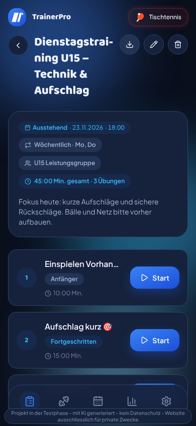
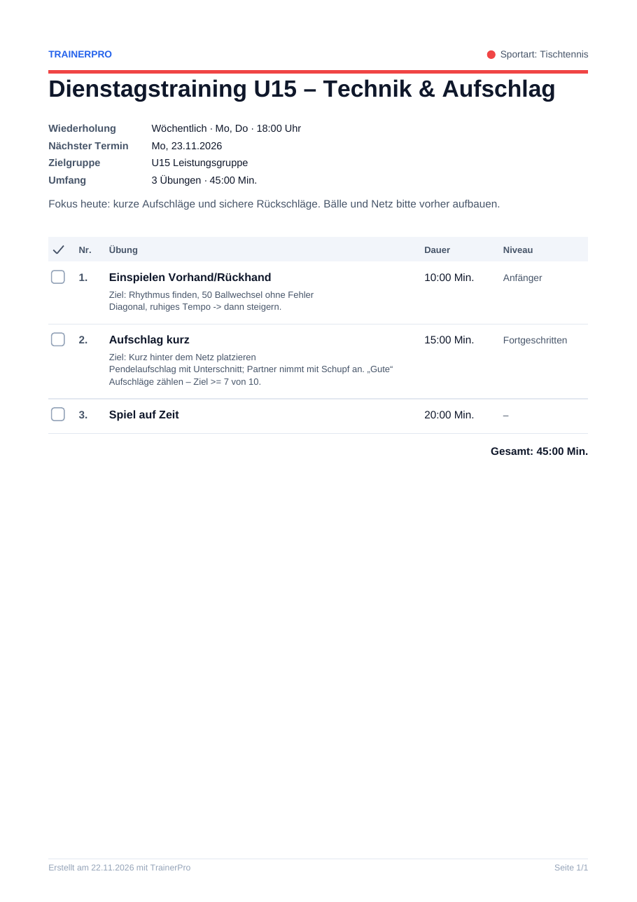
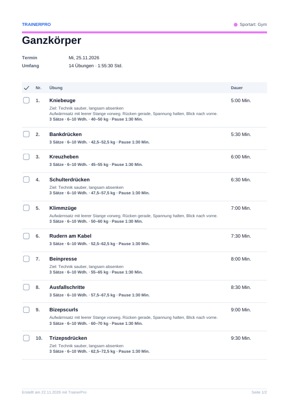
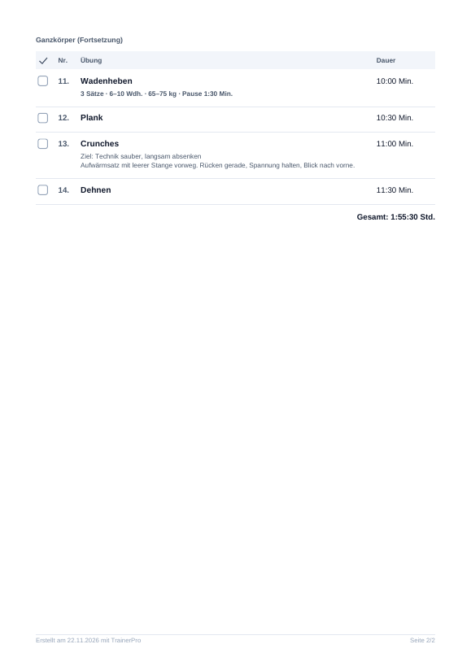
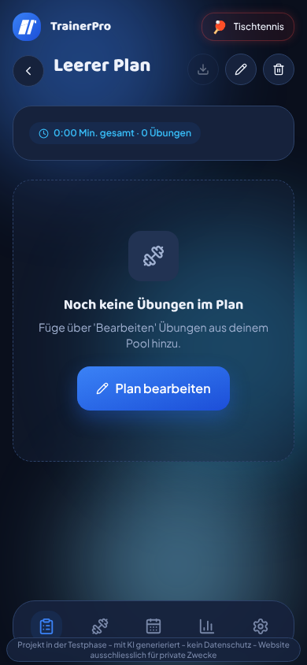

# C16 – Plan als PDF herunterladen

**Phase:** Flowstate D · **Branch:** `phase-1` · **Datum:** 22.11.2026 · **Status:** ✅ umgesetzt

## Anforderung

> Pläne werden als PDF, durch Button, zum Herunterladen erhältlich sein.

**Abstimmung im Team (vor der Umsetzung):**
- Alle Empfehlungen der Vorarbeit übernommen.
- Der Button sitzt **nur im Plandetail**, nicht auf den Plankarten der Startseite.
- Format: **A4 hochkant**.
- Notizen (C13) kommen **nicht** in die PDF: Sie sind persönlich, und der Ausdruck wird oft an die Gruppe weitergegeben.

## Zusammenfassung

### Der Button
- Im Plandetail oben rechts steht als **erste** Aktion ein runder Icon-Button mit Download-Symbol, gefolgt von
  „Bearbeiten“ und „Löschen“. Er hat denselben Stil wie die beiden anderen Buttons, und die Position ist fest.
- Ein Tipp darauf lädt direkt eine **echte PDF-Datei** herunter. Es öffnet sich kein Druckdialog.
- Während die PDF entsteht, dreht sich kurz ein Ladekreis im Button.
- Bei einem Fehler erscheint eine ruhige Meldung „Die PDF konnte nicht erstellt werden. Bitte versuche es noch
  einmal.“ ohne Rot und ohne Alarm.
- **Plan ohne Übungen:** Der Button ist ausgegraut. Sein Hinweis lautet „Als PDF herunterladen – erst Übungen
  hinzufügen“, damit keine leere PDF entsteht.

### Die PDF (A4 hochkant)
Die PDF hat bewusst ein **Papier-Layout statt des dunklen App-Designs**: weißer Grund und dunkle Schrift. Das ist gut
lesbar, spart Tinte und eignet sich zum Aushängen oder Verteilen.

| Bereich | Inhalt |
|---------|--------|
| Kopf | „TRAINERPRO“ in App-Blau, rechts „Sportart: …“ mit Punkt in der Sportfarbe, darunter ein schmaler Streifen in der Sportfarbe |
| Titel | Planname, groß und bei Bedarf mehrzeilig |
| Eckdaten | **Termin** (z. B. „Mo, 23.11.2026 · 18:00 Uhr“) oder bei Serien **Wiederholung** („Wöchentlich · Mo, Do · 18:00 Uhr“) und **Nächster Termin**; **Zielgruppe** (nur wenn die Trainer-Funktion aus C9 an ist); **Umfang** („3 Übungen · 45:00 Min.“) |
| Beschreibung | Planbeschreibung, falls vorhanden |
| Übungstabelle | **Kästchen zum Abhaken** mit dem Stift · Nr. · Übung (fett) mit Ziel, Beschreibung und bei Gym den Sätzen darunter · Dauer · Niveau (nur wenn die Trainer-Funktion „Schwierigkeitsgrad“ an ist) |
| Summe | „Gesamt: 45:00 Min.“ unter der Tabelle |
| Fußzeile | „Erstellt am … mit TrainerPro“ und „Seite 1/2“ auf jeder Seite |

**Mehrere Seiten:** Der Platz jeder Übung wird vorab berechnet, damit **keine Übung über einen Seitenumbruch zerrissen**
wird. Auf Folgeseiten stehen der Planname als „(Fortsetzung)“ und erneut der Tabellenkopf.

**Dateiname:** Er setzt sich aus Planname und (nächstem) Termin zusammen, z. B.
`Dienstagstraining_U15_Technik_Aufschlag_2026-11-23.pdf`. Ohne Termin besteht er nur aus dem Plannamen.

 

Beispiel-Dateien: [Tischtennis](assets/c16-beispiele/Beispiel_Tischtennis.pdf) ·
[Gym, 2 Seiten](assets/c16-beispiele/Beispiel_Gym_2_Seiten.pdf)

## Einheitliches Design
- In der App gibt es **keine neue Optik**: Der Button nutzt den vorhandenen `IconButton` in derselben Reihe wie
  Bearbeiten/Löschen, das Symbol ist ein lucide-Icon wie überall, der Hinweis ist ruhig wie bei C6a.
- Die PDF nimmt die App-Sprache auf: dasselbe Blau für „TRAINERPRO“ und die Sportfarbe als einziger farbiger Akzent.
  Das passt zum dezenten Umgang mit Sportfarben aus C15. Begriffe und Formate sind dieselben wie in der App
  („15:00 Min.“, „Wöchentlich · Mo, Do“, „3 Sätze · 6–10 Wdh. · 40–50 kg“).
- **Handy:** Mit dem dritten Button wird der Titel schmaler. Lange Wörter werden jetzt mit deutscher Silbentrennung
  umbrochen („Dienstagstrai-ning“) statt hart mitten im Wort.

## Technik
- **`src/lib/planPdf.ts`** (neu):
  - `downloadPlanPdf`: lädt `jsPDF` per **dynamischem Import** nach, baut das Dokument und speichert es.
  - `buildPlanPdf`: baut das Layout.
  - `planPdfFacts`: Eckdaten.
  - `planPdfFileName`: Dateiname.
  - `pdfText`: Zeichen-Aufbereitung.
- **Bibliothek `jspdf` 4.2.1** (aktuelle Version ohne bekannte Sicherheitslücken; 2.5.2 hatte welche und wurde
  deshalb nicht genommen). Sie liegt in einem **eigenen Paket**, das erst beim ersten Antippen geladen wird. Der
  App-Start wird dadurch nicht langsamer. Die PDF entsteht **komplett im Browser**: Es wird nichts hochgeladen, und es
  funktioniert offline.
- **Text in der PDF ist markierbar und durchsuchbar.** Die Datei ist klein (etwa 12 KB für einen Plan mit 3 Übungen).
- **Zeichen:** Die PDF-Standardschrift kann Umlaute, ß, „“, – und ·, aber **keine Emojis**.
  - Emojis werden entfernt (aus „Aufschlag kurz 🎯“ wird „Aufschlag kurz“).
  - Das Sporticon wird durch Sportart-Name und Farbpunkt ersetzt.
  - Zeichen mit Bedeutung werden **ersetzt statt entfernt**: → wird zu ->, ≥ zu >=, ≤ zu <=, ≈ zu ~.
- **Dateiname ohne Umlaute** (ö → oe usw.): Ein Browser hat einen Namen mit „ö“ verworfen und die Datei „download“
  genannt (im Test gefunden).
- **Trainer-Funktionen (C9)** gelten auch in der PDF: Ist „Zielgruppe“ oder „Schwierigkeitsgrad“ aus, fehlen Zeile
  bzw. Spalte.

## Geänderte Dateien

| Datei | Änderung |
|-------|----------|
| `src/lib/planPdf.ts` | **neu** – PDF-Layout, Eckdaten, Dateiname, Zeichen-Aufbereitung |
| `src/pages/PlanDetail.tsx` | PDF-Button (Laden, Fehler, deaktiviert ohne Übungen), Silbentrennung im Titel |
| `package.json`, `package-lock.json` | Abhängigkeit `jspdf` |

## Tests

**Browser (Playwright, Download abgefangen und Datei ausgewertet, feste Zeit So 22.11.2026):**

| Fall | Ergebnis |
|------|----------|
| Tischtennis-Serie Mo/Do 18:00, Zielgruppe, 3 Übungen (Desktop + Handy) | 1 Seite A4 (210 × 297 mm), Dateiname `…_2026-11-23.pdf`, „Nächster Termin Mo, 23.11.2026“, Zielgruppe und Niveau vorhanden, „Gesamt: 45:00 Min.“ |
| Sonderzeichen | Umlaute, „“, – und · korrekt; 🎯 entfernt; → wird zu ->; „≥ 7 von 10“ wird zu „>= 7 von 10“ |
| Gym, 14 Übungen, Trainer-Funktionen aus | **2 Seiten**, keine Übung zerrissen, „Ganzkörper (Fortsetzung)“ und Tabellenkopf auf Seite 2, keine Zielgruppe, keine Niveau-Spalte, Sätze unter der Übung, „Seite 1/2“ und „2/2“ |
| Dateiname mit Umlaut | `Ganzkoerper_2026-11-25.pdf` |
| Plan ohne Übungen | Button deaktiviert, Hinweis „erst Übungen hinzufügen“ |
| Layout | kein horizontaler Überlauf, keine Konsolenfehler |

Der Inhalt wurde mit `pdftotext` geprüft, Seitenzahl, Format und Titel mit `pypdf`, und die Seiten wurden als Bild
kontrolliert.

`npm run build` erfolgreich, `npm run lint` ohne neue Warnungen.

