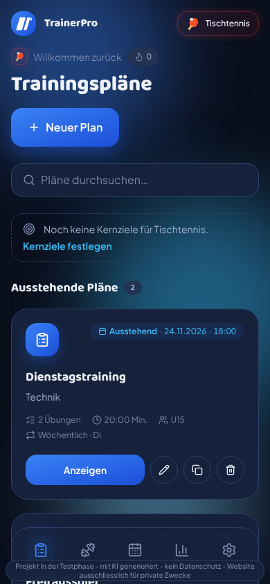
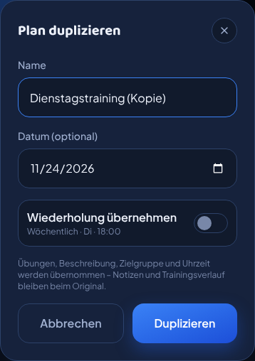
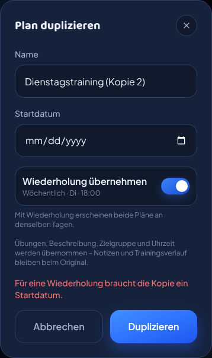
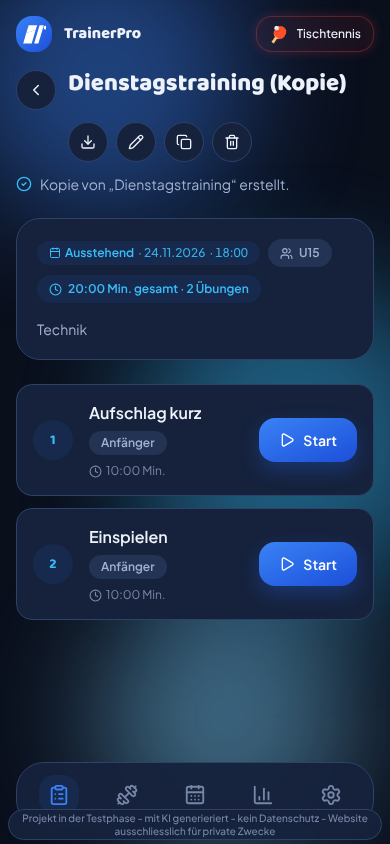
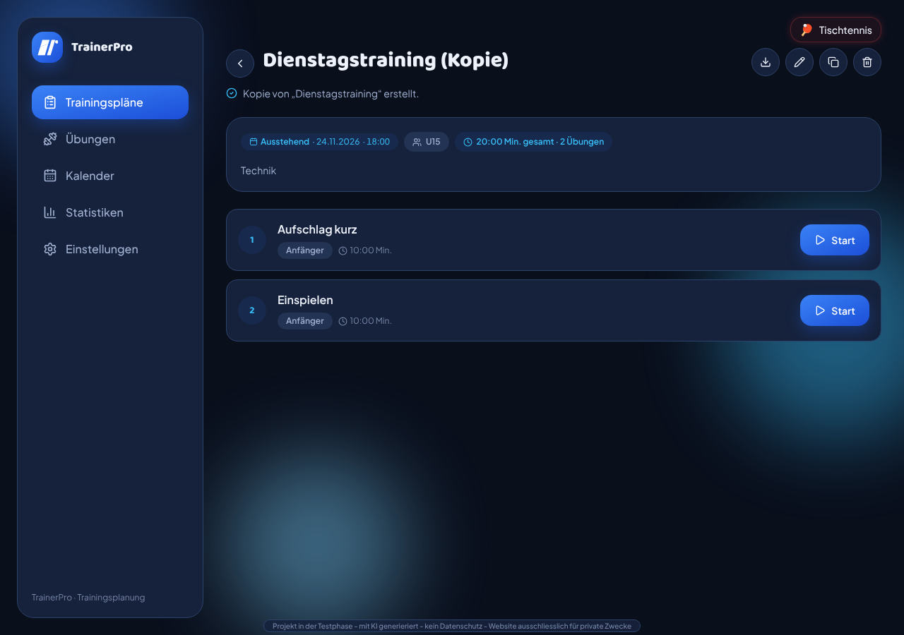
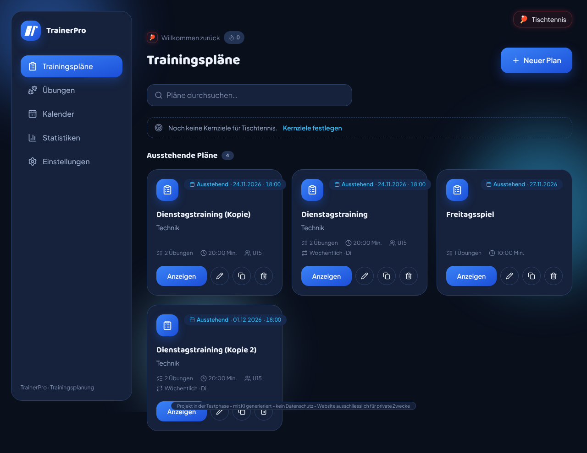

# C17 – Pläne duplizieren

**Phase:** Flowstate D · **Branch:** `phase-1` · **Datum:** 22.11.2026 · **Status:** ✅ umgesetzt

## Anforderung

> Pläne werden per Button duplizierbar sein.

**Abstimmung im Team (vor der Umsetzung):**
- Alle Empfehlungen der Vorarbeit wurden übernommen: ein Dialog statt einer sofortigen Kopie, der Button an **beiden** Stellen (Plankarte und Plandetail), auf dem Handy eine eigene Aktionszeile im Plandetail, und nach dem Duplizieren geht es direkt zur Kopie.
- Wiederholungen werden **standardmäßig nicht** übernommen.
- Der Name bekommt den Zusatz **„(Kopie)“**.

## Zusammenfassung

### Wo der Button sitzt
- **Plankarte (Startseite):** Das runde Icon „Kopieren“ steht zwischen Bearbeiten und Löschen. Löschen bleibt immer
  ganz rechts.
- **Plandetail:** Die Reihenfolge ist PDF · Bearbeiten · **Duplizieren** · Löschen, also dieselbe Reihenfolge wie auf
  der Karte.
- **Handy:** Mit vier Aktionen rutschen die Buttons im Plandetail in eine **eigene Zeile unter den Titel**, bündig mit
  dem Titel. Der Titel bekommt dadurch wieder die volle Breite und bricht nicht mehr mitten im Wort um. Auf dem Desktop
  bleibt alles in einer Zeile.

### Der Dialog „Plan duplizieren“

| Feld | Vorbelegung | Hinweis |
|------|-------------|---------|
| **Name** | „Dienstagstraining (Kopie)“; ist der Name vergeben: „(Kopie 2)“, „(Kopie 3)“ … | Eine Kopie einer Kopie zählt weiter statt „(Kopie) (Kopie)“; Groß-/Kleinschreibung egal |
| **Datum** | Termin des Originals, bei Serien der **nächste** Termin | änderbar oder leer = ohne Datum; heißt „Startdatum“, sobald die Wiederholung übernommen wird |
| **Wiederholung übernehmen** | **aus** (nur bei Serien sichtbar) | Schalter im Stil der Trainer-Funktionen (C9), darunter die Regel („Wöchentlich · Di · 18:00“). Eingeschaltet erscheint grau: „Mit Wiederholung erscheinen beide Pläne an denselben Tagen.“ |

Darunter steht in Grau, was mitkommt, z. B. „Übungen, Beschreibung, Zielgruppe und Uhrzeit werden übernommen –
Notizen und Trainingsverlauf bleiben beim Original.“ Es werden nur Angaben genannt, die es gibt; die Zielgruppe nur,
wenn die Trainer-Funktion an ist.

**Prüfungen:**
- Leerer Name: „Bitte gib einen Namen für die Kopie ein.“
- Wiederholung ohne Startdatum: Hinweis, dass ein Startdatum nötig ist.
- Startdatum nach dem Serienende: Hinweis mit dem Enddatum.

Die Fehlermeldungen sehen aus wie im Planformular. Abbrechen legt nichts an.

 

### Nach dem Duplizieren
Die App springt direkt ins **Plandetail der Kopie**. Oben steht ruhig „✓ Kopie von „Dienstagstraining“ erstellt.“ Man
sieht sofort das Ergebnis und kann es bearbeiten, als PDF laden oder starten.

### Was kopiert wird – und was nicht

| Wird kopiert | Wird **nicht** kopiert | Warum |
|--------------|------------------------|-------|
| Beschreibung, Zielgruppe, Uhrzeit | – | – |
| Übungen in gleicher Reihenfolge, **als Verweis** | Die Übungen selbst werden nicht verdoppelt | Sonst stünde jede Übung doppelt im Pool, und Statistiken und Bestwerte (C14) würden sich aufteilen |
| Wiederholung, **nur wenn eingeschaltet** | Ausgetragene Einzeltermine (C7a) | Sie gehören zur alten Serie, z. B. Ferien des Originals |
| – | Notizen (C13) | Sie gehören zu genau diesem Plan |
| – | Trainingsverlauf (C11), ID, Erstelldatum | Die Kopie ist ein neuer Plan |
| Sportart | – | Die Kopie bleibt in der aktiven Sportart (C5) |

Der Flammenstreak ändert sich durch das Duplizieren nicht. Er zählt nur beendete und neu erstellte **Übungen**.
Weil die Wiederholung standardmäßig nicht übernommen wird, entstehen keine doppelten Termine und die Planerfüllung
(C14) wird nicht verfälscht.

## Einheitliches Design
- Der Dialog nutzt den vorhandenen `Modal`, dieselben Feld-Klassen wie das Planformular und die Button-Anordnung
  Abbrechen (Kontur) | Hauptaktion (blau) wie bei „Kernziel bearbeiten“ und „Notiz bearbeiten“.
- Der Schalter und seine Zeile sehen aus wie in den Trainer-Funktionen (C9).
- Das Icon ist lucide `Copy` im runden `IconButton`, mit derselben Größe und Position in der Aktionsreihe wie die
  übrigen Aktionen.
- Erfolgshinweis und Hinweistexte sind ruhig und grau bzw. haben ein blaues Häkchen, ohne zusätzliche Kästen. Das
  entspricht dem Stil der Hinweise aus C14 und C16.

## Technik
- **`src/lib/planCopy.ts`** (neu, reine Funktionen):
  - `copyName`: freier Name mit „(Kopie n)“.
  - `defaultCopyDate`: maßgeblicher Termin über `getPlanSchedule` aus C7.
  - `copyPlanInput`: erzeugt die Eingabe für den neuen Plan nach den Regeln oben.
- **`src/components/DuplicatePlanDialog.tsx`** (neu): gemeinsamer Dialog für Karte und Plandetail.
  - Er legt den Plan über das vorhandene `addPlan` an. Dadurch gelten automatisch die Regeln aus C5 (aktive
    Sportart, nur eigene Übungen).
  - Danach leitet er mit `state.copiedFrom` zur Kopie weiter.
- **`PlanCard`** hat jetzt `onDuplicate`. **`PlansOverview`** und **`PlanDetail`** öffnen den Dialog.
- Es gibt **keine Datenmodell-Änderung und keine Migration**.

## Geänderte Dateien

| Datei | Änderung |
|-------|----------|
| `src/lib/planCopy.ts` | **neu** – Name, Vorbelegung, Kopier-Regeln |
| `src/components/DuplicatePlanDialog.tsx` | **neu** – Dialog „Plan duplizieren“ |
| `src/components/PlanCard.tsx` | Button „Plan duplizieren“ |
| `src/pages/PlansOverview.tsx` | Dialog auf der Startseite |
| `src/pages/PlanDetail.tsx` | Button, eigene Aktionszeile am Handy, Hinweis „Kopie … erstellt“ |

## Tests

**Logik (16 Prüfungen, je in Europe/Berlin, America/Los_Angeles, Australia/Sydney – alle bestanden):**
- Namen: (Kopie), (Kopie 2), (Kopie 3) ohne Groß-/Kleinschreibung, Kopie einer Kopie zählt weiter
- Vorbelegung: nächster Serientermin, Einzeltermin, leer ohne Datum
- Standard ohne Wiederholung; Übungen als neue Liste in gleicher Reihenfolge, keine ID/Sportart im Input
- Mit Wiederholung werden ausgetragene Termine geleert, das Original bleibt unverändert
- Wiederholung ohne Datum ergibt keine Serie

**Browser (Playwright, Desktop 1280 px und Handy 390 px, Sonntag 22.11.2026) – 38 von 38 bestanden:**

| Fall | Ergebnis |
|------|----------|
| Duplizieren von der Plankarte (Serie Di 18:00) | Name „Dienstagstraining (Kopie)“, Datum 24.11.2026 (nächster Dienstag), Schalter aus |
| Ergebnis | neuer Plan ohne Serie, am 24.11. um 18:00, Übungen in gleicher Reihenfolge, Zielgruppe übernommen, Übungs-Pool unverändert (2 Übungen) |
| Danach | Weiterleitung zur Kopie, Hinweis „Kopie von „Dienstagstraining“ erstellt.“; Notizen nicht mitkopiert, Original unverändert |
| Zweite Kopie aus dem Plandetail, mit Wiederholung | Name „(Kopie 2)“, grauer Hinweis „beide Pläne an denselben Tagen“; ohne Startdatum Fehlermeldung; mit 30.11. Serie angelegt, ausgetragene Termine leer |
| Leerer Name / Abbrechen | Meldung bzw. nichts angelegt |
| Handy | Aktionen in eigener Zeile unter dem Titel, kein horizontaler Überlauf |
| Startseite | listet alle 4 Pläne; keine Konsolenfehler |

`npm run build` erfolgreich, `npm run lint` ohne neue Warnungen.

