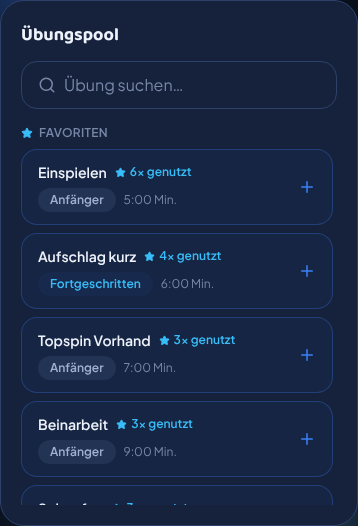
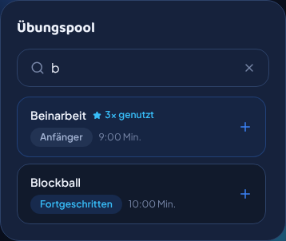
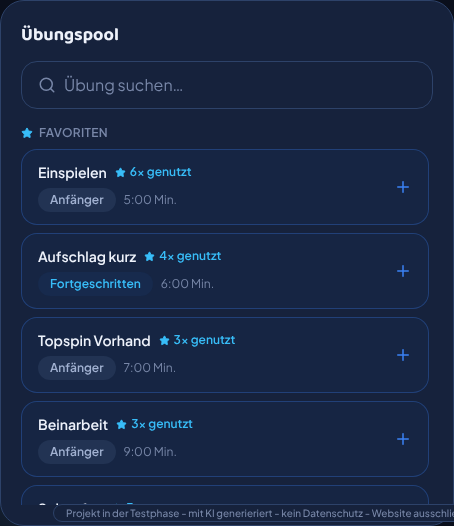

# C18 – Favoriten in der Planerstellung

**Phase:** Flowstate D · **Branch:** `phase-1` · **Datum:** 22.11.2026 · **Status:** ✅ umgesetzt

## Anforderung

> Übungen werden weiter oben angezeigt, in der Planerstellung, wenn sie häufig benutzt werden, und farblich leicht
> hervorgehoben.

**Abstimmung im Team (vor der Umsetzung):**
- Alle Empfehlungen der Vorarbeit übernommen.
- Favoriten werden **automatisch** ermittelt. Einen Stern zum Markieren von Hand gibt es vorerst nicht.
- Gezählt wird eine **Kombination** aus Plänen und Ausführungen.
- Es gibt **höchstens 5 Favoriten**.
- Der Name ist **„Favoriten“**. Er passt besser zur Zielgruppe der App als „Häufig genutzt“.

## Zusammenfassung

### Die Regel
| Punkt | Festlegung |
|-------|------------|
| Nutzungswert | **Anzahl Pläne**, die die Übung enthalten (je Plan einmal), **plus Anzahl Ausführungen** der letzten **8 Wochen** (Protokoll aus C11: Timer abgelaufen, „Als erledigt“, Gym-Sätze abgeschlossen) |
| Favorit ab | Wert **3**, sonst wäre bei wenig Daten jede Übung ein Favorit |
| Anzahl | höchstens **5** |
| Reihenfolge | höchster Wert zuerst; bei Gleichstand die **zuletzt genutzte**, dann alphabetisch |
| Gültigkeit | je aktiver Sportart (C5); wird bei jedem Öffnen **berechnet, nie gespeichert** und ist daher immer aktuell |

Warum diese Kombination:
- Nur Pläne zu zählen würde Übungen aufblähen, die per „Duplizieren“ (C17) in vielen Kopien stecken.
- Nur Ausführungen zu zählen würde Trainer benachteiligen, die viel planen, aber den Timer selten nutzen.
- Durch das Zeitfenster von 8 Wochen zählen aktuelle Gewohnheiten mehr als alte.

### So sieht es aus (Übungspool im Planformular – Erstellen und Bearbeiten)
- Ganz oben steht der Abschnitt **„★ Favoriten“** mit den Favoriten in Rangfolge, darunter **„Alle Übungen“** in der
  bisherigen Reihenfolge. Auf dem Handy sieht man die Favoriten sofort, ohne zu scrollen.
- **Leichte Hervorhebung** der Favoriten-Zeilen: eine leicht blau getönte Fläche (`primary-soft`, 40 %) und ein feiner
  blauer Rand (`primary`, 30 %). Neben dem Namen steht klein **„★ 6× genutzt“**, damit klar ist, *warum* die Übung oben
  steht.
- **Ohne Nutzungsdaten** (neue App, neue Sportart) sieht der Pool **genau wie bisher** aus, ohne leere Überschrift.
- **Suche:** Die Ergebnisse bilden eine einzige Trefferliste. Favoriten stehen darin zuerst und bleiben hervorgehoben;
  Überschriften gibt es dabei nicht.
- **Auswählen:** Ein gewählter Favorit wandert wie jede Übung in „Ausgewählte Übungen“. Sind alle Favoriten gewählt,
  entfällt der Abschnitt.

 

## Einheitliches Design
- **Farbe:** Favoriten nutzen nur das App-Blau, und zwar nur angedeutet. Orange bleibt allein dem Streak (C14), die
  Sportfarbe der Sportart-Anzeige (C15). Es gibt keinen dicken Rahmen und keinen zusätzlichen Kasten (Feedback aus
  C2c/C6a).
- **Zwischenüberschriften** haben denselben Stil wie „Gewichte“ und „Stoppuhr“ in den Statistiken (klein,
  Großbuchstaben, grau).
- **Zeilen** sind gleich aufgebaut wie bisher, mit Name, Niveau/Dauer und dem Plus rechts. Der Hinweis
  „★ n× genutzt“ steht in der **Namenszeile**. Im ersten Entwurf stand er unter dem Namen und rutschte am Handy neben
  „Fortgeschritten“ in eine dritte Zeile. Jetzt sind Favoriten genauso hoch wie normale Zeilen, und lange Namen
  werden vorher gekürzt.
- Für Screenreader lautet die Beschriftung „Einspielen hinzufügen (Favorit, 6× genutzt)“.

## Technik
- **`src/lib/favorites.ts`** (neu, reine Funktionen):
  - `usageScores(exercises, plans, log, today)` liefert je Übung Pläne, Ausführungen, Wert und letzte Nutzung.
  - `favoriteIds(exercises, scores)` liefert die Rangfolge (max. 5, ab Wert 3).
  - Die Konstanten `FAVORITE_MAX`, `FAVORITE_MIN_SCORE` und `FAVORITE_WINDOW_DAYS` lassen sich später leicht anpassen.
- **`src/pages/PlanForm.tsx`:**
  - Werte per `useMemo` aus den Daten der aktiven Sportart (`plans`, `exerciseLog` aus dem AppDataContext).
  - Die Abschnitte bildet `poolSections`: „Favoriten“ und „Alle Übungen“, bei einer Suche eine einzige Trefferliste.
- Es gibt **kein neues Speicherfeld und keine Migration**.

## Geänderte Dateien

| Datei | Änderung |
|-------|----------|
| `src/lib/favorites.ts` | **neu** – Nutzungswerte und Favoriten-Rangfolge |
| `src/pages/PlanForm.tsx` | Abschnitte, Hervorhebung, „★ n× genutzt“ im Übungspool |

## Tests

**Logik (10 Prüfungen, je in Europe/Berlin, America/Los_Angeles, Australia/Sydney – alle bestanden):**
- Ohne Daten gibt es keine Favoriten.
- Eine Übung zählt je Plan einmal, auch wenn sie im Plan doppelt vorkommt.
- Ein Wert unter 3 ergibt keinen Favoriten; 2 Pläne + 1 Ausführung = 3 ergibt einen.
- Zeitfenster: Tag 56 zählt, Tag 57 nicht. Zukünftige Einträge und gelöschte Übungen werden ignoriert.
- Höchstens 5 Favoriten, Rangfolge nach Wert, dann letzter Nutzung, dann Name.

**Browser (Playwright, Desktop 1280 px und Handy 390 px) – 26 von 26 bestanden:**

| Fall | Ergebnis |
|------|----------|
| Ohne Nutzungsdaten | keine Überschriften, Reihenfolge wie bisher |
| 7 Übungen, 3 Pläne, 8 Ausführungen (2 davon älter als 8 Wochen) | Favoriten in Rangfolge: Einspielen (6×), Aufschlag kurz (4×), dann drei mit Wert 3 nach letzter Nutzung; danach „Alle Übungen“ in alter Reihenfolge; genau 5 hervorgehoben; Übung mit Wert 1 (nur alte Ausführungen) kein Favorit |
| Suche „b“ | eine Trefferliste, Favorit zuerst, keine Überschriften |
| Favorit auswählen | verschwindet aus dem Pool, erscheint unter „Ausgewählte Übungen“; alle 5 gewählt → Abschnitt entfällt |
| Layout | kein horizontaler Überlauf, keine Konsolenfehler |

`npm run build` erfolgreich, `npm run lint` ohne neue Warnungen.

## Für später vorgemerkt
- Übungen zusätzlich **von Hand** mit einem Stern als Favorit markieren (z. B. auf der Übungsseite).
