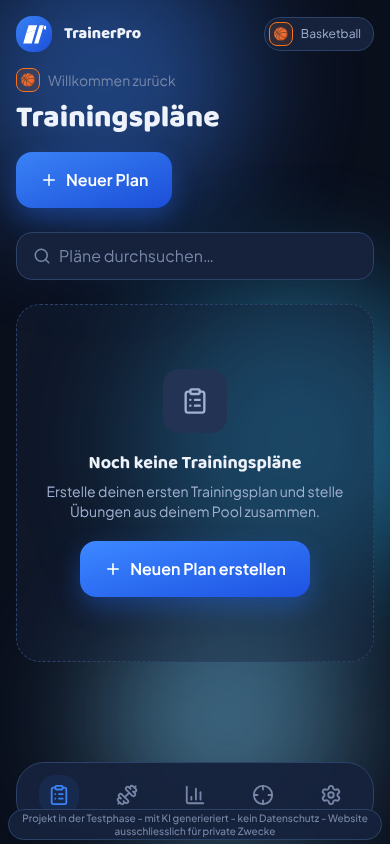
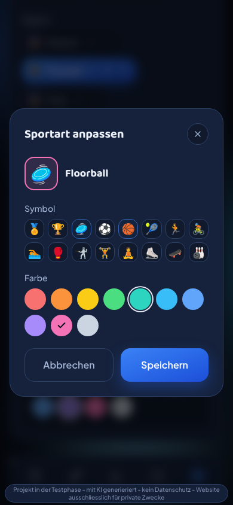
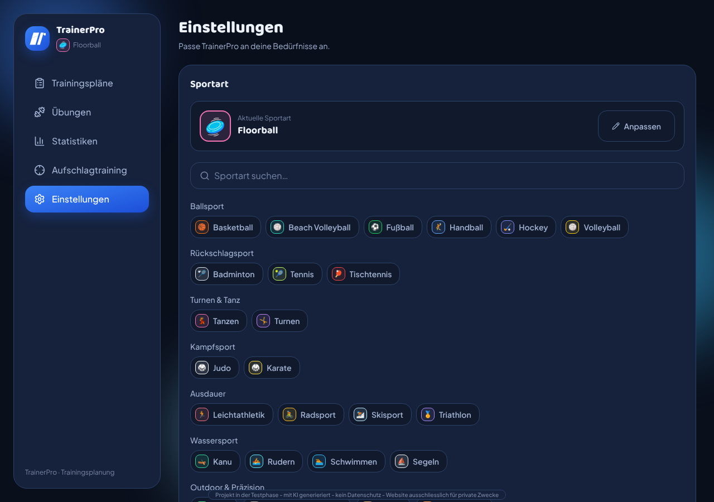

# C2 – Symbole und Farben an die Sportart anpassen

**Phase:** Flowstate A · **Branch:** `phase-1` · **Datum:** 15.11.2026 · **Status:** ✅ umgesetzt

## Anforderung

> Die Sporticons (oben in der rechten Ecke der App) sollen sich je nach Sportart anpassen und auch die
> farbliche Umrandung des Sporticons soll farblich mit der Sportart abgestimmt werden.
> Zum Beispiel orange für Basketball.

**Abstimmung im Team (vor der Umsetzung):**
- Am **Desktop** gibt es kein Icon oben rechts. Dort reicht die farbliche Umrandung am Sporticon in der Sidebar.
- Für **eigene Sportarten** sollen **Symbol und Farbe** wählbar sein.

## Zusammenfassung

- Neue Komponente **`SportBadge`**: Sporticon mit Umrandung in der Farbe der Sportart und leicht getöntem
  Hintergrund. Sie wird überall eingesetzt, wo das Sporticon erscheint:
  - Handy: Kopfzeile oben rechts
  - Desktop: Sidebar
  - Trainingspläne („Willkommen zurück“)
  - Statistiken (Kachel „Sportart“)
  - Einstellungen (aktuelle Sportart und alle Auswahl-Chips)
- Jede der **25 vorgegebenen Sportarten hat eine eigene Farbe**, z. B. Basketball orange, Tischtennis rot,
  Fußball grün, Schwimmen hellblau.
- **Eigene Sportarten:** Beim Anlegen lassen sich ein **Symbol (16 zur Auswahl)** und eine **Farbe (10 zur Auswahl)**
  wählen, mit Live-Vorschau. Über den Stift-Button am Chip oder „Anpassen“ bei der aktuellen Sportart lassen sie
  sich auch **später ändern**. „Abbrechen“ verwirft die Änderung.
- Bewusst **nicht** geändert: Die Grundfarbe der App (Blau für Buttons und Navigation) bleibt gleich. Nur das
  Sporticon trägt die Sportfarbe.

## Farbregeln

1. Die Farbe passt zur Sportart, wo es sich anbietet (Ballfarbe, Trikot, Element).
2. Sportarten mit **gleichem Emoji** sind über die Farbe unterscheidbar:
   Volleyball (gelb) / Beach Volleyball (türkis), Judo (weiß) / Karate (gelb).
3. **Kontrast mindestens 3:1** (WCAG 2.1, Kriterium 1.4.11 „Nicht-Text-Kontrast“) gegen **alle vier**
   Hintergründe der App: `#0a0f1c`, `#111a2c`, `#16223c`, `#223353`.
4. Für eigene Sportarten gibt es **keine freie Farbwahl**, sondern eine feste, geprüfte Palette.
   So entsteht kein unsichtbares Dunkel auf Dunkel.

### Ergebnis der Kontrastprüfung (schlechtester Wert über alle vier Hintergründe)

| Sportart | Farbe | Kontrast | | Sportart | Farbe | Kontrast |
|---|---|---|---|---|---|---|
| Fußball | `#22c55e` | 5,53 | | Judo | `#f8fafc` | 12,04 |
| Handball | `#60a5fa` | 4,96 | | Karate | `#fde047` | 9,56 |
| Basketball | `#f97316` | 4,50 | | Leichtathletik | `#fb7185` | 4,68 |
| Volleyball | `#facc15` | 8,23 | | Radsport | `#fbbf24` | 7,55 |
| Beach Volleyball | `#2dd4bf` | 6,77 | | Triathlon | `#a78bfa` | 4,63 |
| Hockey | `#818cf8` | 4,22 | | Skisport | `#bae6fd` | 9,50 |
| Tischtennis | `#ef4444` | 3,35 | | Schwimmen | `#38bdf8` | 5,88 |
| Tennis | `#bef264` | 9,65 | | Kanu | `#34d399` | 6,56 |
| Badminton | `#e2e8f0` | 10,22 | | Rudern | `#67e8f9` | 8,69 |
| Turnen | `#c084fc` | 4,77 | | Segeln | `#f1f5f9` | 11,50 |
| Tanzen | `#f472b6` | 4,76 | | Reiten | `#d6a26a` | 5,54 |
| Golf | `#4ade80` | 7,23 | | Schießsport | `#fb923c` | 5,57 |
| Klettern & Bergsport | `#a8a29e` | 5,00 | | | | |

**Palette für eigene Sportarten:** Rot `#f87171` (4,56) · Orange `#fb923c` (5,57) · Gelb `#facc15` (8,23) ·
Grün `#4ade80` (7,23) · Türkis `#2dd4bf` (6,77) · Hellblau `#38bdf8` (5,88) · Blau `#60a5fa` (4,96) ·
Violett `#a78bfa` (4,63, Standard) · Pink `#f472b6` (4,76) · Grau `#cbd5e1` (8,49)

Alle 35 Farben bestehen. Der niedrigste Wert ist Tischtennis-Rot mit 3,35.

## Technische Hinweise

- Die Farbe wird **per `style` bzw. CSS-Variable `--sport-color`** gesetzt und nicht als dynamische
  Tailwind-Klasse (`border-${color}`). Tailwind erzeugt nur Klassen, die wörtlich im Quellcode stehen.
- Symbol und Farbe eigener Sportarten werden nur aus den festen Listen akzeptiert
  (`isAllowedCustomEmoji` / `isAllowedCustomColor`), beim Anlegen, beim Ändern und beim Laden aus `localStorage`.
- **Migration:** Eigene Sportarten aus C1 wurden ohne Farbe gespeichert. Beim Laden bekommen sie automatisch
  Violett und behalten 🏅. Ungültige oder manipulierte Werte werden ebenfalls durch diese Standardwerte ersetzt.
- Barrierefreiheit: Symbol- und Farbauswahl sind als Radiogruppen umgesetzt (`role="radiogroup"` / `role="radio"`).
  Jede Farbe hat einen Namen (z. B. „Türkis“), damit Screenreader sie vorlesen. Das Sporticon selbst ist
  dekorativ (`aria-hidden`), weil der Name immer daneben steht.

## Geänderte Dateien

| Datei | Änderung |
|-------|----------|
| `src/types.ts` | `Sport` um `color` erweitert |
| `src/lib/sport.ts` | Farben für alle 25 Sportarten; Symbol- und Farbpalette für eigene Sportarten; Prüf-Funktionen; Migration in `sanitizeCustomSports` |
| `src/context/SportContext.tsx` | `addCustomSport(name, appearance)`, neu: `updateCustomSport(id, appearance)` |
| `src/components/SportBadge.tsx` | **neu** – Sporticon mit farbiger Umrandung |
| `src/components/SportAppearancePicker.tsx` | **neu** – Auswahl von Symbol und Farbe |
| `src/components/SportPicker.tsx` | Badges in Chips und Kopfbereich, Symbol- und Farbwahl beim Anlegen, Dialog „Sportart anpassen“ |
| `src/components/MobileTopBar.tsx` | Sporticon oben rechts als `SportBadge` |
| `src/components/Sidebar.tsx` | Sporticon als `SportBadge` (Desktop) |
| `src/pages/PlansOverview.tsx`, `src/pages/Statistics.tsx` | Sporticon als `SportBadge` |

## Tests

- `npm run build` ✅ und `npm run lint` ✅ (nur die zwei schon vorher bestehenden Warnungen)
- Im Browser (Playwright) geprüft:
  - Basketball: Umrandung oben rechts ist orange (`rgb(249, 115, 22)`) ✅
  - Eigene Sportart aus C1 ohne Farbe bekommt Violett, ein manipulierter Eintrag (`<b>x</b>`, `#000000`) wird auf Standard gesetzt ✅
  - Neue Sportart „Floorball“ mit 🏀 und Türkis wird angelegt und oben rechts so angezeigt ✅
  - Ändern auf 🥏 und Pink über „Anpassen“ ✅, „Abbrechen“ verwirft eine Änderung ✅
  - Alles bleibt nach dem Neuladen erhalten ✅

| Handy (Kopfzeile oben rechts) | Dialog „Sportart anpassen“ |
|---|---|
|  |  |

