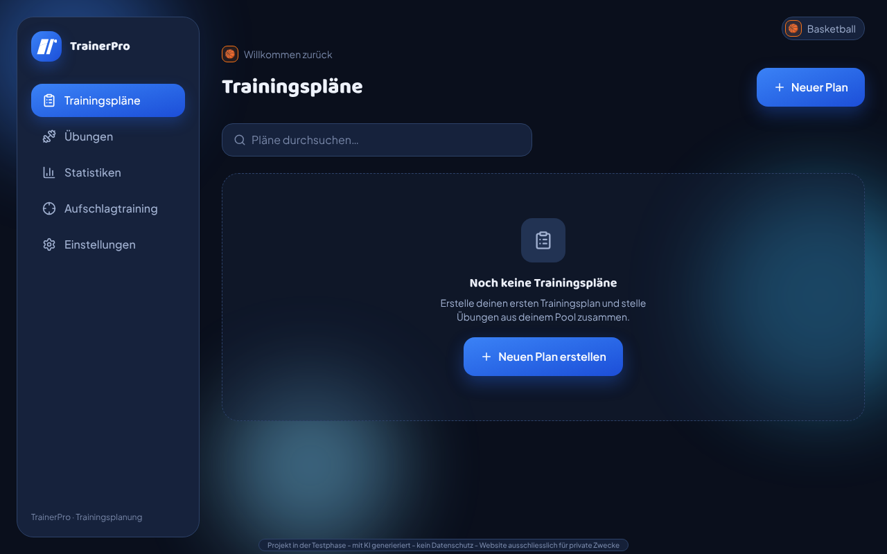

# C2a – Sporticon am Desktop oben rechts

**Phase:** Flowstate A · **Branch:** `phase-1` · **Datum:** 15.11.2026 · **Status:** ✅ umgesetzt
**Bezug:** Nachbesserung zu [C2](C2.md)

## Anforderung

> Das Sporticon soll (am Desktop) oben rechts erscheinen und nicht unter dem Logo.

In C2 war abgestimmt, dass am Desktop die farbliche Umrandung in der Sidebar unter dem Logo reicht.
Nach der Sichtung wurde das geändert: Das Sporticon sitzt jetzt **auf allen Geräten oben rechts**.

## Zusammenfassung

- Neue Komponente **`SportPill`** (Sporticon mit farbiger Umrandung + Name). Sie wird von der Handy-Kopfzeile
  und der neuen Desktop-Kopfzeile gemeinsam genutzt, damit beide gleich aussehen.
- **Desktop:** Neue Kopfzeile in `AppShell` mit der `SportPill` rechtsbündig, auf die Inhaltsbreite ausgerichtet.
  Der obere Abstand des Inhalts wurde von `pt-8` auf `pt-2` reduziert, damit die Seite nicht nach unten rutscht.
- **Sidebar:** Die Sportart-Zeile unter dem Logo „TrainerPro“ wurde entfernt.
- **Kleine Ergänzung:** Ein Klick auf die Sportart oben rechts öffnet die Einstellungen zum Wechseln der Sportart
  (Handy und Desktop).

## Geänderte Dateien

| Datei | Änderung |
|-------|----------|
| `src/components/SportPill.tsx` | **neu** – Sportart-Anzeige oben rechts (Link zu den Einstellungen) |
| `src/components/AppShell.tsx` | Desktop-Kopfzeile mit `SportPill`; oberer Abstand angepasst |
| `src/components/MobileTopBar.tsx` | Nutzt jetzt `SportPill` statt eigenem Markup |
| `src/components/Sidebar.tsx` | Sportart-Zeile unter dem Logo entfernt |

## Tests

- `npm run build` ✅ und `npm run lint` ✅ (nur die zwei schon vorher bestehenden Warnungen)
- Im Browser (Playwright) geprüft:
  - Desktop (1280 px): genau eine sichtbare Sportart-Anzeige, oben rechts (x ≈ 1128, y = 24) ✅
  - Sidebar zeigt die Sportart nicht mehr ✅
  - Klick auf die Anzeige öffnet `/einstellungen` ✅
  - Handy (390 px): Anzeige unverändert oben rechts, genau eine sichtbar ✅

