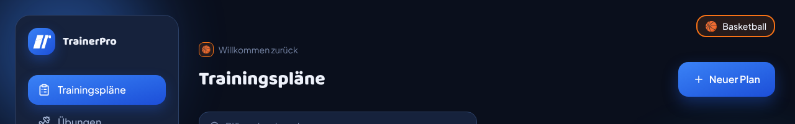
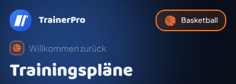

# C2b – Farbige Umrandung um die gesamte Sportart-Anzeige

**Phase:** Flowstate A · **Branch:** `phase-1` · **Datum:** 15.11.2026 · **Status:** ✅ umgesetzt
**Bezug:** Nachbesserung zu [C2](C2.md) und [C2a](C2a.md)

## Anforderung

> Nicht das Icon farblich umranden, sondern das gesamte Sporticon an sich.

Bisher (C2/C2a) hatte oben rechts nur das kleine Emoji-Kästchen einen farbigen Rahmen. Die Anzeige selbst
hatte einen neutralen grauen Rahmen.

## Zusammenfassung

- Die **gesamte Sportart-Anzeige oben rechts** (Symbol + Name) hat jetzt einen **2 px breiten Rahmen in der
  Sportfarbe** und einen leicht getönten Hintergrund (≈ 12 % der Sportfarbe), z. B. orange bei Basketball.
- Das Emoji steht ohne eigenes Kästchen in der Anzeige. Eine doppelte Umrandung entfällt damit.
- Der Name wird jetzt in heller Schrift (`text-ink`, halbfett) statt grau angezeigt, damit er auf dem
  getönten Hintergrund gut lesbar bleibt.
- Gilt für Handy und Desktop gleichermaßen, da beide `SportPill` nutzen.
- **Nicht geändert:** Die kleineren Sporticons an anderen Stellen („Willkommen zurück“, Statistik-Kachel,
  Auswahl-Chips in den Einstellungen) behalten die Kästchen-Umrandung aus C2 (`SportBadge`).

## Geänderte Dateien

| Datei | Änderung |
|-------|----------|
| `src/components/SportPill.tsx` | Rahmen/Hintergrund in Sportfarbe auf der ganzen Anzeige; Emoji ohne eigenes Kästchen |

## Tests

- `npm run build` ✅ und `npm run lint` ✅ (nur die zwei schon vorher bestehenden Warnungen)
- Im Browser (Playwright) geprüft: Rahmen der Anzeige bei Basketball `rgb(249, 115, 22)` / 2 px auf
  Desktop und Handy ✅, keine Laufzeitfehler ✅

| Desktop | Handy |
|---|---|
|  |  |
