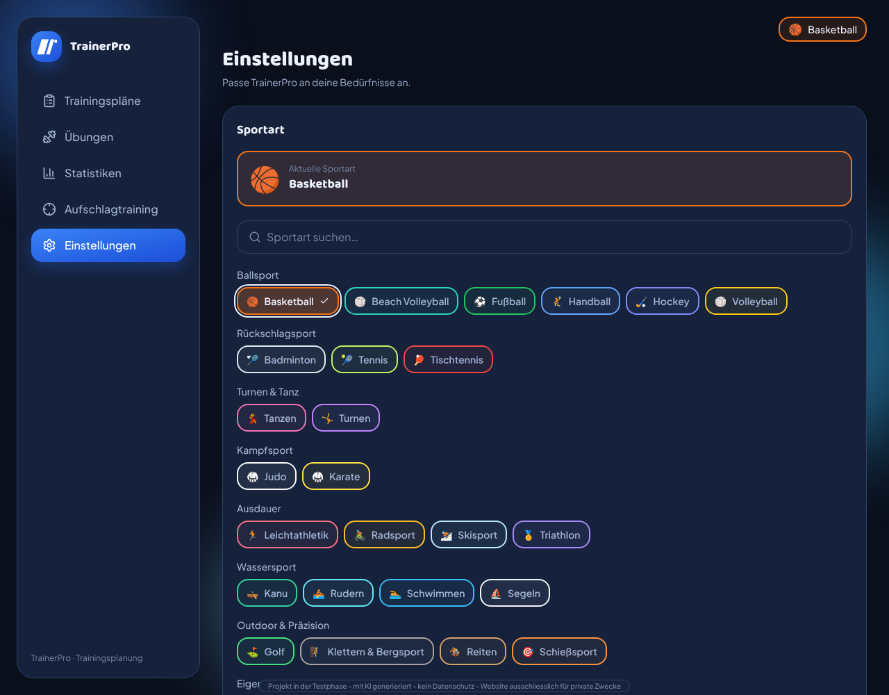

# C2c – Farbige Umrandung der ganzen Elemente im Sportart-Auswahlbereich

**Phase:** Flowstate A · **Branch:** `phase-1` · **Datum:** 15.11.2026 · **Status:** ✅ umgesetzt
**Bezug:** Nachbesserung zu [C2](C2.md), überträgt [C2b](C2b.md) auf die Einstellungen

## Anforderung

> Mach dies (die Umrandung des gesamten Sporticons wie in C2b) jetzt auch für den Bereich, in dem man die Sportart auswählt.

## Zusammenfassung

Im Bereich **Einstellungen → Sportart** ist jetzt überall das **ganze Element** in der Sportfarbe umrandet (2 px)
und leicht getönt, statt nur ein kleines Emoji-Kästchen:

| Element | Vorher (C2) | Jetzt (C2c) |
|---------|-------------|-------------|
| Karte „Aktuelle Sportart“ | grauer Rahmen, Emoji im farbigen Kästchen | ganze Karte in Sportfarbe umrandet und getönt, großes Emoji ohne Kästchen |
| Auswahl-Chips (alle 25 + eigene) | grauer Rahmen, Emoji im farbigen Kästchen | ganzer Chip in Sportfarbe umrandet, Emoji ohne Kästchen |
| Ausgewählter Chip | blauer Verlauf | stärker getönt in Sportfarbe + weißer Ring + Häkchen |
| Vorschau „Neue Sportart“ | Emoji im Kästchen | ganze Vorschau in gewählter Farbe umrandet |
| Dialog „Sportart anpassen“ | Emoji im Kästchen | ganze Vorschau in gewählter Farbe umrandet |

**Ausgewählter Chip:** Der bisherige blaue Verlauf hätte die Sportfarbe überdeckt. Die Auswahl ist jetzt an drei
Merkmalen erkennbar: stärkere Tönung (≈ 25 % statt ≈ 6 %), weißer Ring und Häkchen. So hängt die Erkennbarkeit
nicht allein an der Farbe.

**Technik:** Der Rahmen-Stil liegt jetzt zentral in `sportFrameStyle()` (`src/lib/sportStyle.ts`). Ihn nutzen die
Anzeige oben rechts (`SportPill`, C2b) und der Auswahlbereich. Beide sehen dadurch garantiert gleich aus.

**Nicht geändert:** „Willkommen zurück“ (Pläne) und die Kachel „Sportart“ (Statistiken) nutzen weiterhin `SportBadge`
aus C2, weil sie nicht zum Auswahlbereich gehören.

## Geänderte Dateien

| Datei | Änderung |
|-------|----------|
| `src/lib/sportStyle.ts` | **neu** – `sportFrameStyle(color, tint)` für Rahmen + Tönung in Sportfarbe |
| `src/components/SportPicker.tsx` | Karte, Chips, Vorschau und Dialog mit Umrandung des ganzen Elements; neuer Auswahl-Stil |
| `src/components/SportPill.tsx` | Nutzt jetzt den gemeinsamen Helfer (Aussehen unverändert) |

## Tests

- `npm run build` ✅ und `npm run lint` ✅ (nur die zwei schon vorher bestehenden Warnungen)
- Im Browser (Playwright) geprüft:
  - Chip-Rahmen Basketball `rgb(249, 115, 22)`, Tischtennis `rgb(239, 68, 68)` ✅
  - Karte „Aktuelle Sportart“ wechselt beim Auswählen die Rahmenfarbe (orange → rot), Anzeige oben rechts zieht mit ✅
  - Abgewählter Chip verliert Ring und starke Tönung (nach der 150-ms-Übergangsanimation) ✅
  - Eigene Sportart (Floorball, Pink) mit Bearbeiten-/Löschen-Buttons im umrandeten Chip ✅

