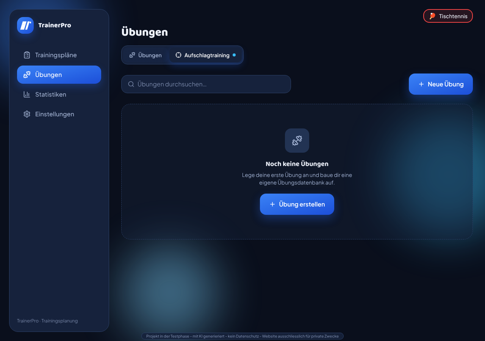
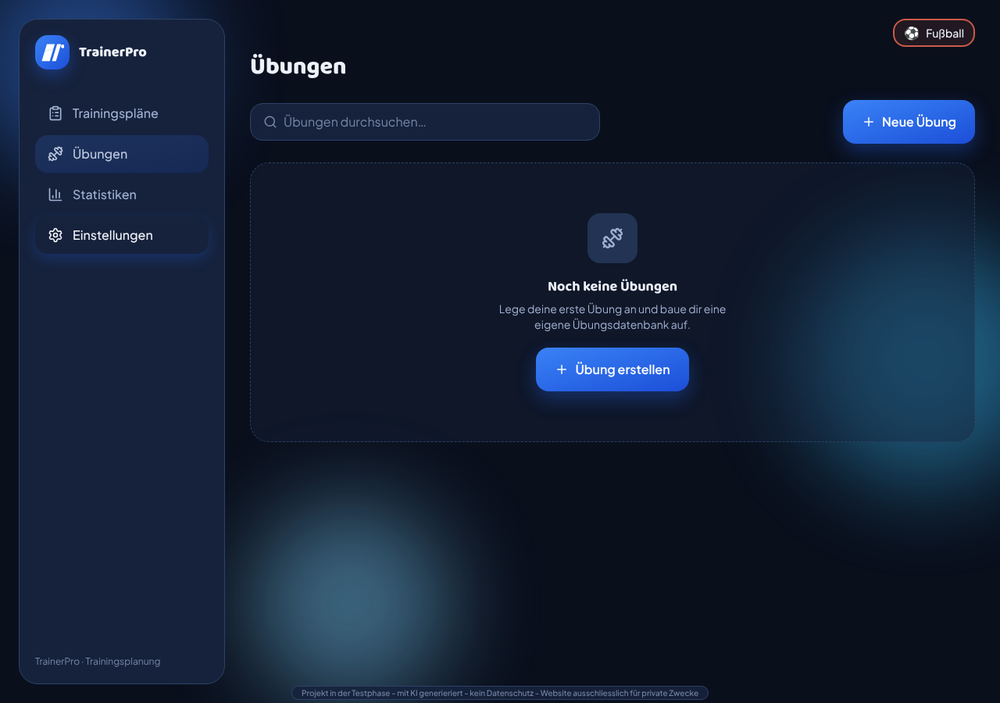
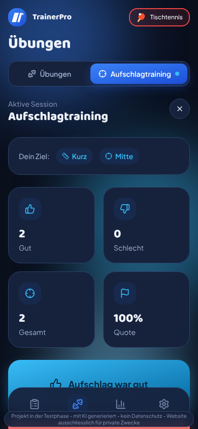

# C3 – Aufschlagtraining nur noch für Tischtennis (im Übungsbereich)

**Phase:** Flowstate A · **Branch:** `phase-1` · **Datum:** 15.11.2026 · **Status:** ✅ umgesetzt

## Anforderung

> Das Menü für das Aufschlagtraining soll nur noch für die Sportart Tischtennis zugänglich sein und in den
> Übungsbereich verlegt werden.

**Abstimmung im Team (vor der Umsetzung):**
- Darstellung als **Reiter** im Übungsbereich.
- Bei anderen Sportarten wird das Aufschlagtraining **komplett ausgeblendet** (kein ausgegrauter Hinweis).

## Zusammenfassung

- Der eigene Menüpunkt **„Aufschlagtraining“ wurde aus der Hauptnavigation entfernt** (Sidebar und untere
  Leiste am Handy, die jetzt 4 statt 5 Symbole hat).
- Der Übungsbereich hat bei **Tischtennis** oben zwei Reiter: **„Übungen | Aufschlagtraining“**.
  Bei allen anderen Sportarten gibt es keine Reiterleiste, und die Seite sieht aus wie bisher.
- Läuft gerade eine Aufschlag-Session, zeigt ein **kleiner Punkt am Reiter** das an.
- Der Zugang ist **nicht nur optisch ausgeblendet, sondern gesperrt**:

| Aufruf | Tischtennis | andere Sportart |
|--------|-------------|-----------------|
| Reiter „Aufschlagtraining“ | sichtbar | ausgeblendet |
| `/uebungen/aufschlagtraining` (direkt / Lesezeichen) | öffnet Aufschlagtraining | Weiterleitung nach `/uebungen` |
| `/aufschlagtraining` (alte Adresse) | Weiterleitung nach `/uebungen/aufschlagtraining` | Weiterleitung nach `/uebungen` |

- **Keine Daten gehen verloren:** Gespeicherte Sessions (`trainerpro:serveSessions`), auch eine gerade laufende,
  bleiben beim Wechsel der Sportart erhalten. Nach dem Zurückwechseln zu Tischtennis lässt sich die laufende
  Session direkt fortsetzen.
- Die Prüfung erfolgt über die **feste ID `tischtennis`** (`hasServeTraining()` in `src/lib/sport.ts`), nicht über
  den Namen.

## Einheitliches Design

- Der aktive Reiter nutzt **denselben Stil wie die Hauptnavigation** (blauer Verlauf mit Schatten), inaktive Reiter
  denselben Hover-Stil. Die Reiterleiste hat denselben Rahmen und dieselbe Fläche wie Suchfeld und Karten
  (`border-border`, `bg-surface`, abgerundet).
- Die Seitenüberschrift **„Übungen“ (h1)** steht jetzt einmal oben im Layout, für beide Reiter gleich.
  Die bisherigen h1-Überschriften im Aufschlagtraining („Aufschlagtraining“, „Ziel festlegen“) sind zu
  **Abschnittsüberschriften (h2, etwas kleiner)** geworden. So gibt es pro Seite nur eine Hauptüberschrift, was
  auch für Screenreader richtig ist.
- Im Reiter „Übungen“ stehen **Suche und „Neue Übung“ in einer gemeinsamen Werkzeugzeile**. Am Handy steht der
  Button über der Suche.
- Inhalt und Ablauf des Aufschlagtrainings (Ziel → aktive Session → Ergebnis) sind **unverändert**.

## Hinweis für C5

Das Aufschlagtraining gehört fest zu Tischtennis und braucht deshalb keine eigene Sportart-Zuordnung. In C5 muss
nur die Übungsliste im Reiter „Übungen“ nach Sportart gefiltert werden. Der Reiter-Aufbau bleibt unberührt.

## Geänderte Dateien

| Datei | Änderung |
|-------|----------|
| `src/pages/ExercisesLayout.tsx` | **neu** – Überschrift „Übungen“ + Reiterleiste (nur bei Tischtennis) + Outlet |
| `src/components/RouteGuards.tsx` | **neu:** `ServeTrainingGuard` – leitet bei anderen Sportarten nach `/uebungen` um |
| `src/App.tsx` | Verschachtelte Routen `/uebungen` und `/uebungen/aufschlagtraining`; `/aufschlagtraining` leitet weiter |
| `src/lib/sport.ts` | `SERVE_TRAINING_SPORT_ID`, `hasServeTraining()` |
| `src/lib/nav.ts` | Menüpunkt „Aufschlagtraining“ entfernt |
| `src/pages/Exercises.tsx` | Überschrift ins Layout verschoben; Werkzeugzeile mit Suche + „Neue Übung“ |
| `src/pages/ServeTraining.tsx` | h1 → h2 in allen vier Phasen-Ansichten |

## Tests

- `npm run build` ✅ und `npm run lint` ✅ (nur die zwei schon vorher bestehenden Warnungen)
- Im Browser (Playwright) geprüft:
  - Hauptnavigation: Trainingspläne, Übungen, Statistiken, Einstellungen (ohne Aufschlagtraining) ✅
  - Tischtennis: alte Adresse `/aufschlagtraining` → `/uebungen/aufschlagtraining`, Reiter „Übungen | Aufschlagtraining“, „Übungen“ in der Hauptnavigation aktiv ✅
  - Session starten, 2× „Gut“ → laufende Session gespeichert, Punkt am Reiter sichtbar ✅
  - Wechsel zum Reiter „Übungen“ und zurück → Session läuft weiter ✅
  - Wechsel zu Fußball → keine Reiter; `/uebungen/aufschlagtraining` und `/aufschlagtraining` leiten nach `/uebungen` um ✅
  - Session bleibt dabei gespeichert (2 Versuche, nicht beendet) ✅
  - Zurück zu Tischtennis → laufende Session kann fortgesetzt werden ✅
  - Handy: untere Navigation mit 4 Symbolen ✅

| Tischtennis – Reiter „Übungen“ | Fußball – ohne Reiter |
|---|---|
|  |  |

