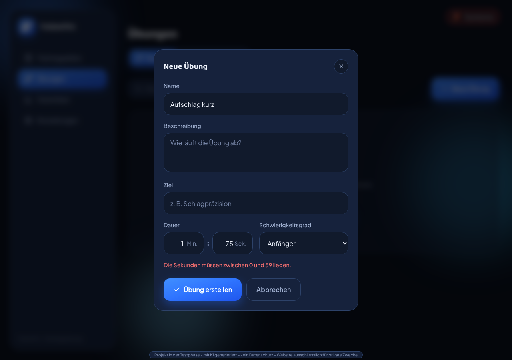

# C4 – Sekundengenaue Übungsdauer

**Phase:** Flowstate A · **Branch:** `phase-1` · **Datum:** 15.11.2026 · **Status:** ✅ umgesetzt

## Anforderung

> Die Dauer von Übungen soll nun auch auf die Sekunde genau eingestellt werden können.

**Abstimmung im Team (vor der Umsetzung):**
- Anzeige in **Uhrform** (z. B. „1:30 Min.“).
- **Höchstdauer 3 Stunden** pro Übung.

## Zusammenfassung

- Übungen speichern ihre Dauer jetzt in **ganzen Sekunden** (`durationSeconds`) statt in ganzen Minuten
  (`durationMinutes`). Ganze Zahlen statt Kommaminuten vermeiden Rundungsfehler beim Aufsummieren.
- Das Übungsformular hat zwei Felder **„Min. : Sek.“**. Am Handy öffnet sich die Zahlentastatur.
- **Einheitliche Uhrform überall:** Übungskarte, Plankarte, Planformular, Plandetail, Statistik und Timer.
- **Bestehende Übungen werden automatisch umgerechnet** (Minuten × 60). Es geht nichts verloren.

### Anzeigeformat (Uhrform)

| Dauer | vorher | jetzt |
|-------|--------|-------|
| 45 Sekunden | – (nicht möglich) | `0:45 Min.` |
| 1 Min. 30 Sek. | – (nicht möglich) | `1:30 Min.` |
| 15 Minuten | `15 Min.` | `15:00 Min.` |
| 65 Minuten | `1 Std. 5 Min.` | `1:05:00 Std.` |
| Timer bei 65 Min. | `65:00` | `1:05:00` |

### Eingaberegeln

| Eingabe | Ergebnis |
|---------|----------|
| `1` : `30` | ✅ 1:30 Min. |
| leer : `45` | ✅ 0:45 Min. (leeres Feld = 0) |
| `180` : `00` | ✅ 3:00:00 Std. (Maximum) |
| `0` : `0` | ❌ „Die Dauer muss größer als 0:00 Min. sein.“ |
| `1` : `75` | ❌ „Die Sekunden müssen zwischen 0 und 59 liegen.“ |
| `181` : `00` | ❌ „Die Dauer darf höchstens 3:00:00 Std. betragen.“ |
| `1,5` / `1.5` / `abc` / `-3` | ❌ „Bitte gib für Minuten und Sekunden nur ganze Zahlen ein.“ |
| Sekunden `5`, Feld verlassen | wird zu `05` ergänzt |

**Bewusste Entscheidung:** Ungültige Zeichen werden **nicht still entfernt**. Aus „1,5“ (gemeint: 1,5 Minuten)
würde sonst unbemerkt „15“ Minuten. Stattdessen erscheint eine klare Fehlermeldung.

## Rechengenauigkeit

- Plan-Gesamtdauer und Statistik-Durchschnitt werden **erst in Sekunden aufsummiert und dann einmal formatiert
  bzw. gerundet**. Es wird nicht pro Übung gerundet.
- Beispiel aus dem Test: 15:00 + 1:30 + 0:45 = **17:15 Min.**; Durchschnitt aus 17:15 und 65:00 = 41:07,5, gerundet
  **41:08 Min.**

## Speicherung & Migration

| Feld | Inhalt |
|------|--------|
| `durationSeconds` | **neu** – Dauer in ganzen Sekunden |
| `durationMinutes` | **alt** – wird beim Laden in Sekunden umgerechnet und beim nächsten Speichern nicht mehr geschrieben |

`migrateDurationSeconds()` geht in dieser Reihenfolge vor:
1. Ein gültiges `durationSeconds` wird übernommen.
2. Sonst wird `durationMinutes × 60` berechnet.
3. Sonst gilt der Standardwert 15:00 Min.

Ist der gespeicherte Übungs-Eintrag beschädigt (keine Liste), startet die App mit einer leeren Liste statt
abzustürzen. Bestehende Werte über 3 Std. werden nicht gekürzt (keine stillen Datenänderungen). Die Grenze gilt
nur bei der Eingabe.

## Einheitliches Design

- Die Felder „Min.“ und „Sek.“ nutzen dieselbe Eingabe-Klasse (`inputClass`) wie alle anderen Formularfelder.
  Die Einheit steht grau im Feld, und ein „:“ trennt die Felder wie bei einer Uhr.
- Fehlermeldungen erscheinen in der App-eigenen roten Meldungszeile. Die Browser-eigene Sprechblase ist
  abgeschaltet (`noValidate`), wie schon beim Sportart-Formular aus C1.
- Am Handy stehen „Dauer“ und „Schwierigkeitsgrad“ untereinander, ab Tablet-Breite wie bisher nebeneinander.

## Geänderte Dateien

| Datei | Änderung |
|-------|----------|
| `src/types.ts` | `Exercise.durationMinutes` → `durationSeconds` |
| `src/lib/time.ts` | `formatDuration()` in Uhrform (Sekunden), `formatCountdown()` mit Stunden, neu: `MAX_DURATION_SECONDS`, `DEFAULT_DURATION_SECONDS`, `splitSeconds()`, `parseDurationInput()`, `migrateDurationSeconds()` |
| `src/context/AppDataContext.tsx` | Migration der gespeicherten Übungen beim Laden |
| `src/components/ExerciseFormModal.tsx` | Zwei Felder Min./Sek., Prüfung, `noValidate` |
| `src/components/Timer.tsx` | Startet mit exakten Sekunden; Gesamtdauer in Uhrform |
| `src/lib/stats.ts` | Durchschnitt in Sekunden |
| `src/components/ExerciseCard.tsx`, `PlanCard.tsx`, `src/pages/PlanDetail.tsx`, `PlanForm.tsx`, `Statistics.tsx` | Anzeige/Summen auf Sekunden umgestellt |

## Tests

- `npm run build` ✅ und `npm run lint` ✅ (nur die zwei schon vorher bestehenden Warnungen)
- **20 Funktionsprüfungen** für `formatDuration`, `formatCountdown`, `parseDurationInput` und
  `migrateDurationSeconds` (alle Fälle aus den Tabellen oben) ✅
- Im Browser (Playwright, Desktop + Handy) geprüft:
  - Alte Übung mit `durationMinutes: 15` → `durationSeconds: 900`, Anzeige „15:00 Min.“ ✅
  - Alle ungültigen Eingaben zeigen die passende Meldung im App-Design ✅
  - Neue Übung 1:30 → Karte „1:30 Min.“; beim Bearbeiten stehen wieder „1“ und „30“ in den Feldern ✅
  - Plan mit 15:00 + 1:30 + 0:45 → „17:15 Min. gesamt“; Plan mit 65 Min. → „1:05:00 Std.“ ✅
  - Timer der 1:30-Übung startet bei „01:30“, Gesamtdauer „1:30 Min.“ ✅
  - Statistik Ø Trainingsdauer „41:08 Min.“ ✅

| Formular (Handy) | Plan (Handy) | Timer (Handy) |
|---|---|---|
|  |  |  |

