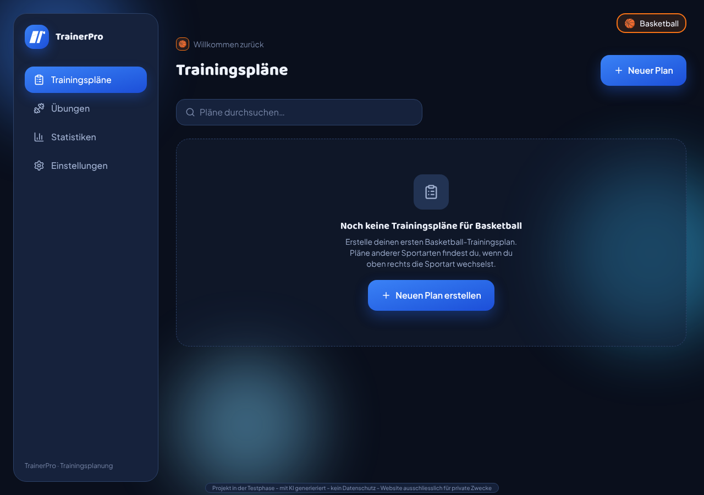
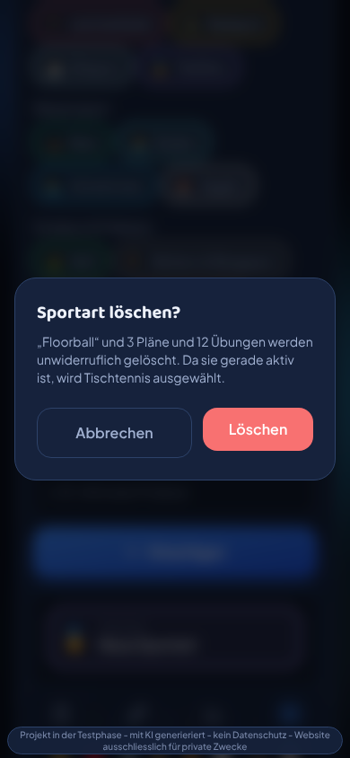
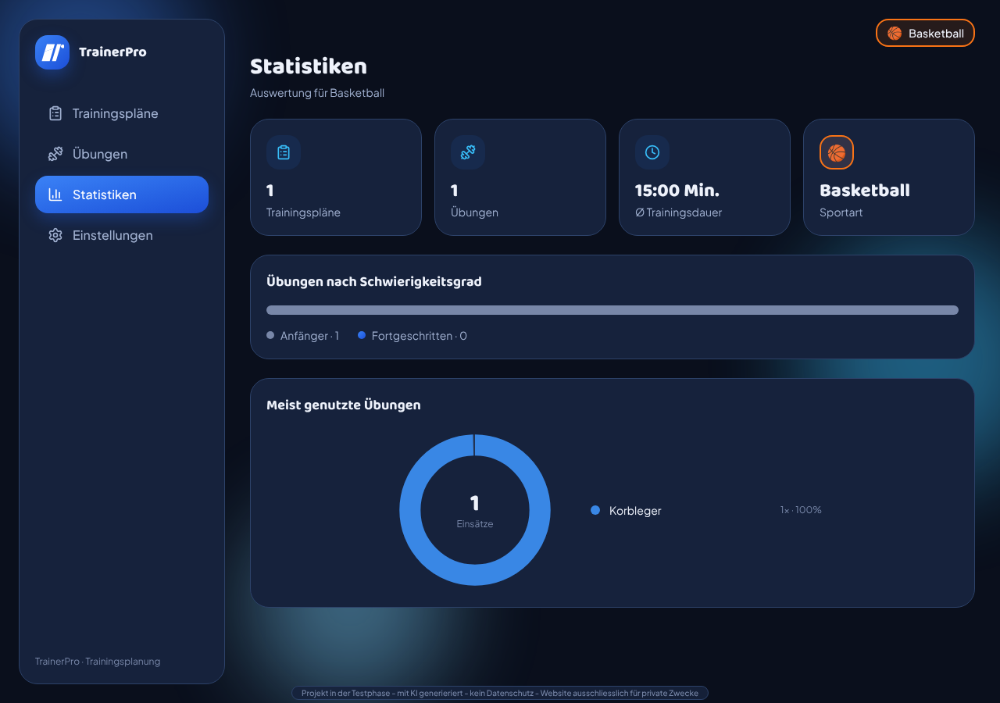

# C5 – Übungen und Pläne je Sportart getrennt

**Phase:** Flowstate A · **Branch:** `phase-1` · **Datum:** 15.11.2026 · **Status:** ✅ umgesetzt

## Anforderung

> Für jede Sportart sollen die Übungen und die Pläne getrennt voneinander gespeichert und dargestellt werden.
> Beispiel: Keine Pläne vom Tanzen, wenn Schwimmen ausgewählt ist.

**Abstimmung im Team (vor der Umsetzung):**
- Bestehende Pläne und Übungen werden **Tischtennis** zugeordnet.
- Beim Löschen einer eigenen Sportart werden ihre Pläne und Übungen **nach Warnung mitgelöscht**.

## Zusammenfassung

- Jeder Plan und jede Übung hat jetzt eine **Sportart (`sportId`)**, also die feste ID aus C1, nicht den Namen.
- Angezeigt werden **nur Pläne und Übungen der aktiven Sportart**. Das gilt überall:
  Pläne-Übersicht, Plandetail, Planformular inkl. Übungspool, Übungen, Statistiken und Timer.
- **Neue** Pläne und Übungen gehören automatisch zur aktiven Sportart. Beim **Bearbeiten** bleibt die Sportart
  immer erhalten.
- Ein Plan kann **nur Übungen seiner eigenen Sportart** enthalten. Der Übungspool zeigt nur passende Übungen,
  und fremde Übungs-IDs werden beim Speichern zusätzlich herausgefiltert.
- **Leere Zustände nennen die Sportart** („Noch keine Trainingspläne für Basketball“, inkl. Hinweis auf den
  Sportartwechsel oben rechts). So wirkt eine leere Liste nach dem Wechsel nicht wie Datenverlust.
- Die **Statistiken** zeigen unter der Überschrift „Auswertung für <Sportart>“.
- Das **Aufschlagtraining** bleibt unverändert. Es gehört seit C3 fest zu Tischtennis.

## Architektur: zentrale Filterung

Die Trennung passiert **an einer einzigen Stelle**, in `AppDataContext`:
- Im State liegen weiterhin **alle** Pläne und Übungen aller Sportarten (ein gemeinsamer Speicher).
- `useAppData().plans` / `.exercises` liefern **nur die der aktiven Sportart**.
- `getPlan()` / `getExercise()` finden ebenfalls nur Einträge der aktiven Sportart.

Dadurch muss keine Seite selbst filtern, und keine kann es vergessen. Auch künftige Seiten sind automatisch getrennt.

## Direkte Aufrufe und Sportwechsel

| Aufruf | Verhalten |
|--------|-----------|
| `/plaene/<id>` eines Plans einer **anderen** Sportart (Lesezeichen, Zurück-Button) | Weiterleitung zur Pläne-Übersicht |
| `/plaene/<id>/bearbeiten` eines Plans einer anderen Sportart | Weiterleitung zur Pläne-Übersicht |
| `/plaene/<id>` eines **nicht existierenden** Plans | unverändert: Hinweis „Plan nicht gefunden“ |
| `/plaene/<id>/bearbeiten` eines nicht existierenden Plans | Weiterleitung zur Pläne-Übersicht (vorher: leeres „Neuer Plan“-Formular, das einen neuen Plan angelegt hätte) |

## Löschen einer eigenen Sportart

Der Bestätigungsdialog nennt, was mitgelöscht wird, z. B.:
> „Floorball“ und 3 Pläne und 12 Übungen werden unwiderruflich gelöscht. Da sie gerade aktiv ist, wird Tischtennis ausgewählt.

Ohne zugehörige Daten bleibt der bisherige Text („… wird aus deiner Liste entfernt.“). Erst werden die Daten
gelöscht, dann die Sportart. So bleiben **keine unsichtbaren, verwaisten Einträge** im Speicher zurück.
Der offene Hinweis aus C1 im Code (`removeCustomSport`) ist damit erledigt.

## Speicherung & Migration

| Feld | Inhalt |
|------|--------|
| `plans[].sportId` | **neu** – Sportart des Plans |
| `exercises[].sportId` | **neu** – Sportart der Übung |

Einträge ohne gültige `sportId` (Stand vor C5) werden beim Laden **Tischtennis** zugeordnet (`migrateSportId()`).
Das passiert unabhängig davon, welche Sportart gerade aktiv ist: Im Test war Basketball aktiv, und die Altdaten
landeten trotzdem korrekt bei Tischtennis. Beschädigte Plan-Daten (keine Liste) führen zu einer leeren Liste
statt zum Absturz.

## Nebenbei behobener Fehler (bestand schon vor C5)

Wechselte man direkt von „Neuer Plan“ (`/plaene/neu`) zu „Plan bearbeiten“, verwendete React dieselbe
Formular-Instanz weiter. Die **leeren Felder des neuen Plans hätten beim Speichern Zielgruppe und Übungen des
bestehenden Plans überschrieben**. Jetzt wird das Formular pro Plan neu aufgebaut (`key`). Entdeckt im C5-Test.

## Einheitliches Design

Es gibt keine neuen Bausteine. Leere Zustände, Bestätigungsdialog und die Unterzeile in den Statistiken nutzen die
vorhandenen Komponenten und Stile (`EmptyState`, `ConfirmDialog`, Unterzeile wie in den Einstellungen).

## Geänderte Dateien

| Datei | Änderung |
|-------|----------|
| `src/types.ts` | `sportId` an `Exercise` und `TrainingPlan`; nicht Teil von `ExerciseInput`/`PlanInput` |
| `src/lib/sport.ts` | `LEGACY_DATA_SPORT_ID`, `migrateSportId()` |
| `src/context/AppDataContext.tsx` | Zentrale Filterung, Migration, `sportId` beim Anlegen/Bearbeiten, neu: `getPlanSportId`, `countSportData`, `deleteSportData` |
| `src/components/SportPicker.tsx` | Löschdialog mit Anzahl, Daten werden mitgelöscht |
| `src/context/SportContext.tsx` | C1-Hinweis als erledigt kommentiert |
| `src/pages/PlanDetail.tsx` | Weiterleitung bei Plänen anderer Sportarten |
| `src/pages/PlanForm.tsx` | Schutz vor dem Formular + `key` je Plan |
| `src/pages/PlansOverview.tsx`, `Exercises.tsx`, `Statistics.tsx` | Sportart in leeren Zuständen bzw. Unterzeile |

## Tests

- `npm run build` ✅ und `npm run lint` ✅ (nur die zwei schon vorher bestehenden Warnungen)
- Im Browser (Playwright, Desktop + Handy) geprüft:
  - Altdaten ohne `sportId` → alle `tischtennis`, obwohl Basketball aktiv war ✅
  - Basketball: „Noch keine Trainingspläne für Basketball“ / „Noch keine Übungen für Basketball“ ✅
  - Übungspool eines Basketball-Plans enthält keine Tischtennis-Übung ✅
  - Neuer Basketball-Plan wird mit `sportId: basketball` gespeichert ✅
  - Statistik bei Basketball zählt 1 Plan / 1 Übung (nicht die Tischtennis-Daten) ✅
  - `/plaene/tp` und `/plaene/tp/bearbeiten` (Tischtennis-Plan) bei Basketball → `/plaene` ✅
  - `/plaene/gibtsnicht` → Hinweis „Plan nicht gefunden“ ✅
  - Bei Tischtennis: nur der Tischtennis-Plan sichtbar, Basketball-Plan-Adresse → `/plaene` ✅
  - Tischtennis-Plan bearbeiten → `sportId`, Zielgruppe und Übungen bleiben erhalten ✅
  - Direkter Wechsel „Neuer Plan“ → „Bearbeiten“ zeigt die richtigen Werte des Plans ✅
  - Floorball mit 1 Plan + 2 Übungen löschen → Dialog nennt beides; danach nur noch Basketball- und Tischtennis-Daten im Speicher, Tischtennis aktiv ✅

| Basketball – leere Pläne | Löschdialog (Handy) |
|---|---|
|  |  |

