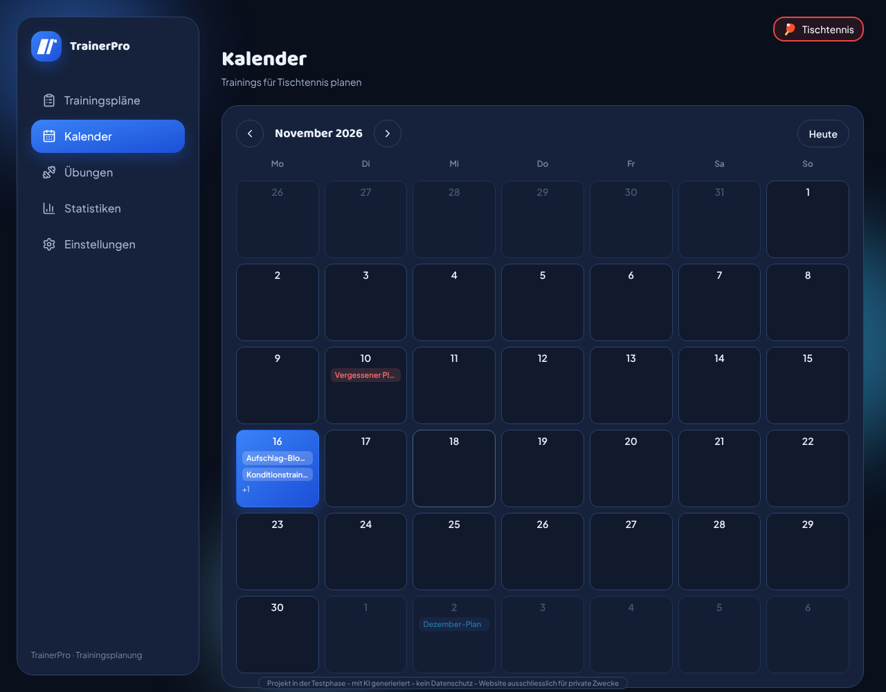
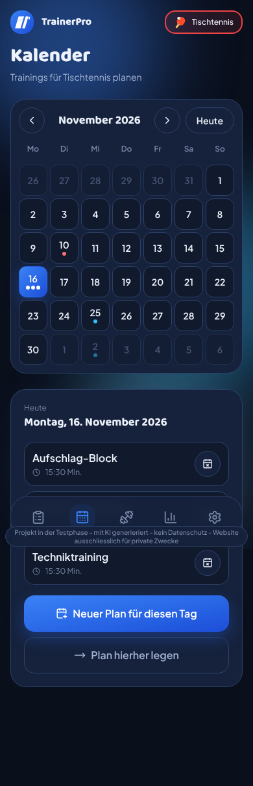
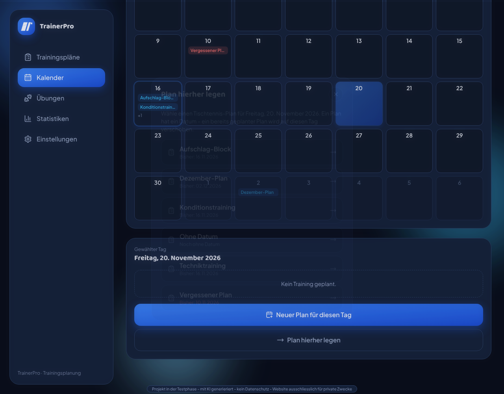

# C6 – Kalendertool (Monatsansicht)

**Phase:** Flowstate B · **Branch:** `phase-1` · **Datum:** 16.11.2026 · **Status:** ✅ umgesetzt

> **Hinweis:** „Überfällig“, die Menü-Position und das Kalender-Design wurden in [C6a](C6a.md) überarbeitet.

## Anforderung

> Ein Kalendertool wird in die Menüleiste mit aufgenommen, um Trainings konkret zu planen. → Monatsansicht

**Abstimmung im Team (vor der Umsetzung):**
- Im Kalender gibt es beide Wege: **neuen Plan für einen Tag anlegen** und **vorhandenen Plan auf einen Tag legen**.
  Bis C7 hat ein Plan genau ein Datum, „hierher legen“ verschiebt ihn also.
- Der Kalender zeigt **nur die Pläne der aktiven Sportart**, passend zur Trennung aus C5.

## Zusammenfassung

- Neuer Menüpunkt **„Kalender“** direkt nach „Trainingspläne“ (Sidebar und Handy-Leiste, dort wieder 5 Symbole).
- **Monatsansicht:**
  - Woche beginnt am Montag.
  - Immer 6 Wochen, damit die Höhe beim Blättern nicht springt.
  - Tage aus dem Vor- und Folgemonat sind gedimmt angedeutet.
  - Monatsnamen auf Deutsch, Pfeile zum Blättern und ein „Heute“-Button.
- **Termine = Pläne an ihrem Datum** (`plan.date`). Es gibt keine zweite Terminliste, Kalender und Plan können also nie
  voneinander abweichen.
- **Gewählter Tag:** Darunter (ab sehr breiten Bildschirmen daneben) stehen die Pläne des Tages mit Dauer, einem Link
  zum Plan und dem Button **„Datum entfernen“**. Dazu kommen die Aktionen:
  - **„Neuer Plan für diesen Tag“**: Das Planformular öffnet mit dem Datum schon eingetragen. „Zurück“ führt wieder in
    den Kalender.
  - **„Plan hierher legen“**: Ein Dialog listet alle Pläne der Sportart mit ihrem bisherigen Datum. Ein Klick verschiebt
    den Plan auf den gewählten Tag.
- Klick auf einen angedeuteten Tag aus dem Nachbarmonat wechselt in diesen Monat.

## Darstellung

| | Handy | Desktop |
|---|---|---|
| Tagesfeld | Tageszahl + bis zu 3 Punkte | Tageszahl + bis zu 2 Plannamen + „+n“ |
| Gewählter Tag | blauer Verlauf (wie aktive Navigation) | gleich |
| Heute | Ring in Primärfarbe | gleich |
| Überfällig (Datum vor heute) | roter Punkt | roter Planname (wie „Überfällig“ in der Plankarte) |

**Bedienbarkeit:** Jedes Tagesfeld ist ein Button mit vollständiger Ansage, z. B. „Montag, 16. November 2026,
3 Pläne, heute“ bzw. „…, 1 Plan, überfällig“. Der Monatstitel wird beim Blättern angesagt (`aria-live`).

## Zeitzonen-Fix (betraf auch bestehende Funktionen)

`new Date('2026-11-16')` liest der Browser als **UTC-Mitternacht**. In Zeitzonen westlich von UTC ergibt das lokal
den **15.11.** In Deutschland fiel das nicht auf. Im Kalender wäre ein Termin dort aber sichtbar einen Tag zu früh
einsortiert worden. Auch Plankarten hätten ein falsches Datum gezeigt.

**Lösung:** Neue Helfer in `src/lib/dateKey.ts`. Ein Kalendertag ist ein reiner Text `JJJJ-MM-TT` und wird nur über
`parseDateKey()` als lokales Datum gelesen. `isOverdue()` vergleicht jetzt Texte, `formatDate()` liest
zeitzonensicher. Im Test hätte die alte Methode in Los Angeles aus dem 16.11. den **15.11.2026** gemacht, jetzt
korrekt **16.11.2026**.

## Vorbereitung für C7

Die Termine eines Zeitraums berechnet allein `getCalendarEntries()` in `src/lib/calendar.ts`. C7 (Uhrzeit und
Wiederholungen) erweitert nur diese Funktion, die Kalenderseite bleibt dabei unverändert.

## Geänderte Dateien

| Datei | Änderung |
|-------|----------|
| `src/lib/dateKey.ts` | **neu** – `toDateKey`, `parseDateKey`, `todayKey`, `isDateKey` (zeitzonensicher) |
| `src/lib/calendar.ts` | **neu** – `getMonthGrid`, `getCalendarEntries`, `formatMonthTitle`, `formatLongDay`, `shiftMonth`, `WEEKDAY_LABELS` |
| `src/pages/Calendar.tsx` | **neu** – Kalenderseite mit Monatsraster, Tagesliste und Dialog „Plan hierher legen“ |
| `src/lib/nav.ts` | Menüpunkt „Kalender“ |
| `src/App.tsx` | Route `/kalender` |
| `src/pages/PlanForm.tsx` | Datum aus `?datum=JJJJ-MM-TT` vorbelegen (nur gültige Daten); „Zurück“ in den Kalender |
| `src/lib/time.ts` | `isOverdue()` und `formatDate()` zeitzonensicher |

## Tests

- `npm run build` ✅ und `npm run lint` ✅ (nur die zwei schon vorher bestehenden Warnungen)
- **17 Funktionsprüfungen** (Raster Nov. 2026 / Feb. 2027 / Schaltjahr 2028, Jahreswechsel, deutsche Titel,
  `isDateKey` inkl. 30. Februar, Gruppierung/Sortierung/Bereich der Termine), jeweils in den Zeitzonen
  **Berlin, Los Angeles und Auckland** ✅
- Im Browser (Playwright, **Zeitzone Los Angeles**, Datum fest auf 16.11.2026) geprüft:
  - Menü: Trainingspläne, Kalender, Übungen, Statistiken, Einstellungen; Handy-Leiste 5 Symbole ✅
  - 16.11. zeigt 3 Pläne + „heute“; 10.11. „überfällig“; Basketball-Plan (andere Sportart) erscheint nicht ✅
  - Klick auf 2.12. (Nachbarmonat) → Dezember; „Heute“ → zurück zu November ✅
  - „Plan hierher legen“: Liste mit bisherigem Datum; Plan auf 20.11. gelegt, Zielgruppe/Übungen bleiben erhalten ✅
  - „Datum entfernen“ → Plan ohne Datum, Tag leer ✅
  - „Neuer Plan für diesen Tag“ (25.11.) → Datum vorbelegt; „Zurück“ → Kalender; gespeichert mit 25.11. und Tischtennis ✅
  - Plankarte zeigt in Los Angeles 16.11.2026 (vorher 15.11.) ✅; überfälliger Plan rot markiert ✅
  - Ungültiges `?datum=2026-02-30` wird ignoriert ✅

| Handy | Dialog „Plan hierher legen“ |
|---|---|
|  |  |
