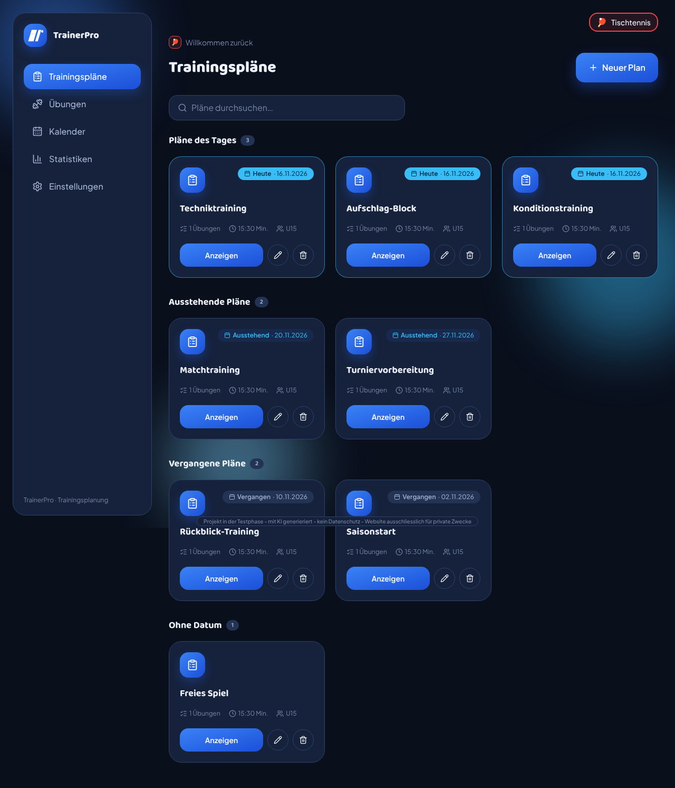
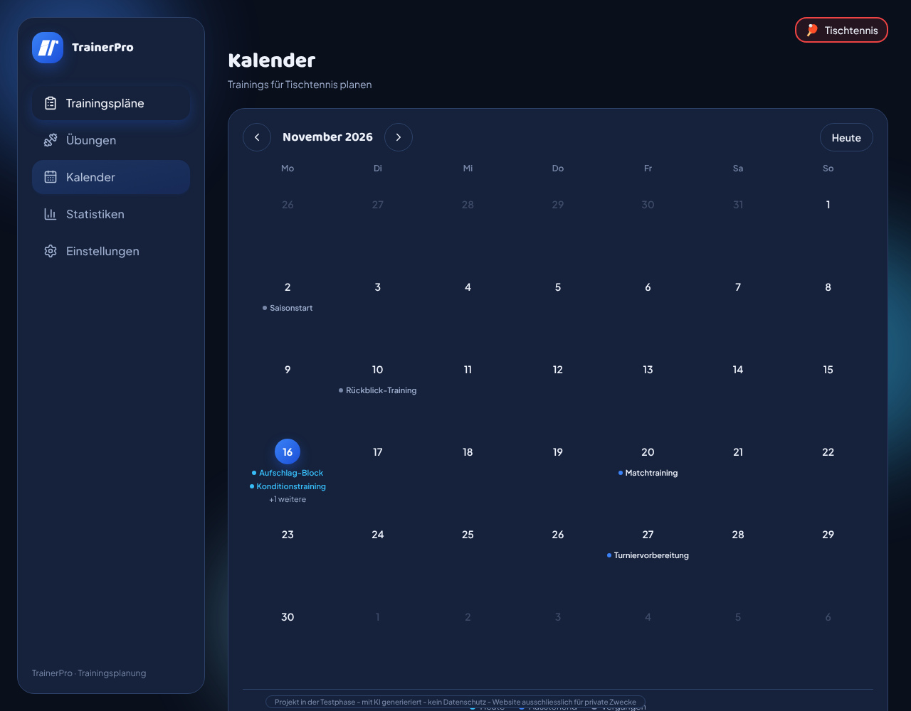
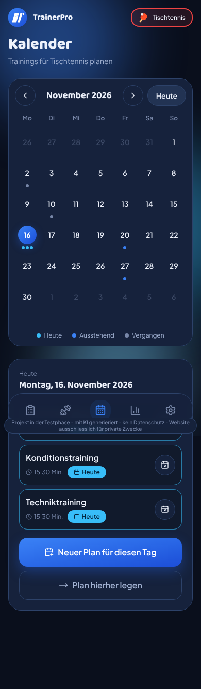

# C6a – Status „Heute / Ausstehend / Vergangen“, Menü-Position und Kalender-Design

**Phase:** Flowstate B · **Branch:** `phase-1` · **Datum:** 16.11.2026 · **Status:** ✅ umgesetzt
**Bezug:** Nachbesserung zu [C6](C6.md)

## Anforderung

> Abgelaufene Übungen sollen nicht mehr als „überfällig“ bezeichnet werden. Stattdessen gibt es ausstehende Übungen,
> vergangene Übungen und Übungen des Tages. Das Kalendertool soll rechts neben den Übungen in der Menüleiste stehen.
> Die Tage im Kalender sollen nur als Tage dargestellt und nicht extra umrandet werden.

Ein Datum haben in TrainerPro nur **Pläne**. Deshalb gelten die drei Zustände für Pläne, und zwar überall in der App
einheitlich: Pläne-Übersicht, Plankarte, Plandetail und Kalender.

## 1. Drei Zustände statt „Überfällig“

| Status | Bedeutung | Badge | Punkt im Kalender |
|--------|-----------|-------|-------------------|
| **Heute** | Plandatum = heute | kräftiges Akzent-Blau (wie der Akzent-Button) | Akzent-Blau |
| **Ausstehend** | Plandatum in der Zukunft | dunkles Blau mit hellblauer Schrift (wie die Ziel-Chips) | Primär-Blau |
| **Vergangen** | Plandatum in der Vergangenheit | neutral grau | Grau |

- **Vergangene Pläne sind nicht mehr rot.** Ein zurückliegendes Training ist kein Fehler. Rot steht in der App jetzt
  nur noch für Fehlermeldungen und Löschen.
- **Pläne des Tages** bekommen zusätzlich einen Akzent-Rahmen an der Karte, damit sie sofort auffallen.
- Alle Farbpaare sind geprüft: Badge-Text ≥ 4,5:1 (Heute 7,24 · Ausstehend 6,65 · Vergangen 5,84). Punkte ≥ 3:1
  (Heute 7,38 · Ausstehend 4,30 · Vergangen 4,39). Für graue Plannamen im Kalender wird das hellere `text-muted`
  verwendet, weil `text-muted-2` mit 4,39:1 für kleine Schrift zu knapp wäre.
- Farben, Texte und Reihenfolge liegen **zentral** in `src/lib/planStatus.ts`. Das Badge ist eine eigene Komponente
  (`PlanStatusBadge`). So sehen alle Stellen garantiert gleich aus.

### Pläne-Übersicht in Abschnitten

Die Übersicht ist jetzt gegliedert. Leere Abschnitte werden ausgeblendet, die Suche wirkt über alle Abschnitte:

1. **Pläne des Tages**
2. **Ausstehende Pläne**: nächster Termin zuerst
3. **Vergangene Pläne**: jüngster zuerst
4. **Ohne Datum**

Jede Überschrift zeigt die Anzahl der Pläne.

## 2. Menü-Position

Neue Reihenfolge: Trainingspläne · Übungen · **Kalender** · Statistiken · Einstellungen. In der Handy-Leiste steht
der Kalender also rechts neben „Übungen“, in der Sidebar direkt darunter.

## 3. Kalender-Design: Tage ohne Rahmen

| | vorher (C6) | jetzt (C6a) |
|---|---|---|
| Tagesfeld | Kästchen mit Rahmen und Hintergrund | **nur die Tageszahl**, kein Rahmen, kein Hintergrund |
| Gewählter Tag | ganzes Kästchen im blauen Verlauf | **Kreis um die Zahl** im blauen Verlauf |
| Heute | Ring um das Kästchen | Zahl in Akzentfarbe auf **zart getöntem Kreis** |
| Hover | Rahmen heller | zarter Kreis hinter der Zahl |
| Termine (Handy) | Punkte | Punkte **in Statusfarbe** |
| Termine (Desktop) | farbige Namens-Kästchen | **schlichte Textzeilen** mit Status-Punkt, mittig unter der Zahl |
| Legende | – | neu: ● Heute ● Ausstehend ● Vergangen unter dem Raster |

Die Tastaturbedienung bleibt erhalten. Bei Tastaturfokus erscheint ein Fokus-Ring, nur dann. Die Screenreader-Ansage
nennt den Status, z. B. „Dienstag, 10. November 2026, 1 Plan, vergangen“.

## Geänderte Dateien

| Datei | Änderung |
|-------|----------|
| `src/lib/planStatus.ts` | **neu** – `getPlanStatus()`, `PLAN_STATUS_META` (Texte/Farben), `PLAN_STATUS_ORDER` |
| `src/components/PlanStatusBadge.tsx` | **neu** – einheitliches Status-Badge (optional mit Datum) |
| `src/lib/time.ts` | `isOverdue()` entfernt |
| `src/components/PlanCard.tsx` | Status-Badge statt rotem Datum, Akzent-Rahmen für „Heute“, Text „Überfällig“ entfernt |
| `src/pages/PlanDetail.tsx` | Status-Badge statt „· Überfällig“ |
| `src/pages/PlansOverview.tsx` | Abschnitte nach Status mit Anzahl und Sortierung |
| `src/pages/Calendar.tsx` | Tage ohne Rahmen, Kreis-Hervorhebungen, Statusfarben, Legende, Status in Tagesliste und Planauswahl |
| `src/lib/nav.ts` | Kalender nach „Übungen“ |

## Tests

- `npm run build` ✅ und `npm run lint` ✅ (nur die zwei schon vorher bestehenden Warnungen)
- Im Browser (Playwright, Zeitzone Los Angeles, Datum fest auf 16.11.2026) geprüft:
  - Menü (Sidebar und Handy): Trainingspläne, Übungen, Kalender, Statistiken, Einstellungen ✅
  - Pläne-Übersicht: „Pläne des Tages (3)“, „Ausstehende Pläne (2)“ mit 20.11. vor 27.11., „Vergangene Pläne (2)“ mit 10.11. vor 02.11., „Ohne Datum (1)“ ✅
  - Badges „Heute · 16.11.2026“, „Ausstehend · …“, „Vergangen · …“; das Wort „überfällig“ kommt nirgends mehr vor ✅
  - Kalender-Tagesfeld: Rahmenbreite 0 px, Hintergrund transparent ✅
  - Ansagen: „…, 1 Plan, vergangen“, „…, 1 Plan, ausstehend“, „…, 3 Pläne, heute“ ✅
  - Legende „Heute · Ausstehend · Vergangen“; Tagesliste mit Status-Badges ✅

| Kalender Desktop | Kalender Handy |
|---|---|
|  |  |
