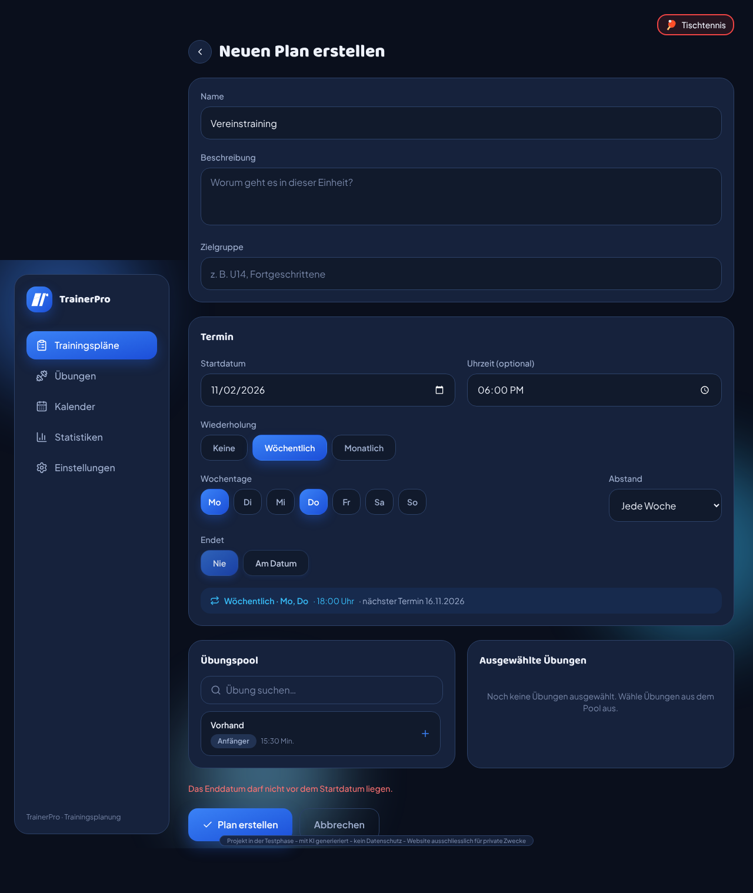
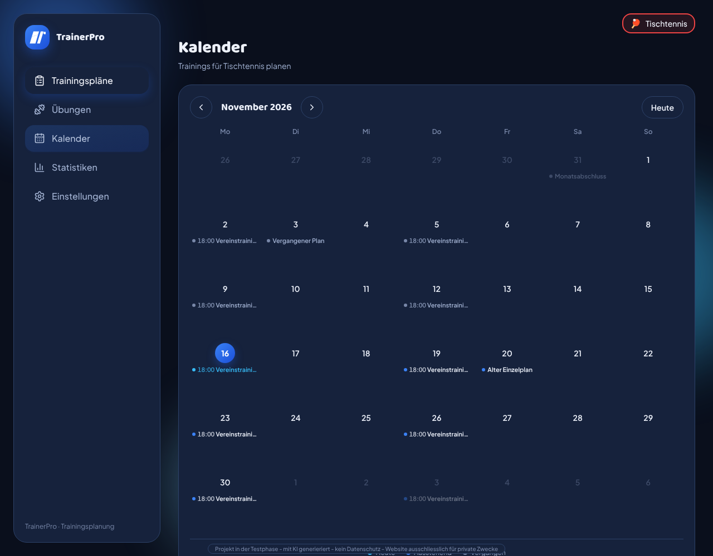
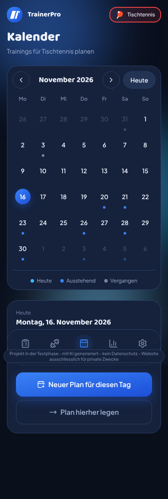
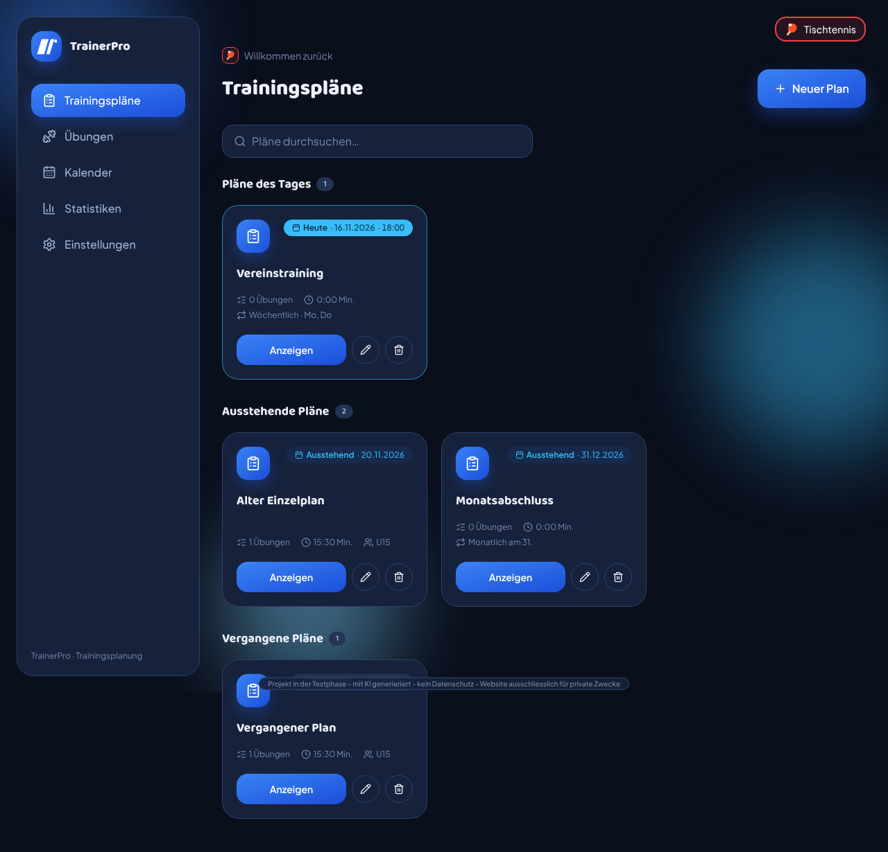

# C7 – Wiederkehrende Trainings (Uhrzeit und Wiederholungen)

**Phase:** Flowstate B · **Branch:** `phase-1` · **Datum:** 16.11.2026 · **Status:** ✅ umgesetzt

## Anforderung

> In den Einstellungen für Trainingspläne werden Uhrzeit und Wiederholungen einstellbar sein. Diese Wiederholungen
> werden auch im Kalender sichtbar sein und so die Tage mit Übung farblich kenntlich machen.

**Abstimmung im Team (vor der Umsetzung):**
- Wiederholungsarten: **Keine / Wöchentlich (mit Wochentagen und Abstand) / Monatlich**.
- Ende einer Serie: **nie** oder **an einem Datum**.
- Die farbliche Kennzeichnung im Kalender bleibt **unverändert** wie in C6a (Punkte bzw. Namen in Statusfarbe).
- **Einzelne Termine auslassen** (z. B. in den Ferien) wird **auf später verschoben**. Das Design soll trotzdem stimmig
  eingebunden sein.

## Zusammenfassung

- Das Planformular hat einen neuen Abschnitt **„Termin“** mit diesen Feldern:
  - **Datum bzw. Startdatum** und **Uhrzeit (optional)**.
  - **Wiederholung** (Keine / Wöchentlich / Monatlich).
  - Bei „Wöchentlich“: **Wochentage Mo–So** und **Abstand** (jede Woche bis alle 4 Wochen).
  - **Endet** (Nie / Am Datum).
  - Eine **Zusammenfassung in Klartext**, z. B. „Wöchentlich · Mo, Do · 18:00 Uhr · nächster Termin 16.11.2026“.
- Wählt man „Wöchentlich“ und es ist noch kein Tag ausgewählt, wird der **Wochentag des Startdatums vorgeschlagen**.
- **Kalender:** Jede Serie erscheint an allen ihren Tagen. Die Uhrzeit steht vor dem Plannamen („18:00 Vereinstraining“).
  Die Tagesliste ist nach Uhrzeit sortiert und zeigt die Regel mit Wiederholungssymbol.
- **Plankarte und Plandetail** zeigen bei Serien den **nächsten Termin** inkl. Uhrzeit („Heute · 16.11.2026 · 18:00“)
  und die Regel („Wöchentlich · Mo, Do“).
- **Pläne-Übersicht:** Einteilung und Sortierung richten sich bei Serien nach dem nächsten Termin, innerhalb eines Tages
  nach Uhrzeit.

## Status bei Serien

| Status | Einzeltermin | Serie |
|--------|--------------|-------|
| **Heute** | Datum = heute | heute ist ein Termin der Serie |
| **Ausstehend** | Datum in der Zukunft | es kommt noch ein Termin → Anzeige des **nächsten** Termins |
| **Vergangen** | Datum vorbei | Serie beendet → Anzeige des **letzten** Termins |

Im Kalender hat jeder einzelne Termin den Status seines Tages.

## Kalender-Aktionen bei Serien

| Aktion | Einzeltermin | Serie |
|--------|--------------|-------|
| Button in der Tagesliste | „Datum entfernen“ | **„Serie bearbeiten“** (öffnet das Planformular). Ein Termin allein wird nicht entfernt, das kommt mit „Termine auslassen“ später |
| „Plan hierher legen“ | verschiebt den Termin | **setzt den Starttermin neu**. Bei wöchentlichen Serien wird der Wochentag ergänzt, falls er fehlt, sonst läge am gewählten Tag kein Termin |
| Auswahlliste im Dialog | „Bisher: 20.11.2026 · Ausstehend“ | „Serie: Wöchentlich · Mo, Do“ |

Pläne, die am gewählten Tag schon einen Termin haben, stehen im Dialog nicht zur Auswahl.

## Technik

- **Datenmodell:** `TrainingPlan.time` (`HH:MM` oder `null`) und `TrainingPlan.recurrence`
  (`{ freq, interval, weekdays, until }` oder `null`). `date` ist bei Serien der erste Termin.
- **Termine werden nur berechnet, nie gespeichert** (`occurrencesInRange()` in `src/lib/recurrence.ts`), und zwar nur
  für den sichtbaren Zeitraum. Eine Serie ohne Ende kann den Speicher so nicht füllen. Eine Regeländerung wirkt sofort
  überall.
- **Zeitumstellung:** Tage werden über den Kalender fortgezählt (`new Date(j, m, t + n)`), nie über Millisekunden.
  Getestet an den Umstellungstagen 29.03.2026 und 25.10.2026.
- **Monatlich am 31.:** Monate ohne diesen Tag werden übersprungen (wie in gängigen Kalender-Apps). Die Formular-Vorschau
  zeigt das direkt: Start 31.10. → nächster Termin 31.12.
- **Migration:** Bestehende Pläne bekommen `time: null` und `recurrence: null`. Gespeicherte Regeln werden beim Laden
  geprüft (`sanitizeRecurrence`): keine Wochentage → keine Wiederholung, Abstand höchstens 4, ungültiges Enddatum →
  „nie“. Eine Wiederholung ohne Startdatum wird verworfen.
- **Prüfregeln im Formular:**
  - Wiederholung nur mit Startdatum.
  - Bei „Wöchentlich“ mindestens ein Wochentag.
  - Bei „Am Datum“ ein Enddatum, das nicht vor dem Start liegt.
- **Fehlermeldungen im App-Design:** Das Planformular hat jetzt `noValidate` (wie das Übungsformular seit C4). Sonst
  blockierte die Browser-Prüfung des Enddatums (`min`) das Absenden mit einer eigenen Sprechblase.

## Design-Einbindung

- Der Abschnitt „Termin“ ist eine Karte wie „Übungspool“ und „Ausgewählte Übungen“ (gleiche Überschrift, gleicher Rahmen).
- Wiederholung und Ende nutzen die vorhandene **Pill-Auswahl** (`PillSelect`). Die Wochentag-Buttons haben denselben
  Stil als Mehrfachauswahl. Abstand ist ein Auswahlfeld wie „Schwierigkeitsgrad“.
- Die Klartext-Zusammenfassung nutzt die Farben der Info-Chips (`primary-soft` / `accent`).
- Das Wiederholungssymbol (↻) steht überall dort, wo eine Serie beschrieben wird: Formular, Plankarte, Plandetail,
  Kalender-Tagesliste.
- „Zielgruppe“ hat jetzt die volle Breite, weil das Datum in den Abschnitt „Termin“ umgezogen ist.
- **Platz für „Termine auslassen“ (später):** Die Tagesliste hat pro Termin bereits eine eigene Aktion
  („Serie bearbeiten“). Dort kann später „Diesen Termin auslassen“ ergänzt werden, ohne das Layout zu ändern.

## Geänderte Dateien

| Datei | Änderung |
|-------|----------|
| `src/types.ts` | `Recurrence`, `RecurrenceFrequency`; `TrainingPlan.time`, `TrainingPlan.recurrence` |
| `src/lib/recurrence.ts` | **neu** – `occurrencesInRange`, `nextOccurrence`, `lastOccurrenceBefore`, `describeRecurrence`, `sanitizeRecurrence`, `sanitizeTime`, Datums-Hilfen |
| `src/lib/planStatus.ts` | neu: `getPlanSchedule()` (Status + maßgeblicher Termin für Serien) |
| `src/lib/calendar.ts` | `getCalendarEntries()` mit Wiederholungen, Sortierung nach Uhrzeit |
| `src/context/AppDataContext.tsx` | Migration `time`/`recurrence` |
| `src/pages/PlanForm.tsx` | Abschnitt „Termin“, Prüfregeln, `noValidate` |
| `src/pages/Calendar.tsx` | Uhrzeit, Serien in Tagesliste/Dialog, „Serie bearbeiten“, Starttermin verschieben |
| `src/components/PlanStatusBadge.tsx` | optionale Uhrzeit |
| `src/components/PlanCard.tsx`, `src/pages/PlanDetail.tsx`, `src/pages/PlansOverview.tsx` | nächster Termin, Regel, Sortierung |

## Tests

- `npm run build` ✅ und `npm run lint` ✅ (nur die zwei schon vorher bestehenden Warnungen)
- **30 Funktionsprüfungen** in den Zeitzonen **Berlin, Los Angeles und Sydney** ✅. Geprüft wurden:
  - wöchentlich Mo+Do, Start an einem Mittwoch, alle 2 Wochen (auch mitten im Zeitraum)
  - Enddatum
  - Zeitumstellung Herbst/Frühling
  - monatlich am 31. und über den Jahreswechsel
  - Einzeltermine
  - nächster/letzter Termin, alle Status-Fälle
  - Beschreibungstexte, Bereinigung
  - Laufzeit bei einer seit 2020 laufenden Serie unter 50 ms
- Im Browser (Playwright, Datum fest auf Mo 16.11.2026) geprüft:
  - Altpläne bekommen `time: null`, `recurrence: null` ✅
  - Meldungen: „Startdatum fehlt“, „mindestens einen Wochentag“, „Enddatum fehlt“, „Enddatum vor Startdatum“ ✅
  - Vorschlag des Wochentags (Mo bei Start 02.11.) ✅; Vorschau „Wöchentlich · Mo, Do · 18:00 Uhr · nächster Termin 16.11.2026“ ✅
  - Gespeichert: `{ date: 2026-11-02, time: 18:00, recurrence: weekly, Mo+Do, nie }` ✅
  - Monatlich ab 31.10. → Vorschau „nächster Termin 31.12.2026“; Kalender: kein 30.11., aber 31.12. ✅
  - Übersicht: Serie unter „Pläne des Tages“ mit „Heute · 16.11.2026 · 18:00“; ausstehende/vergangene Pläne korrekt einsortiert ✅
  - Kalender November: Termine an allen Mo/Do ab 02.11. plus Einzel- und Monatstermine ✅; Tagesliste „18:00 Vereinstraining · Heute · Wöchentlich · Mo, Do“ mit „Serie bearbeiten“ statt „Datum entfernen“ ✅
  - Serie auf Sa 21.11. gelegt → Start 21.11., Wochentage Mo, Do, **Sa**; 16.11. danach ohne Termin ✅

Hinweis: In den Screenshots erscheinen Datum und Uhrzeit im englischen Format (11/02/2026, 06:00 PM), weil der
Testbrowser auf Englisch eingestellt ist. In einem deutschen Browser stehen dort 02.11.2026 und 18:00.

| Kalender Handy | Pläne-Übersicht |
|---|---|
|  |  |
