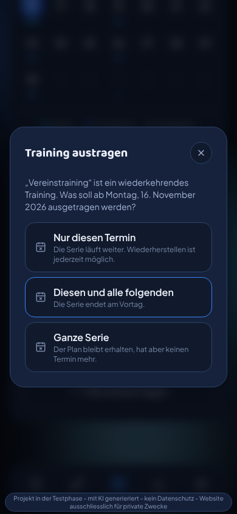
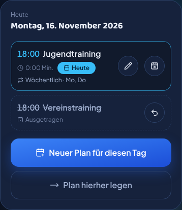
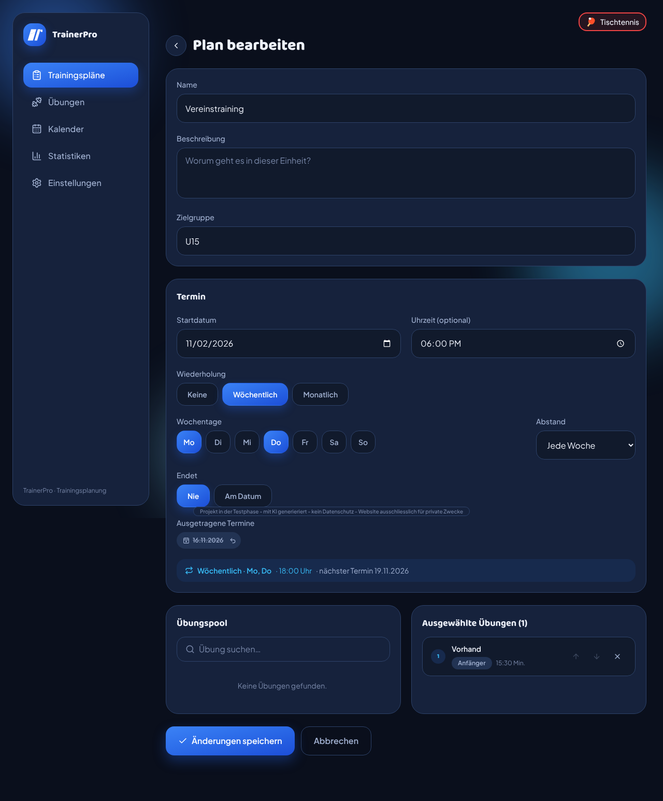

# C7a – Trainings auch bei Serien austragen

**Phase:** Flowstate B · **Branch:** `phase-1` · **Datum:** 16.11.2026 · **Status:** ✅ umgesetzt
**Bezug:** Nachbesserung zu [C7](C7.md). Setzt den dort verschobenen Punkt „einzelne Termine auslassen“ um.

## Anforderung

> Auch bei wiederkehrenden Plänen soll es möglich sein, das Training auszutragen (Button „Austragen“ im Kalender).

## Zusammenfassung

- Der **Austragen-Button** (Kalender-Symbol mit ✕) steht jetzt **auch bei Serien** in der Tagesliste, neben
  „Serie bearbeiten“.
- Bei Serien öffnet er den Dialog **„Training austragen“** mit drei Möglichkeiten (wie in gängigen Kalender-Apps):

| Auswahl | Wirkung | Rückgängig |
|---------|---------|------------|
| **Nur diesen Termin** | Der Termin wird als Ausnahme gespeichert, die Serie läuft weiter | „Wiederherstellen“ direkt am Tag oder im Planformular |
| **Diesen und alle folgenden** | Die Serie endet am Vortag (`until`). Liegt der Vortag vor dem Start, wird die Serie ganz ausgetragen | Enddatum im Planformular ändern |
| **Ganze Serie** | Der Plan bleibt mit allen Übungen erhalten, hat aber kein Datum und keine Wiederholung mehr | Termin im Planformular neu setzen |

- Bei **Einzelterminen** ändert sich nichts: Der Button entfernt das Datum wie bisher direkt.
- **Ausgetragene Termine bleiben sichtbar:** Am Tag erscheinen sie **gedimmt und durchgestrichen** mit dem Hinweis
  „Ausgetragen“ und einem Button **„Wiederherstellen“** (↶). Im Monatsraster verschwinden sie.
- **Planformular:** Im Abschnitt „Termin“ stehen die ausgetragenen Termine als Chips („~~16.11.2026~~ ↶“). Ein Klick
  stellt einen Termin wieder her. Beim Speichern bleiben Ausnahmen erhalten.
- **Status passt sich an:** Ist der heutige Termin einer Serie ausgetragen, zeigt die Plankarte den nächsten Termin
  („Ausstehend · 19.11.2026 · 18:00“). Ist der letzte Termin einer beendeten Serie ausgetragen, gilt der davor als
  „letzter Termin“.

## Design-Einbindung

- Der Dialog „Training austragen“ nutzt denselben Rahmen (`Modal`) und dieselben Listen-Buttons wie
  „Plan hierher legen“. Die beiden Kalender-Dialoge sehen also gleich aus. Jede Option hat eine Kurzerklärung in der
  Zweitfarbe.
- Ausgetragene Termine haben einen gestrichelten Rahmen wie die übrigen „leeren“ Zustände (z. B. „Kein Training
  geplant.“). So sind sie klar als „nicht aktiv“ erkennbar, ohne Rot.
- Symbole durchgängig: ✕-Kalender = austragen, ↶ = wiederherstellen, ✎ = Serie bearbeiten.

## Technik

- `Recurrence.exceptions: string[]` mit den ausgetragenen Tagen (`JJJJ-MM-TT`).
- `occurrencesInRange()` überspringt diese Tage. Damit berücksichtigen Kalender, nächster/letzter Termin und Status
  die Ausnahmen automatisch.
- `withException()` / `withoutException()` fügen eine Ausnahme hinzu bzw. entfernen sie (ohne Doppelte, sortiert).
- **Migration:** Regeln aus C7 ohne `exceptions` bekommen `[]`. Ungültige oder doppelte Einträge werden beim Laden
  entfernt.
- Serien, deren Termin am gewählten Tag ausgetragen ist, stehen im Dialog „Plan hierher legen“ nicht zur Auswahl.
  Sie werden direkt am Tag wiederhergestellt.

## Geänderte Dateien

| Datei | Änderung |
|-------|----------|
| `src/types.ts` | `Recurrence.exceptions` |
| `src/lib/recurrence.ts` | Ausnahmen in `sanitizeRecurrence` und `occurrencesInRange`; neu: `withException`, `withoutException` |
| `src/pages/Calendar.tsx` | Austragen-Button auch bei Serien, Dialog mit drei Optionen, ausgetragene Termine mit „Wiederherstellen“ |
| `src/pages/PlanForm.tsx` | Ausnahmen bleiben beim Speichern erhalten; Chips „Ausgetragene Termine“ mit Wiederherstellen |

## Tests

- `npm run build` ✅ und `npm run lint` ✅ (nur die zwei schon vorher bestehenden Warnungen)
- **36 Funktionsprüfungen** (30 aus C7 + 6 neue für Ausnahmen) in den Zeitzonen Berlin, Los Angeles und Sydney ✅
- Im Browser (Playwright, Datum fest auf Mo 16.11.2026) geprüft:
  - Regeln ohne `exceptions` → `[]` ✅
  - Jede Serie hat „Serie bearbeiten“ **und** „Termin austragen“ ✅
  - „Nur diesen Termin“ → Ausnahme 16.11.; Tag zeigt „Vereinstraining · Ausgetragen“; 19.11. weiterhin mit Termin ✅
  - „Diesen und alle folgenden“ → Serie endet am 15.11. ✅
  - „Ganze Serie“ → Datum und Wiederholung entfernt, Plan bleibt ✅
  - Übersicht: „Ausstehend · 19.11.2026 · 18:00“ für die Serie mit ausgetragenem heutigen Termin ✅
  - Planformular zeigt den Chip 16.11.2026; Ausnahme bleibt nach dem Speichern erhalten ✅
  - „Wiederherstellen“ im Kalender → Ausnahme entfernt, 16.11. wieder mit Termin ✅

| Dialog (Handy) | Ausgetragener Termin |
|---|---|
|  |  |

