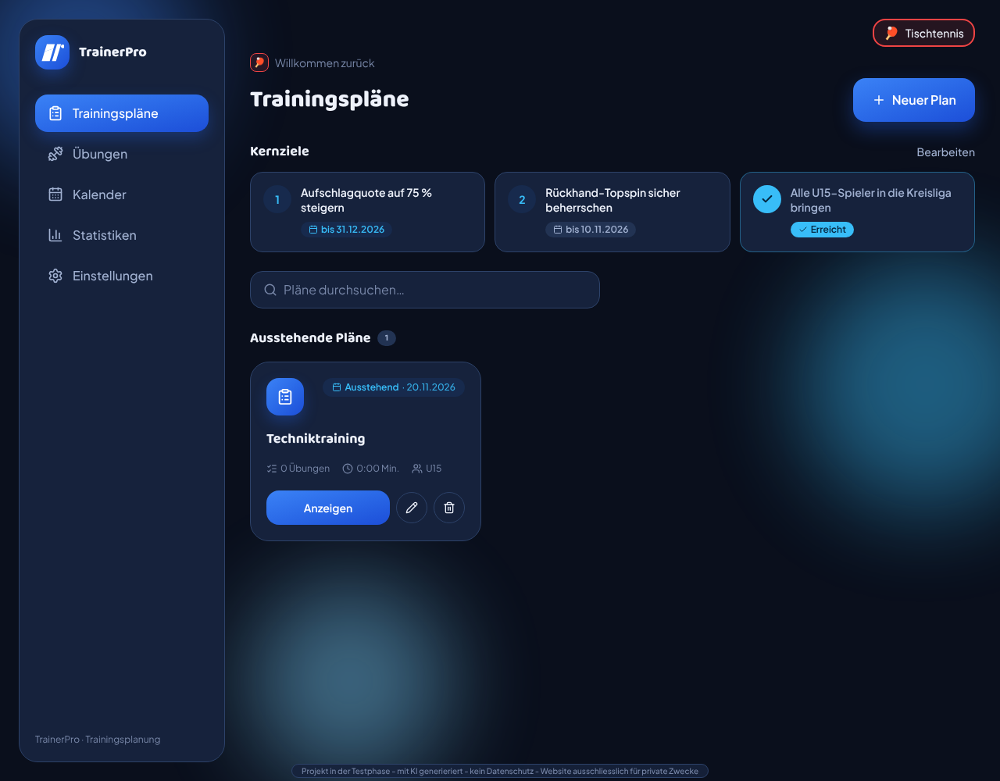
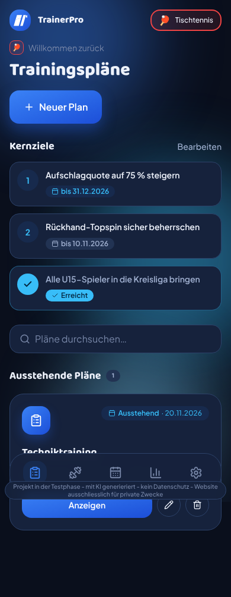
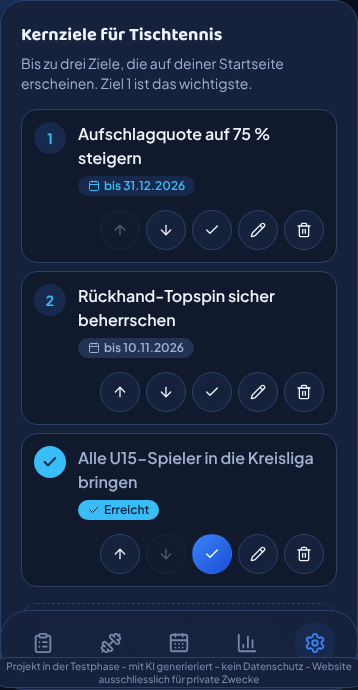
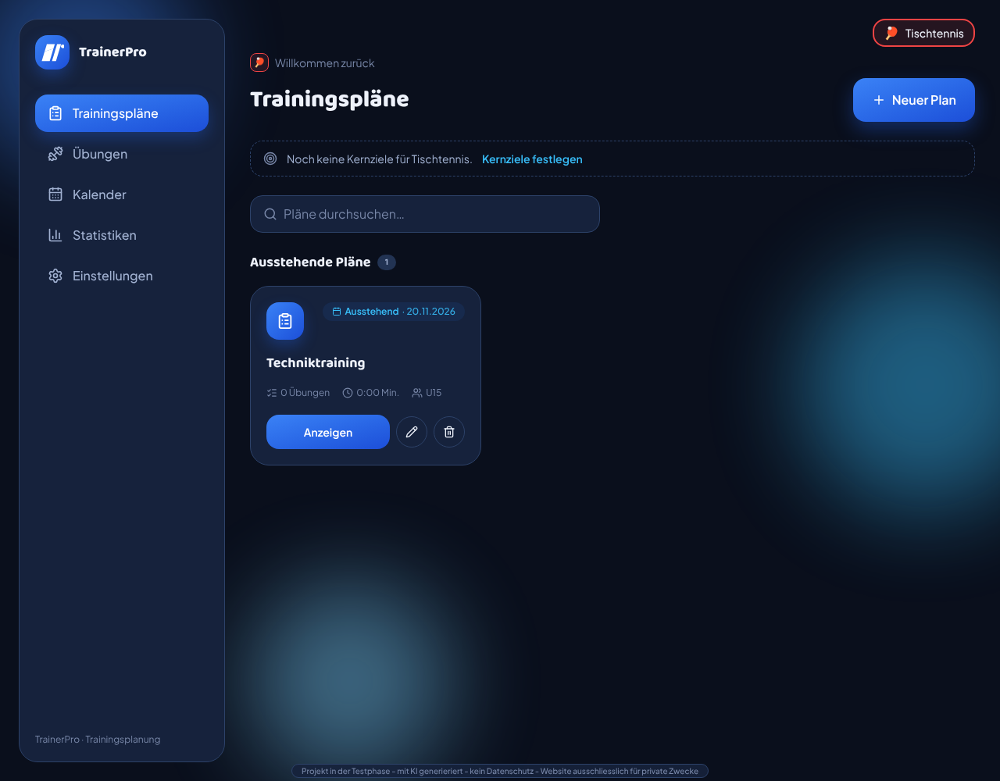
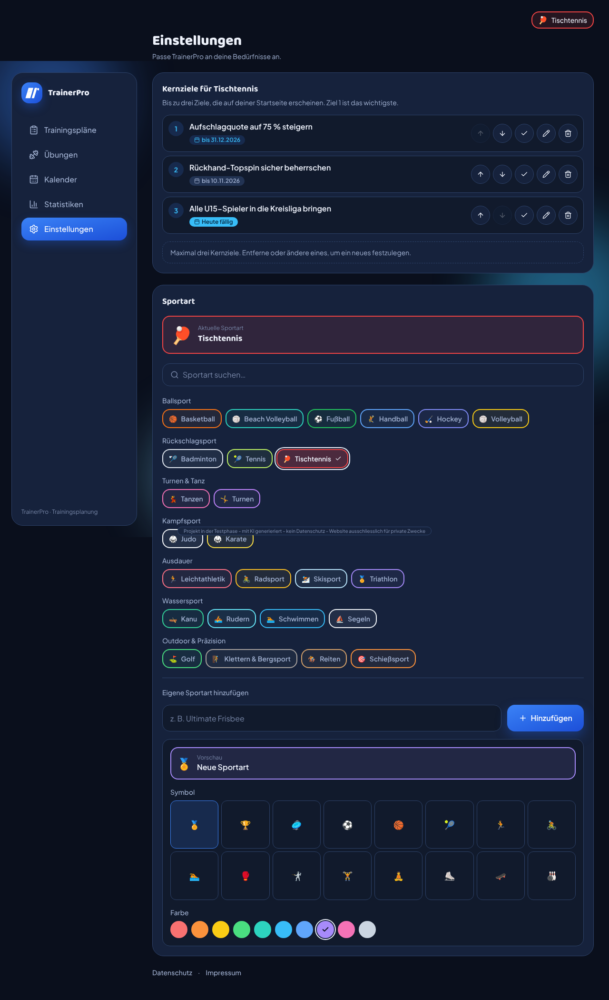

# C8 – Zielsetzungstool (Kernziele)

**Phase:** Flowstate B · **Branch:** `phase-1` · **Datum:** 16.11.2026 · **Status:** ✅ umgesetzt

> **Hinweis:** Die Suchleiste steht seit [C8a](C8a.md) über den Kernzielen.

## Anforderung

> Ein Zielsetzungstool in den Einstellungen wird es ermöglichen, bis zu drei Kernziele auf der Hauptseite anzuzeigen.
> Zielsetzung erfolgt in den Einstellungen.

**Abstimmung im Team (vor der Umsetzung):**
- Hauptseite = **Trainingspläne**, die Startseite nach dem Login.
- Kernziele sind **je Sportart getrennt**, passend zu C5.
- Jedes Kernziel hat **Text, optionales Zieldatum und kann abgehakt werden**.
- Ohne Kernziele erscheint auf der Startseite ein **dezenter Hinweis „Kernziele festlegen“** mit Link.

## Zusammenfassung

### Einstellungen – Karte „Kernziele für {Sportart}“
- Steht **über** der Karte „Sportart“, weil die Sportart-Auswahl sehr lang ist.
- Hinzufügen mit **Text** (max. 80 Zeichen) und **Zieldatum (optional)**.
- Pro Ziel gibt es Buttons für **↑/↓** (Reihenfolge, Ziel 1 = wichtigstes), **✓** (erreicht/offen), **✎** (Bearbeiten im
  Dialog) und **🗑** (Löschen mit Bestätigung).
- **Höchstens drei:** Ab drei Zielen verschwindet das Eingabefeld, stattdessen steht dort „Maximal drei Kernziele.
  Entferne oder ändere eines, um ein neues festzulegen.“
- **Prüfregeln:** Leere Ziele werden abgelehnt, Ziele über 80 Zeichen ebenfalls. Doppelte Ziele werden abgelehnt, ohne
  Rücksicht auf Groß-/Kleinschreibung und Leerzeichen, auch beim Bearbeiten.

### Startseite (Trainingspläne)
- Der Bereich **„Kernziele“** steht direkt unter der Begrüßung, vor Suche und Plänen, mit dem Link **„Bearbeiten“**
  (seit C8a: zwischen Suchleiste und Plänen).
- Es gibt **flache Kacheln**: am Handy untereinander, ab Tablet nebeneinander, bei drei Zielen am breiten Bildschirm
  in einer Reihe.
- Jede Kachel hat eine **Nummer (Rang)**. Ein Klick darauf **hakt das Ziel ab**. Beim Überfahren mit der Maus erscheint
  ein Häkchen als Hinweis.
- **Zieldatum als Badge in den Statusfarben aus C6a:**
  - „bis 31.12.2026“ (ausstehend, blau)
  - „Heute fällig“ (Akzent)
  - „bis 10.11.2026“ (vorbei, neutral grau, bewusst nicht rot)
  - Erreichte Ziele zeigen **„Erreicht“** und einen Akzent-Rahmen.
- **Ohne Kernziele** erscheint eine einzeilige, gestrichelte Hinweiszeile: „Noch keine Kernziele für Tischtennis.
  **Kernziele festlegen**“.
- Die Links führen zu **`/einstellungen#kernziele`**, und die Seite springt direkt zur Karte.

### Sportarten
- Jede Sportart hat ihre **eigenen** bis zu drei Kernziele.
- Wird eine eigene Sportart gelöscht, **nennt der Dialog die Kernziele mit** und löscht sie zusammen mit Plänen und
  Übungen. Die Aufzählung lautet jetzt sprachlich sauber „A, B und C“.

## Namensgebung

„Ziel“ war schon zweimal belegt: als Feld einer Übung und als „Ziel festlegen“ im Aufschlagtraining. Das neue Tool
heißt deshalb überall **„Kernziele“**.

## Technik

- `CoreGoal { id, sportId, text, dueDate, achieved, createdAt }` in `trainerpro:coreGoals`. Die Reihenfolge im Array
  ist die Reihenfolge je Sportart.
- Zentral in `AppDataContext`: `goals` (nur aktive Sportart), `addGoal`, `updateGoal`, `toggleGoalAchieved`,
  `deleteGoal`, `moveGoal`.
- Die Obergrenze ist an drei Stellen abgesichert:
  1. In der Oberfläche (kein Eingabefeld ab drei Zielen).
  2. In `addGoal`, falls doch aufgerufen.
  3. Beim Laden (`sanitizeCoreGoals` übernimmt je Sportart nur die ersten drei, ungültige Einträge und Daten werden
     verworfen, zu lange Texte gekürzt).
- Das Zieldatum nutzt die zeitzonensicheren Datums-Helfer aus C6.

## Design-Einbindung

- Die Karte in den Einstellungen nutzt dieselbe Kartenform wie „Sportart“.
- Die Liste ist wie „Ausgewählte Übungen“ im Planformular aufgebaut: Nummer im Kreis, Buttons ↑/↓.
- Bearbeiten erfolgt im selben Dialog-Rahmen wie beim Übungsformular, Löschen über den bekannten Bestätigungsdialog.
- Das „Erreicht“-Badge und der Kreis in Akzentfarbe entsprechen dem „Heute“-Badge aus C6a.
- Der leere Hinweis ist gestrichelt wie andere leere Zustände, aber nur eine Zeile hoch, damit die Pläne nicht nach
  unten rutschen.
- Alle Formularfelder nutzen `inputClass`. Fehlermeldungen erscheinen in der roten Meldungszeile der App (`noValidate`).

## Geänderte Dateien

| Datei | Änderung |
|-------|----------|
| `src/types.ts` | `CoreGoal` |
| `src/lib/coreGoals.ts` | **neu** – `MAX_CORE_GOALS`, `CORE_GOAL_MAX_LENGTH`, `validateGoalText`, `cleanGoalText`, `sanitizeCoreGoals` |
| `src/context/AppDataContext.tsx` | Kernziele (je Sportart, Reihenfolge, Obergrenze), `countSportData`/`deleteSportData` inkl. Kernziele |
| `src/components/CoreGoalBadge.tsx` | **neu** – Badge „Erreicht“ bzw. Zieldatum in Statusfarben |
| `src/components/CoreGoalsSettings.tsx` | **neu** – Karte in den Einstellungen |
| `src/components/CoreGoalsPanel.tsx` | **neu** – Kacheln bzw. Hinweis auf der Startseite |
| `src/pages/Settings.tsx` | Karte „Kernziele“ über „Sportart“, Sprung zu `#kernziele` |
| `src/pages/PlansOverview.tsx` | Kernziele unter der Begrüßung |
| `src/components/SportPicker.tsx` | Löschdialog nennt Kernziele, Aufzählung „A, B und C“ |

## Tests

- `npm run build` ✅ und `npm run lint` ✅ (nur die zwei schon vorher bestehenden Warnungen)
- **11 Funktionsprüfungen**: Obergrenze je Sportart beim Laden, andere Sportart unberührt, kaputte Daten, ungültiges
  Datum, Kürzen, leer/zu lang/Duplikat, eigener Text beim Bearbeiten erlaubt ✅
- Im Browser (Playwright, Datum fest auf 16.11.2026) geprüft:
  - Startseite ohne Ziele: Hinweis „Noch keine Kernziele für Tischtennis. Kernziele festlegen“; Link springt zur Karte ✅
  - Meldungen für leeres Ziel und Duplikat (auch beim Bearbeiten) ✅
  - Drei Ziele mit Zieldatum → „bis 31.12.2026“, „Heute fällig“, „bis 10.11.2026“; danach Hinweis „Maximal drei“ statt Eingabefeld ✅
  - ↑ ändert die Reihenfolge, Bearbeiten speichert den neuen Text ✅
  - Startseite zeigt die Ziele in der gewählten Reihenfolge; Abhaken speichert `achieved: true` ✅
  - Basketball: eigene, leere Kernziel-Karte ✅
  - Floorball mit 1 Kernziel löschen → Dialog „„Floorball“ und 1 Kernziel werden unwiderruflich gelöscht…“, danach nur noch Tischtennis-Ziele ✅

| Startseite Handy | Einstellungen Handy |
|---|---|
|  |  |

| Ohne Kernziele | Einstellungen Desktop |
|---|---|
|  |  |
