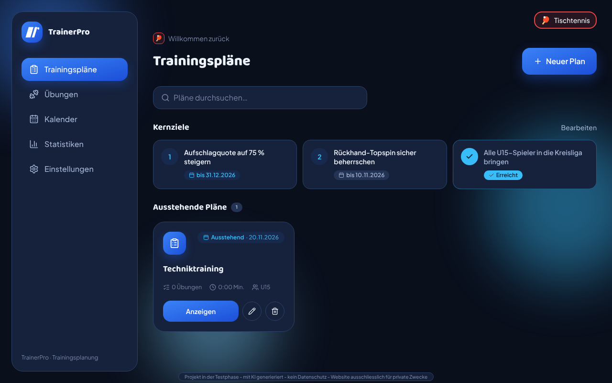
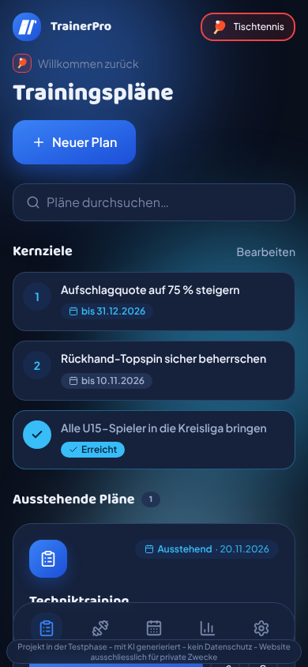

# C8a – Suchleiste über den Kernzielen

**Phase:** Flowstate B · **Branch:** `phase-1` · **Datum:** 16.11.2026 · **Status:** ✅ umgesetzt
**Bezug:** Nachbesserung zu [C8](C8.md)

## Anforderung

> Die Suchleiste auf der Hauptseite soll über die Kernziele verschoben werden.

## Zusammenfassung

Neue Reihenfolge auf der Startseite (Trainingspläne):

| vorher (C8) | jetzt (C8a) |
|-------------|-------------|
| Begrüßung + „Trainingspläne“ | Begrüßung + „Trainingspläne“ |
| **Kernziele** | **Suchleiste „Pläne durchsuchen…“** |
| Suchleiste | **Kernziele** |
| Pläne (Abschnitte) | Pläne (Abschnitte) |

Die Suche filtert weiterhin nur die Pläne. Die Kernziele bleiben bei jeder Suche sichtbar, auch wenn keine Pläne
gefunden werden.

## Geänderte Dateien

| Datei | Änderung |
|-------|----------|
| `src/pages/PlansOverview.tsx` | Reihenfolge Suchleiste / Kernziele getauscht |

## Tests

- `npm run build` ✅ und `npm run lint` ✅ (nur die zwei schon vorher bestehenden Warnungen)
- Im Browser (Playwright) geprüft: Suchleiste liegt auf Desktop (y = 192) und Handy (y = 244) jeweils über der
  Überschrift „Kernziele“ (y = 252 bzw. 304) ✅. Suche ohne Treffer: Kernziele bleiben sichtbar, Pläne zeigen
  „Keine Treffer“ ✅

| Desktop | Handy |
|---|---|
|  |  |
