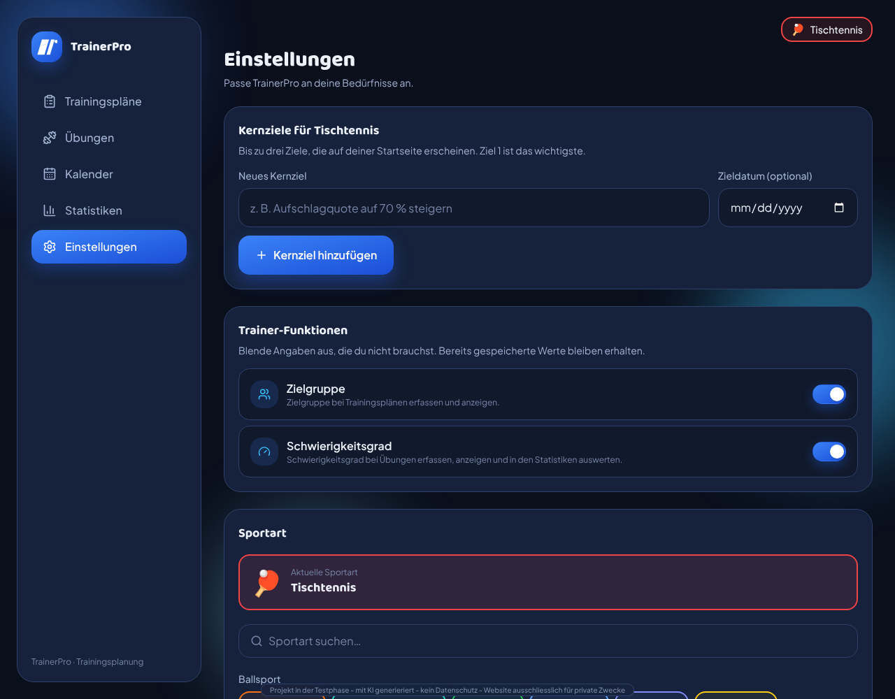
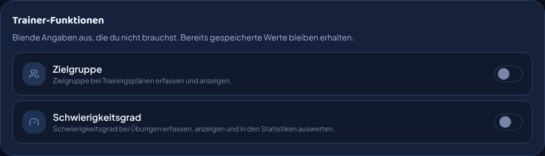
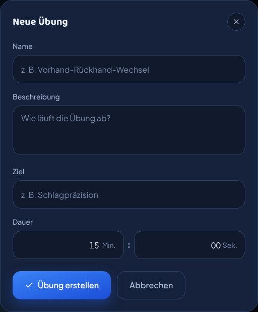
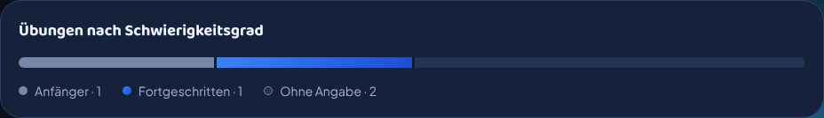

# C9 – Trainer-Funktionen ein- und ausschalten

**Phase:** Flowstate B · **Branch:** `phase-1` · **Datum:** 16.11.2026 · **Status:** ✅ umgesetzt

> **Hinweis:** Ein Hauptschalter für alle Trainer-Funktionen wurde in [C9a](C9a.md) ergänzt.

## Anforderung

> Funktionen für Trainer in den Einstellungen der App verwalten. Trainerelemente (Zielgruppe, Schwierigkeitsgrad) in
> der App ein- und ausschaltbar machen.

**Abstimmung im Team (vor der Umsetzung):**
- Umfang: **Zielgruppe und Schwierigkeitsgrad**. Der Aufbau ist **erweiterbar** für spätere Schalter.
- Die Schalter gelten **für die ganze App**, nicht je Sportart.
- Neue Übungen bei ausgeschaltetem Schwierigkeitsgrad werden mit **„ohne Angabe“** gespeichert, nicht still mit
  „Anfänger“.
- **Standard:** beide eingeschaltet. Für bestehende Nutzer:innen sieht die App unverändert aus.

## Zusammenfassung

- Neue Karte **„Trainer-Funktionen“** in den Einstellungen, zwischen „Kernziele“ und „Sportart“. Pro Funktion gibt es
  eine Zeile mit Symbol, Titel, Erklärung und **Ein/Aus-Schalter**. Änderungen wirken sofort.
- **Ausschalten blendet nur aus.** Gespeicherte Werte bleiben erhalten und sind nach dem Wiedereinschalten sofort
  wieder da.

### Wo die Schalter wirken

| Schalter | Ausgeblendet, wenn aus |
|----------|------------------------|
| **Zielgruppe** | Feld im Planformular · Meta-Zeile der Plankarte · Chip im Plandetail |
| **Schwierigkeitsgrad** | Auswahlfeld im Übungsformular · Badge auf Übungskarten, im Übungspool, bei „Ausgewählte Übungen“ und im Plandetail · Abschnitt „Übungen nach Schwierigkeitsgrad“ in den Statistiken |

### Daten bleiben erhalten

- **Plan bearbeiten bei ausgeschalteter Zielgruppe:** Die gespeicherte Zielgruppe wird unverändert mitgespeichert.
  Im Test blieb „U15“ erhalten.
- **Übung bearbeiten bei ausgeschaltetem Schwierigkeitsgrad:** Der gespeicherte Grad bleibt erhalten.
- **Neue Übung bei ausgeschaltetem Schwierigkeitsgrad:** Sie wird mit `difficulty: null` = **„ohne Angabe“** gespeichert.
- **Schwierigkeitsgrad optional:** Im Übungsformular gibt es jetzt auch die Option **„Ohne Angabe“**. Neue Übungen
  starten bei eingeschaltetem Schalter wie bisher mit „Anfänger“.
- **Statistik:** Übungen ohne Angabe werden als eigener, zurückhaltender Anteil gezählt („Ohne Angabe · 2“), statt sie
  falsch einzuordnen.

## Design

- **Neue Komponente `Switch`:** Eingeschaltet zeigt sie den **blauen Verlauf mit Schatten** wie die aktive Navigation
  und den weißen Knopf rechts. Ausgeschaltet ist sie eine **neutrale Fläche mit Rahmen** und einem grauen Knopf links.
  Bei Tastaturfokus erscheint ein Fokus-Ring.
- **Zeilen** im Stil der übrigen Listen (`bg-bg-soft`, abgerundet, Rahmen). Das **Symbol** ist bei aktiver Funktion in
  Primärfarben, bei ausgeschalteter neutral grau. Der Zustand ist so auch ohne Blick auf den Schalter erkennbar.
- **Keine Lücken im Layout:** Ohne Schwierigkeitsgrad nimmt „Dauer“ im Übungsformular die ganze Zeile ein. Ohne
  Zielgruppe fällt die Zeile im Planformular ganz weg. Badges und Chips verschwinden ohne Platzhalter.
- **Barrierefreiheit:** `role="switch"` mit `aria-checked`. Titel und Erklärung sind über `aria-labelledby` bzw.
  `aria-describedby` verbunden. Bedienbar mit Leertaste und Enter.

## Technik

- **Zentrale Liste** `TRAINER_FEATURES` in `src/lib/trainerFeatures.ts`. Ein weiterer Schalter wird nur dort ergänzt,
  Karte und Speicherung übernehmen ihn automatisch.
- **`TrainerFeaturesContext`** (app-weit, `trainerpro:trainerFeatures`). Fehlende oder ungültige Werte gelten als
  eingeschaltet.
- **`DifficultyBadge`** prüft den Schalter selbst. Dadurch blenden alle Stellen den Schwierigkeitsgrad automatisch aus,
  ohne dass eine vergessen werden kann.
- **Migration:** Unbekannte Schwierigkeitsgrade in gespeicherten Übungen werden zu `null` („ohne Angabe“).
- **Lint:** Der neue Context erzeugt dieselbe Hinweis-Warnung (`only-export-components`) wie die bestehenden Contexts.
  Das ist bewusst so, weil Provider und Hook wie im übrigen Projekt in einer Datei stehen.

## Geänderte Dateien

| Datei | Änderung |
|-------|----------|
| `src/lib/trainerFeatures.ts` | **neu** – Liste der Schalter, Standard, Bereinigung |
| `src/context/TrainerFeaturesContext.tsx` | **neu** – app-weiter Zustand der Schalter |
| `src/components/Switch.tsx` | **neu** – Ein/Aus-Schalter im App-Design |
| `src/components/TrainerFeaturesSettings.tsx` | **neu** – Karte „Trainer-Funktionen“ |
| `src/App.tsx` | `TrainerFeaturesProvider` |
| `src/pages/Settings.tsx` | Karte zwischen „Kernziele“ und „Sportart“ |
| `src/types.ts` | `Exercise.difficulty` optional (`null` = ohne Angabe) |
| `src/context/AppDataContext.tsx` | Migration ungültiger Schwierigkeitsgrade |
| `src/components/DifficultyBadge.tsx` | prüft Schalter, unterstützt `null` |
| `src/components/ExerciseFormModal.tsx` | Feld nur bei aktivem Schalter, Option „Ohne Angabe“, Layout ohne Lücke |
| `src/pages/Statistics.tsx` | Abschnitt nur bei aktivem Schalter, Anteil „Ohne Angabe“ |
| `src/pages/PlanForm.tsx`, `src/components/PlanCard.tsx`, `src/pages/PlanDetail.tsx` | Zielgruppe nur bei aktivem Schalter (Wert bleibt erhalten) |

## Tests

- `npm run build` ✅ und `npm run lint` ✅ (drei gleichartige Hinweise, siehe oben)
- Im Browser (Playwright, Desktop + Handy) geprüft:
  - Migration: gespeicherter Grad „Profi“ → `null` ✅
  - Reihenfolge der Karten: Kernziele · Trainer-Funktionen · Sportart; beide Schalter standardmäßig an ✅
  - Beide aus → gespeichert `{ targetGroup: false, difficulty: false }` ✅
  - Plankarte, Plandetail, Planformular: keine Zielgruppe, keine Schwierigkeits-Badges ✅
  - Plan bearbeitet und gespeichert → Zielgruppe „U15“ bleibt erhalten ✅
  - Übungskarten ohne Badge, Formular ohne Feld; neue Übung → `null`; bearbeitete Übung behält „Fortgeschritten“ ✅
  - Statistik ohne Abschnitt „Übungen nach Schwierigkeitsgrad“ ✅
  - Wieder an → Statistik „Anfänger · 1 | Fortgeschritten · 1 | Ohne Angabe · 2“, Zielgruppe wieder sichtbar, neues Formular mit „Anfänger“ und Option „Ohne Angabe“ ✅
  - Schalter per Tastatur (Leertaste) bedienbar ✅

| Übungsformular ohne Schwierigkeitsgrad | Statistik mit „Ohne Angabe“ |
|---|---|
|  |  |
