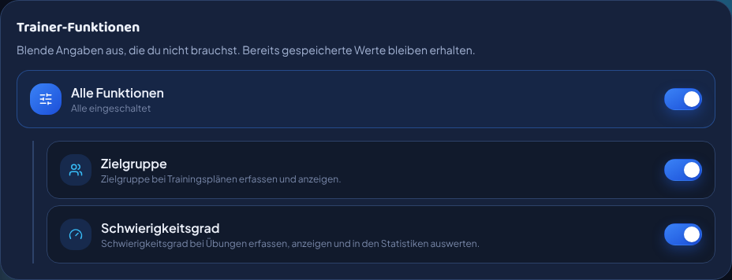
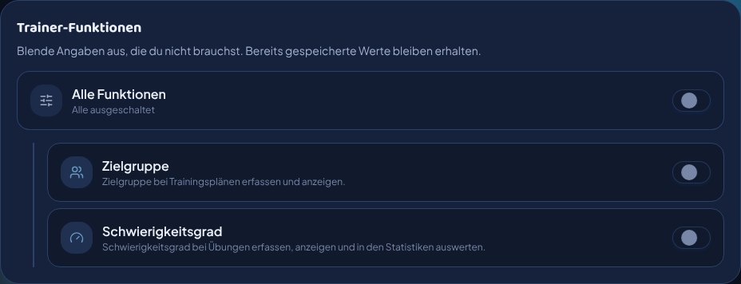
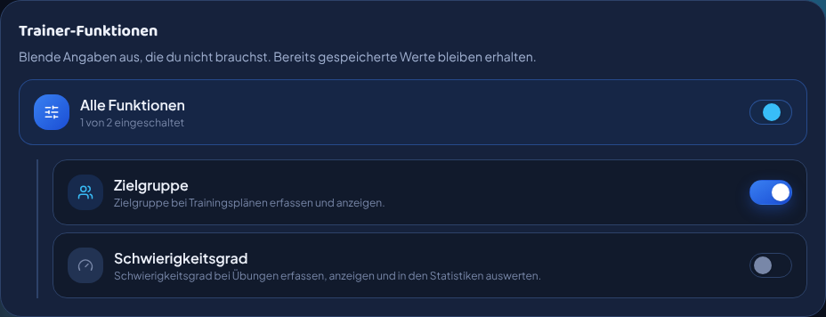
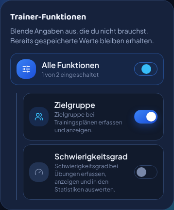

# C9a – Hauptschalter „Alle Funktionen“

**Phase:** Flowstate B · **Branch:** `phase-1` · **Datum:** 16.11.2026 · **Status:** ✅ umgesetzt
**Bezug:** Nachbesserung zu [C9](C9.md)

## Anforderung

> Einen Schalter hinzufügen, mit dem man beide Trainer-Funktionen gleichzeitig an- und ausstellen kann.

## Zusammenfassung

- In der Karte „Trainer-Funktionen“ steht oben ein **Hauptschalter „Alle Funktionen“**. Darunter folgen die
  Einzelschalter, eingerückt und mit einer Linie verbunden.
- Der Hauptschalter **leitet seinen Zustand aus den Einzelschaltern ab**:

| Einzelschalter | Hauptschalter | Unterzeile | Klick auf den Hauptschalter |
|----------------|---------------|------------|-----------------------------|
| alle an | **an** (blauer Verlauf, Knopf rechts) | „Alle eingeschaltet“ | schaltet **alle aus** |
| alle aus | **aus** (neutral, Knopf links) | „Alle ausgeschaltet“ | schaltet **alle an** |
| gemischt | **Zwischenzustand** (Knopf mittig in Akzentfarbe) | „1 von 2 eingeschaltet“ | schaltet **alle an** (wie „Alle auswählen“) |

- Die Einzelschalter funktionieren weiter wie bisher. Der Hauptschalter aktualisiert sich dabei sofort.
- `setAllFeatures()` nutzt die zentrale Liste aus C9. Künftige Schalter sind damit automatisch eingeschlossen.

## Design

- Die **Hauptzeile** hat denselben Aufbau wie die Einzelzeilen (Symbol, Titel, Unterzeile, Schalter), ist aber
  **hervorgehoben**: Primär-Rahmen, getönte Fläche, Symbol im blauen Verlauf. Sind alle Funktionen aus, ist sie
  neutral wie die übrigen Zeilen.
- **Einzelschalter eingerückt** mit senkrechter Linie. Das zeigt, dass sie zum Hauptschalter gehören.
- Der Titel lautet **„Alle Funktionen“**, nicht „Alle Trainer-Funktionen“. Die Karte heißt schon so, und am Handy
  brach der lange Titel am Bindestrich um.
- **Zwischenzustand im Schalter:** Der Knopf steht mittig in Akzentfarbe auf getönter Fläche. Er ist damit klar von
  „an“ und „aus“ unterscheidbar, auch ohne Farbe dank der Knopfposition.
- **Barrierefreiheit:** Im Zwischenzustand meldet sich der Schalter als `role="checkbox"` mit `aria-checked="mixed"`.
  Nur dieser Rollentyp kennt den Zwischenzustand offiziell. Sonst ist er `role="switch"`. Die Unterzeile wird bei
  Änderungen vorgelesen (`aria-live`).

## Geänderte Dateien

| Datei | Änderung |
|-------|----------|
| `src/context/TrainerFeaturesContext.tsx` | neu: `setAllFeatures(enabled)` |
| `src/components/Switch.tsx` | Zwischenzustand `'mixed'` (Darstellung, Rolle, Klickverhalten) |
| `src/components/TrainerFeaturesSettings.tsx` | Hauptschalter-Zeile, eingerückte Einzelschalter |

## Tests

- `npm run build` ✅ und `npm run lint` ✅ (drei gleichartige Hinweise wie in C9)
- Im Browser (Playwright, Desktop + Handy) geprüft:
  - Start: Hauptschalter an, „Alle eingeschaltet“ ✅
  - Hauptschalter aus → beide aus; wieder an → beide an ✅
  - Nur Schwierigkeitsgrad aus → Hauptschalter `mixed`, „1 von 2 eingeschaltet“ ✅
  - Klick im Zwischenzustand → beide an ✅
  - Beide einzeln aus → Hauptschalter aus ✅
  - Bedienung per Tastatur (Leertaste) ✅

| Alle an | Alle aus |
|---|---|
|  |  |

| Zwischenzustand (Desktop) | Handy |
|---|---|
|  |  |
